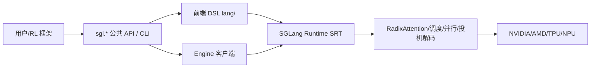

# 00.1 SGLang 是什么

## 定位

SGLang 是一个面向大语言模型（LLM）与多模态/扩散模型的高性能推理服务框架，覆盖从单 GPU 到大规模分布式集群的部署形态。本页从仓库根目录 `README.md` 的 About 段提炼其设计哲学与能力全景，作为后续所有架构页的总纲。

## 设计哲学

SGLang 的核心立意是"以运行时为核心，前端与后端解耦"：

- **运行时优先**：一切优化都落在 SRT（SGLang Runtime）一侧——零开销 CPU 调度器、RadixAttention 前缀缓存、连续批处理与 Paged Attention，使单卡吞吐与延迟逼近理论上限。
- **前端可表达**：提供一套轻量 DSL（`lang/`），用 `gen`/`select`/`fork` 等原语把"提示工程 + 结构化输出 + 多路并行"写成可 traced 的程序，而非一串字符串拼接。
- **横向可扩展**：原生支持 TP/PP/DP/EP/CP 多种并行与 PD 分离，把"单卡引擎"组合成机柜级系统（GB200/GB300 NVL72）。
- **生态兼容**：兼容大多数 Hugging Face 模型与 OpenAI API，并作为 RL/post-training 的 rollout 后端被 verl/Miles/AReaL/slime/Tunix 等框架采用。
- **多硬件中立**：在 NVIDIA（GB200/B300/H100/A100）、AMD（MI355/MI300）、Intel Xeon CPU、Google TPU（SGLang-Jax）、Ascend NPU 等后端运行。

## 能力全景

依据 `README.md` 的 About 段，核心特性可归纳为五类：

| 类别 | 关键能力 |
|---|---|
| 快速运行时 | RadixAttention 前缀缓存、零开销 CPU 调度器、Prefill-Decode 分离、投机解码（EAGLE/DFlash/Spec V2/MTP/N-gram）、连续批处理、Paged Attention、TP/PP/EP/DP、结构化输出、chunked prefill、量化（FP4/FP8/INT4/AWQ/GPTQ）、多 LoRA 批处理 |
| 模型广度 | Llama/Qwen/DeepSeek/Kimi/GLM/GPT/Gemma/Mistral 等语言模型；e5-mistral/gte/mcdse 等嵌入模型；Skywork 等奖励模型；WAN/Qwen-Image 等扩散模型；兼容多数 HF 模型与 OpenAI API |
| 硬件广度 | NVIDIA、AMD、Intel CPU、Google TPU、Ascend NPU 等 |
| 社区与采用 | 开源，支撑全球 40 万+ GPU，被 xAI/AMD/NVIDIA/Intel/Cursor/Oracle/Google/AWS 等采用 |
| RL 后端 | 作为前沿模型训练的 rollout 后端，原生集成 AReaL/Miles/slime/Tunix/verl |

## 关键类与函数

| 名称 | 定义位置 | 说明 |
|---|---|---|
| `Engine` | `python/sglang/srt/entrypoints/engine.py:183` | 推理引擎入口，组合 TokenizerManager/Scheduler/Detokenizer 三组件 |
| `sgl.Engine` | `python/sglang/__init__.py:79` | 包级懒导出，离线推理客户端 API |
| `main` | `python/sglang/cli/main.py:12` | `sglang` 命令分发器（serve/generate/version） |
| `global_config` | `python/sglang/global_config.py:29` | 前端全局配置单例 |

## 数据流 / 控制流

从使用者视角，SGLang 有两条入口：DSL（`sgl.function`/`sgl.gen`）适合可编程提示程序；`sgl.Engine` 适合离线批处理与服务化部署。二者最终都汇入 SRT 运行时。

## 交叉引用

- 仓库物理布局: [`00.2 仓库地图`](00.2-repo-map.md)
- 纵向分层: [`00.3 架构一图流`](00.3-architecture-overview.md)
- 进程拓扑: [`00.4 进程与线程模型`](00.4-process-model.md)
- 术语速查: [`00.5 术语表`](00.5-glossary.md)
- 前端层细节: [`01 前端与客户端层`](../01-frontend/index.md)

## 进一步阅读

- 源码: `README.md`（仓库根）
- 官方文档: <https://docs.sglang.io/>
