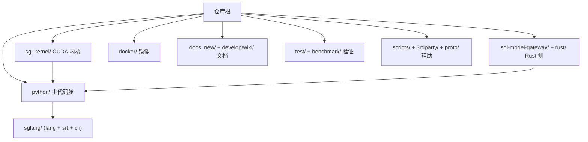

# 00.2 仓库地图

## 定位

本页梳理 SGLang 仓库（`/home/lychee/mycode/sglang`）顶层目录布局，帮助读者从目录名快速定位代码与产物。SGLang 是一个多语言、多产物仓库：Python 服务端、Rust 网关与 gRPC 桥、C++/CUDA 内核、Docker 镜像、文档站与基准脚本并存。

## 顶层目录布局

读取仓库根目录 entries 后，按职责归类如下。各目录均经实际列目录核实，不作推断。

| 目录/文件 | 职责 |
|---|---|
| `python/` | 主代码舱。`sglang/` 包含前端 DSL（`lang/`）、运行时 SRT（`srt/`）、CLI（`cli/`）、`launch_server.py`、`global_config.py`、`jit_kernel/`、`kernels/`、平台 stub 等。`pyproject.toml` 在此，定义入口 `sglang = "sglang.cli.main:main"` |
| `sgl-kernel/` | 重量级 AOT CUDA/C++ 内核包。`csrc/`、`include/`、`python/`、`cmake/`、`tests/`、`benchmark/`，含 `Dockerfile`、`build.sh`，并提供 `setup_rocm.py`/`setup_musa.py`/`setup_metal.py` 等多硬件构建脚本 |
| `sgl-model-gateway/` | Rust 模型网关。`src/`、`bindings/`、`benches/`、`e2e_test/`、`examples/`，用于多副本负载均衡与路由 |
| `rust/` | Rust 桥接子项目。仅含 `sglang-grpc/`（进程内 gRPC 服务器，配合 `--grpc-port`/`--smg-grpc-mode`） |
| `docker/` | 部署镜像。含 `Dockerfile`、`rocm.Dockerfile`、`xeon.Dockerfile`、`xpu.Dockerfile`、`npu.Dockerfile`、`arm64.Dockerfile`、`gateway.Dockerfile`、`sgl-router.Dockerfile`、`sgl-deep-gemm.Dockerfile`、`sagemaker.Dockerfile`，及 k8s YAML 与 `configs/` |
| `test/` | CI/UT 测试套。`run_suite.py` 编排，`README.md` 说明分类，含 `lm_eval_configs/`、`manual/`、`registered/`、`pytest.ini` |
| `benchmark/` | 基准与复现脚本。`benchmark_batch/`、`deepseek_v3/`、`gsm8k/`、`hellaswag/`、`json_schema/`、`hicache/`、`bench_adaptive_speculative.py` 等众多子目录与脚本 |
| `develop/` | 开发者资料。目前只含 `wiki/`（即本 Wiki） |
| `docs_new/` | Mintlify 文档站。`docs.json`、`docs/`、`cookbook/`、`cards/`、`src/`、`scripts/`、`index.mdx`、`CONTRIBUTING.md` |
| `examples/` | 使用示例。`runtime/`（含 `engine/` 离线推理）、`frontend_language/`、`chat_template/`、`checkpoint_engine/`、`monitoring/`、`profiler/`、`usage/`、`sagemaker/` |
| `experimental/` | 实验性代码。当前仅 `sgl-router/`（早期 Rust 路由实验） |
| `scripts/` | 运维/发布脚本。`ci/`、`ci_monitor/`、`release/`、`playground/`、`code_sync/`、`killall_sglang.sh`、`export_deepseek_nextn.py`、各 `update_*_whl_index.py` |
| `3rdparty/` | 第三方资产。当前仅 `amd/`（AMD 相关补丁/依赖） |
| `proto/` | 协议定义。含 `sglang/`（gRPC/IPC protobuf） |
| `assets/` | 仓库静态资源（logo 等） |

根级文件中较重要的：`README.md`（项目说明）、`LICENSE`、`.pre-commit-config.yaml`、`.isort.cfg`、`.codespellrc`、`.coveragerc`。

## 关键类与函数

| 名称 | 定义位置 | 说明 |
|---|---|---|
| `sglang` 入口 | `python/pyproject.toml:187` | `sglang = "sglang.cli.main:main"`，控制台命令 |
| `killall_sglang` 入口 | `python/pyproject.toml:188` | `killall_sglang = "sglang.cli.killall:main"` |
| gRPC 绑定 | `python/pyproject.toml:227` | `target = "sglang.srt.grpc._core"`，指向 `rust/sglang-grpc` |

## 数据流 / 控制流

`python/` 是唯一被 pip 安装的代码舱；`sgl-kernel`、`sgl-model-gateway`、`rust/sglang-grpc` 分别作为独立 wheel/二进制产出，最终在运行期被 `python/sglang/srt/` 内的代码加载或调用。

## 交叉引用

- 全栈分层（这些目录如何串成一条通路）: [`00.3 架构一图流`](00.3-architecture-overview.md)
- Python 包公共面: [`01.1 包与公共 API 面`](../01-frontend/01.1-package-api.md)
- 内核产物: [`15 内核与硬件后端`](../15-kernels-hardware/index.md)
- 网关产物: [`18 模型网关与代理`](../18-gateway/index.md)
- 构建/CI: [`19 构建 CI 与开发`](../19-build-ci-dev/index.md)

## 进一步阅读

- 源码: 仓库根目录 `README.md`、`docker/`、`sgl-kernel/README.md`、`sgl-model-gateway/README.md`
