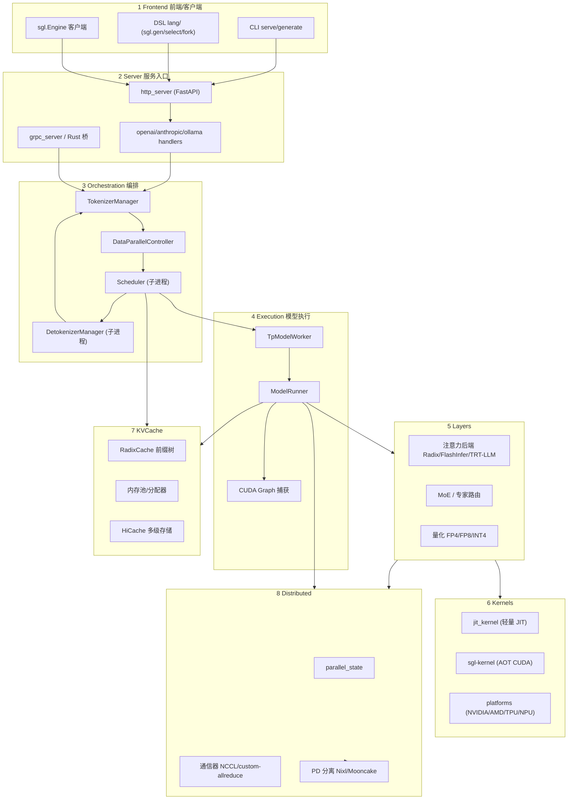

# 00.3 架构一图流

## 定位

本页用一张分层 Mermaid 图描述 SGLang 从客户端到内核的纵向数据通路，是建立"全局心智模型"的入口。`develop/wiki/index.md` 已给过一张粗粒度总览图，本页在其基础上展开成 8 层、标注关键类与跨层依赖，便于下钻到具体子系统。

## 分层模型

从上到下划分为 8 层：Frontend（前端/客户端）→ Server（服务入口与协议）→ Orchestration（核心编排）→ Execution（模型执行）→ Layers（nn.Module 构件）→ Kernels（CUDA/AOT 内核）→ KVCache（缓存与内存）→ Distributed（分布式与分离）。前三层在 CPU 侧以进程/线程形式存在；Execution 起进入 GPU 侧。

## 架构分层图

## 文字解释

- **1 Frontend**：三条入口汇入 HTTP server。CLI（`sglang serve/generate`）面向运维；DSL（`sgl.function`/`sgl.gen`）面向可编程提示程序；`sgl.Engine` 面向离线批处理，可直接绑 `RuntimeEndpoint` 调 SRT 端点，也可进程内构造 `srt.entrypoints.engine.Engine` 绕过 HTTP。
- **2 Server**：`http_server.py` 是默认编解码服务入口；`grpc_server.py`（配合 `--smg-grpc-mode`）与 Rust 桥（`--grpc-port`）提供进程内 gRPC 通路；`openai/anthropic/ollama` 子目录实现各协议适配层。
- **3 Orchestration**：`TokenizerManager` 在主进程内 tokenize 请求并经 ZMQ 发往 Scheduler；`DataParallelController` 在 `dp_size>1` 时作调度器代理，按负载策略择优分发；`Scheduler` 子进程组批、调 `TpModelWorker`；`DetokenizerManager` 子进程把 token 流反解为文本并回传 TokenizerManager。
- **4 Execution**：`TpModelWorker` 持有 `ModelRunner`，后者负责一次 forward、CUDA Graph 重放与采样；`ModelRunner` 是 GPU 侧的执行核心。
- **5 Layers**：注意力后端按模型/硬件选择（Radix/FlashInfer/TRT-LLM MLA 等）；MoE 路由与量化（FP4/FP8/INT4/AWQ/GPTQ）在此层实现。
- **6 Kernels**：`jit_kernel` 提供轻量 JIT（Triton）内核；`sgl-kernel` 是重量级 AOT CUDA/C++ 包；`platforms` 抽象不同硬件后端。
- **7 KVCache**：`RadixCache` 以前缀树复用 KV；内存池/分配器管理物理块（Paged Attention）；`HiCache` 把冷前缀下沉到 CPU/磁盘等多级存储。
- **8 Distributed**：`parallel_state` 维护 TP/PP/DP/EP/CP 拓扑；通信器负责集合通信；PD 分离经 Nixl/Mooncake 跨进程传 KV。

跨层关键依赖：Scheduler 持有 RadixCache 引用并直接读写 KV（3↔7）；ModelRunner 调 Layers、Layers 调 Kernels（4→5→6）；ModelRunner 与 Layers 均依赖 Distributed 通信器（4/5↔8）。请求生命周期完整路径见 [00.4 进程与线程模型](00.4-process-model.md)。

## 交叉引用

- 进程拓扑: [`00.4 进程与线程模型`](00.4-process-model.md)
- 上游入口: [`01 前端与客户端层`](../01-frontend/index.md) → [`02 服务入口`](../02-server-api/index.md)
- 编排细节: [`03 核心调度与编排`](../03-orchestration/index.md)
- 执行细节: [`04 模型执行`](../04-model-execution/index.md) → [`06 Layers`](../06-layers/index.md)
- 缓存细节: [`07 KV Cache`](../07-kv-cache/index.md)
- 分布式细节: [`08 分布式`](../08-distributed/index.md) / [`09 分离式`](../09-disaggregation/index.md)

## 进一步阅读

- 源码: `python/sglang/srt/entrypoints/engine.py`、`python/sglang/srt/managers/`、`python/sglang/srt/model_executor/`
- 顶层总览图: `develop/wiki/index.md`
