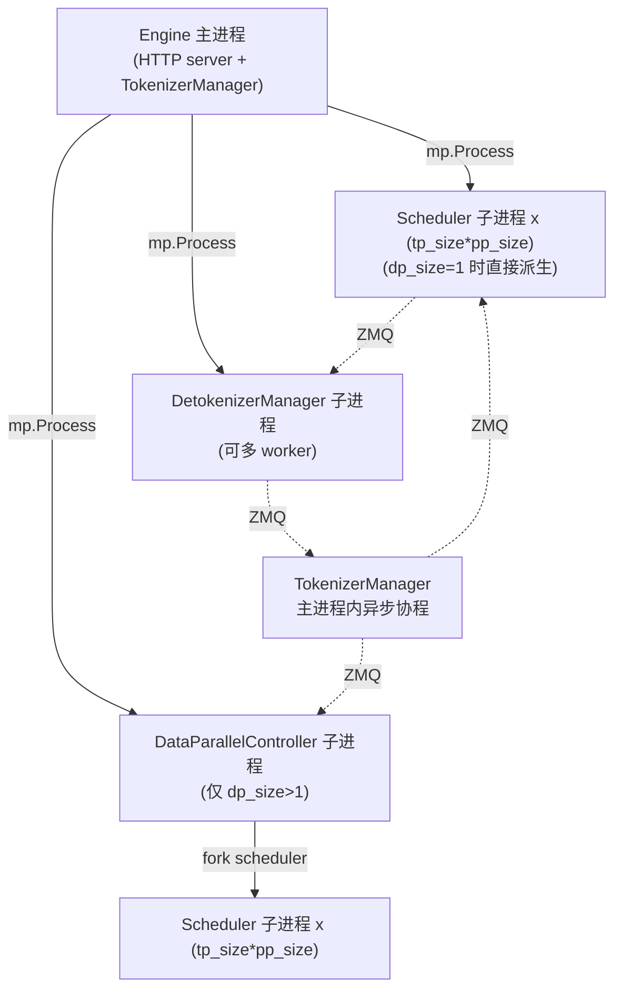
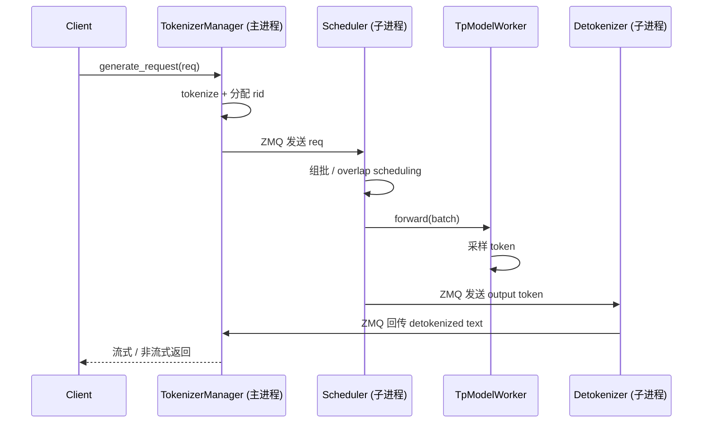

# 00.4 进程与线程模型

## 定位

本页描述 SGLang 运行时的进程/线程拓扑与跨进程通信（ZMQ IPC）形式。理解本页是理解 [03 核心编排](../03-orchestration/index.md) 各 Manager 之间消息流的前提。所有进程都在 `Engine` 启动时拉起。

## 进程拓扑

SGLang 默认模式下有三类进程，全部由主进程（Engine/HTTP server 所在进程）派生：

按 `Engine` 类 docstring 的说明：HTTP server、Engine、TokenizerManager 都运行在主进程；调度器与 Detokenizer 是独立子进程；进程间通信用 ZMQ，每个进程占用不同端口/IPC 名。

## 职责

- **Engine 主进程**：构造 `ServerArgs`，拉起子进程，初始化 ZMQ socket，注册 `atexit` 自动关闭子进程；持有 `tokenizer_manager` 与 `template_manager` 引用。
- **TokenizerManager**：主进程内异步管理器，tokenize 请求、维护请求生命周期、收 Detokenizer 回传结果、对外流式返回。
- **Scheduler 子进程**：组批（continuous batching）、调 `TpModelWorker` 跑 forward、写 KV Cache、采样、把输出 token 发给 Detokenizer。
- **DataParallelController 子进程**：`dp_size>1`（或 EP scale 模式）时作为 Scheduler 的代理，按负载策略在多个 DP worker 间分发请求。
- **DetokenizerManager 子进程**：把 token 流增量反解为文本，回传 TokenizerManager。可启多 worker 经 `MultiDetokenizerRouter` 扇出。

## 关键类与函数

| 名称 | 定义位置 | 说明 |
|---|---|---|
| `Engine` | `python/sglang/srt/entrypoints/engine.py:183` | 推理引擎入口；`__init__` 拉起子进程、建 ZMQ、注册 atexit |
| `Engine._launch_scheduler_processes` | `python/sglang/srt/entrypoints/engine.py:592` | classmethod；`dp_size>1` 时改为起 `DataParallelController` 进程 |
| `Engine._launch_detokenizer_subprocesses` | `python/sglang/srt/entrypoints/engine.py:708` | classmethod；`detokenizer_worker_num>1` 时起 `MultiDetokenizerRouter` |
| `TokenizerManager` | `python/sglang/srt/managers/tokenizer_manager.py:265` | 主进程内异步管理器，请求生命周期中枢 |
| `Scheduler` | `python/sglang/srt/managers/scheduler.py:303` | 子进程核心；多 Mixin 组合（PP/Disaggregation/Dllm/MLX overlap 等） |
| `DetokenizerManager` | `python/sglang/srt/managers/detokenizer_manager.py:91` | 子进程；token→文本 |
| `DataParallelController` | `python/sglang/srt/managers/data_parallel_controller.py:130` | DP 调度代理，ZMQ 连多个 Scheduler |
| `TpModelWorker` | `python/sglang/srt/managers/tp_worker.py:242` | Scheduler 持有的张量并行 worker，持有 ModelRunner |

## 数据流 / 控制流

关键点：TokenizerManager 与 Scheduler 之间是单向 ZMQ（请求下行）；Scheduler 与 Detokenizer 之间也是单向（token 下行）；Detokenizer 回传 TokenizerManager 形成闭环。`dp_size>1` 时 TokenizerManager 先发给 DataParallelController，再由它扇出到具体 Scheduler。ZMQ socket 的 IPC 名/端口由 `PortArgs` 统一管理，`Engine` 在主进程额外建一个 DEALER socket（`send_to_rpc`）以便 RPC 命令进出。

## 子模块树

- `python/sglang/srt/entrypoints/`
  - `engine.py` — Engine 入口与进程拉起
  - `EngineBase.py` — Engine 抽象基类
  - `engine_score_mixin.py` — 评分/embedding 相关 mixin
  - `http_server.py` — 默认 HTTP 服务
- `python/sglang/srt/managers/`
  - `tokenizer_manager.py` — 主进程请求管理
  - `scheduler.py` — 子进程调度
  - `detokenizer_manager.py` — 子进程反解
  - `data_parallel_controller.py` — DP 代理
  - `tp_worker.py` — 张量并行 worker
  - `io_struct.py` — IPC 消息类型定义

## 交叉引用

- 编排骨架细节: [`03 核心调度与编排`](../03-orchestration/index.md)
- 服务入口: [`02 服务入口与 API`](../02-server-api/index.md)
- 模型执行: [`04 模型执行`](../04-model-execution/index.md)
- 配置与运行时上下文: [`16 配置与运行时上下文`](../16-config-runtime/index.md)
- 相关 skill: `.claude/skills/sglang-runtime-context`

## 进一步阅读

- 源码: `python/sglang/srt/entrypoints/engine.py`、`python/sglang/srt/managers/`
- 总览图: [`00.3 架构一图流`](00.3-architecture-overview.md)
