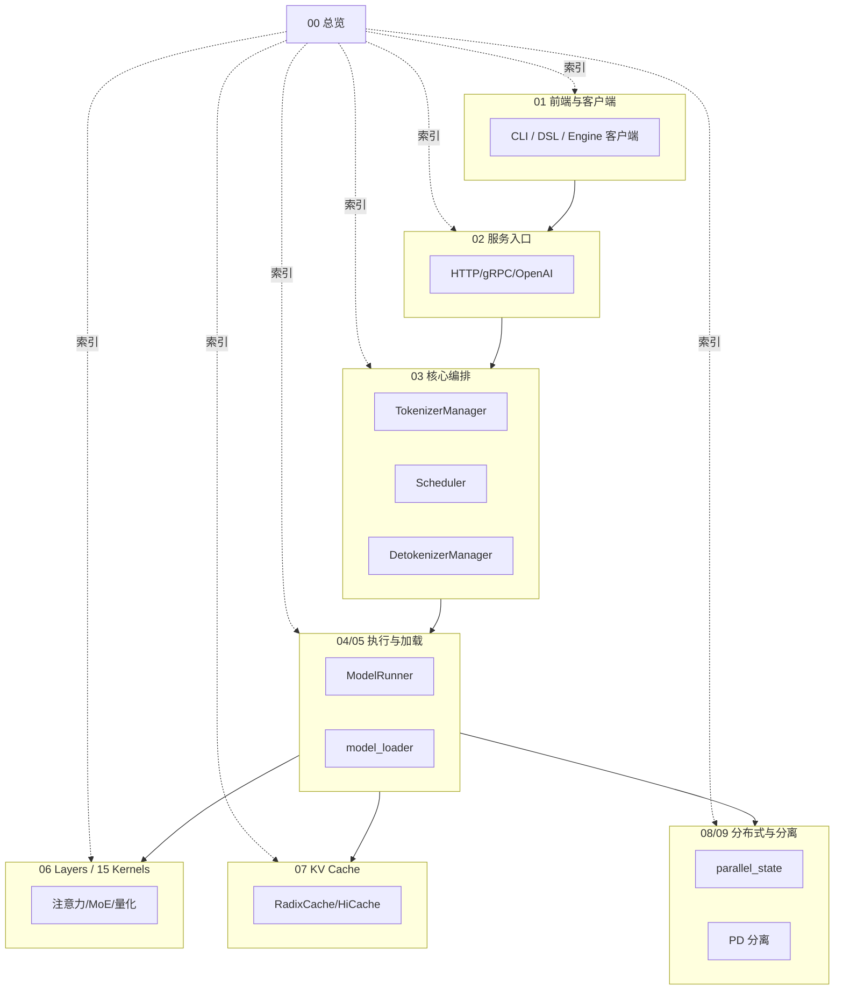

# 00 总览

## 定位

本子系统是 SGLang 架构 Wiki 的入口层，提供系统全貌、仓库地图、架构分层、进程模型与术语表。其余 19 个子系统（01–19）都建立在本子系描述的全局骨架之上：先在此处建立"从客户端到内核"的纵向认识，再下钻到具体子系统。

## 职责

- 给出 SGLang 的设计哲学与能力全景，避免读者陷入局部细节。
- 提供顶层仓库目录地图，使读者能从目录名快速定位代码。
- 用一张分层 Mermaid 图描述 Frontend→Server→Orchestration→Execution→Layers→Kernels→KVCache→Distributed 的纵向数据通路。
- 描述 Engine 主进程与 Scheduler/Detokenizer 子进程的进程线程模型与 ZMQ IPC 拓扑。
- 汇总 RadixAttention、连续批处理、MLA、MoE、HiCache、TP/PP/DP/EP/CP 等核心术语。

## 子系统内导航

- [00.1 SGLang 是什么](00.1-what-is-sglang.md) — 设计哲学、能力全景、核心特性
- [00.2 仓库地图](00.2-repo-map.md) — 顶层目录布局与各目录职责
- [00.3 架构一图流](00.3-architecture-overview.md) — 全栈分层 Mermaid 图与文字解释
- [00.4 进程与线程模型](00.4-process-model.md) — Engine/Scheduler/Detokenizer 进程树与 ZMQ IPC
- [00.5 术语表](00.5-glossary.md) — RadixAttention/MLA/MoE/HiCache/TP/PP/DP/EP/CP 等

## 子系统边界图

00 总览本身不持有运行时对象，它是纯文档层；其"边界"即整张系统拓扑的索引面。读完本子系后，建议按 [00.3 架构一图流](00.3-architecture-overview.md) 指明的纵向通路进入对应子系统。

## 交叉引用

- 上层入口: [`Wiki 首页`](../index.md)
- 纵向通路下游: [`01 前端`](../01-frontend/index.md) → [`02 服务入口`](../02-server-api/index.md) → [`03 编排`](../03-orchestration/index.md) → [`04 执行`](../04-model-execution/index.md)
