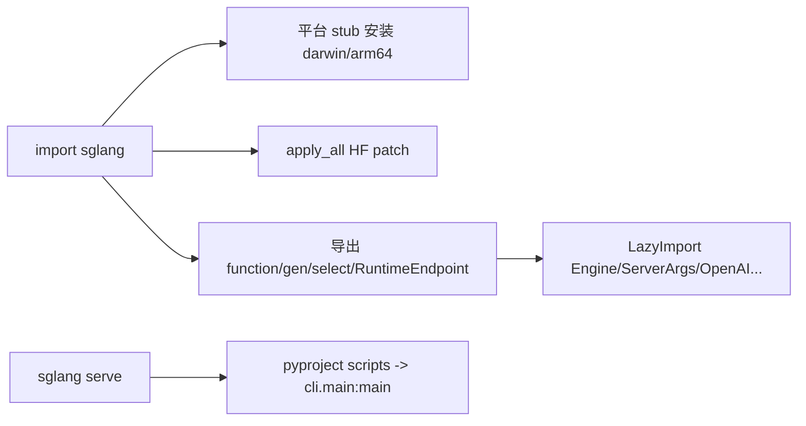

# 01.1 包与公共 API 面

## 定位

`python/sglang/__init__.py` 是 `import sglang` 的总入口，定义包级公共 API、平台 stub 安装、HF 补丁与懒导入策略。本页梳理该公共面对外暴露的符号以及入口点声明，使读者能从"包"层面理解前端层与运行时层的边界。

## 职责

- 在导入早期为无 Triton/无完整 MPS 的平台（macOS arm64）安装 stub，保证客户端代码可纯前端运行。
- 应用 HuggingFace transformers 补丁（`apply_all`），统一模型加载行为。
- 导出前端 DSL API（`function`/`gen`/`gen_int`/`gen_string`/`select`/`image`/`video`/角色 helpers 等）。
- 导出 `RuntimeEndpoint` 与各 backend（OpenAI/Anthropic/VertexAI/LiteLLM/Crusoe），用 `LazyImport` 推迟重型依赖。
- 导出 `Engine`、`ServerArgs` 等运行时符号。

## 关键类与函数

| 名称 | 定义位置 | 说明 |
|---|---|---|
| stub 安装块 | `python/sglang/__init__.py:9` | macOS arm64 + MPS 可用时安装 `_triton_stub` 与 `_mps_stub` |
| `apply_all` | `python/sglang/__init__.py:29` | 调 `sglang.srt.utils.hf_transformers_patches.apply_all` 应用 HF 补丁 |
| `global_config` | `python/sglang/__init__.py:35` | 导出全局配置单例（见 [01.2](01.2-global-config.md)） |
| `function`/`gen`/`select` 等 | `python/sglang/__init__.py:36` | 从 `lang.api` 导出前端 DSL 公共 API |
| `RuntimeEndpoint` | `python/sglang/__init__.py:60` | DSL→SRT 的主桥 backend |
| `LazyImport` | `python/sglang/__init__.py:68` | 懒导入工具；`Anthropic`/`OpenAI`/`Engine`/`ServerArgs` 等经此导入 |
| `Engine` | `python/sglang/__init__.py:79` | `LazyImport("sglang.srt.entrypoints.engine", "Engine")` |
| `__all__` | `python/sglang/__init__.py:81` | 公共符号白名单 |

## 入口点声明

控制台命令在 `python/pyproject.toml` 的 `[project.scripts]` 段声明：

| 命令 | 声明位置 | 目标 |
|---|---|---|
| `sglang` | `python/pyproject.toml:187` | `sglang.cli.main:main` |
| `killall_sglang` | `python/pyproject.toml:188` | `sglang.cli.killall:main` |

gRPC Rust 绑定声明 `target = "sglang.srt.grpc._core"`（`python/pyproject.toml:227`），指向 `rust/sglang-grpc`。

## 子模块树

- `python/sglang/`
  - `__init__.py` — 包入口与公共 API 面
  - `_triton_stub.py` — 无 Triton 平台的 stub
  - `_mps_stub.py` — macOS MPS Stream/set_device 等 stub
  - `global_config.py` — 全局配置（[01.2](01.2-global-config.md)）
  - `launch_server.py` — 服务启动模式分发（[01.4](01.4-launch-server.md)）
  - `lang/` — 前端 DSL（[01.5.x](01.5.1-dsl-api.md)）
  - `cli/` — 命令行（[01.3](01.3-cli.md)）
  - `srt/` — 运行时（不属于本子系统）

## 数据流 / 控制流

导入期只做轻量初始化：stub、HF patch、符号导出；真正的 SRT 重依赖被 `LazyImport` 推迟到首次访问时才加载，这让纯前端脚本（仅用 DSL 连远端 SRT）无需安装完整服务端依赖。

## 交叉引用

- 全局配置细节: [`01.2 GlobalConfig`](01.2-global-config.md)
- CLI 入口: [`01.3 CLI`](01.3-cli.md)
- DSL API: [`01.5.1 DSL API`](01.5.1-dsl-api.md)
- 运行时上下文: [`16 配置与运行时上下文`](../16-config-runtime/index.md)

## 进一步阅读

- 源码: `python/sglang/__init__.py`、`python/sglang/_triton_stub.py`、`python/sglang/_mps_stub.py`、`python/pyproject.toml`
