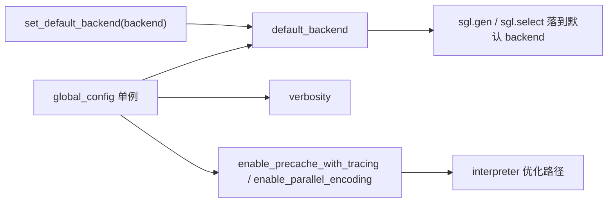

# 01.2 全局配置 GlobalConfig

## 定位

`global_config.py` 定义前端 DSL 层的全局配置单例 `global_config`，是前端 DSL 默认 backend、日志冗长度、解释器优化开关的统一来源。它仅服务前端 `lang/` 层，与 SRT 服务端配置（`ServerArgs`/`RuntimeContext`）是两套体系。文件已标注 FIXME，计划逐步迁移到 `sglang.srt.environ` 或 `sglang.__init__`。

## 职责

- 存放前端层全局常量（冗长度、默认 backend、输出 tokenization 配置）。
- 控制解释器两项优化：`enable_precache_with_tracing`（tracing 预缓存前缀）与 `enable_parallel_encoding`（并行编码）。
- 作为 `set_default_backend` 的写入目标，使 `sgl.gen` 能落到默认 backend。

## 关键类与函数

| 名称 | 定义位置 | 说明 |
|---|---|---|
| `GlobalConfig` | `python/sglang/global_config.py:6` | 全局配置类 |
| `GlobalConfig.__init__` | `python/sglang/global_config.py:11` | 初始化各字段默认值 |
| `verbosity` | `python/sglang/global_config.py:15` | 冗长度：0 静默，2 每次 run 后输出最终文本 |
| `default_backend` | `python/sglang/global_config.py:18` | DSL 默认 backend，默认 `None` |
| `skip_special_tokens_in_output` | `python/sglang/global_config.py:21` | 输出 tokenization 是否跳过特殊 token |
| `spaces_between_special_tokens_in_out` | `python/sglang/global_config.py:22` | 输出特殊 token 间是否加空格 |
| `enable_precache_with_tracing` | `python/sglang/global_config.py:25` | 开启 tracing 预缓存前缀（见 [01.5.4](01.5.4-dsl-tracer.md)） |
| `enable_parallel_encoding` | `python/sglang/global_config.py:26` | 开启并行编码 |
| `global_config` | `python/sglang/global_config.py:29` | 模块级单例，导入即共享 |

## 数据流 / 控制流

`set_default_backend`（`lang/api.py:49`）只把 backend 写入 `global_config.default_backend`；后续无显式 backend 参数的 DSL 调用即用该默认值。解释器（[01.5.3](01.5.3-dsl-interpreter.md)）会在 `run_program` 路径上读 `enable_precache_with_tracing` 决定是否调用 tracer 预缓存前缀。

## 备注

文件顶部注释明确写道："FIXME: deprecate this file and move all usage to `sglang.srt.environ` or `sglang.__init__.py`"。后续新增全局开关应优先走 [`16 配置与运行时上下文`](../16-config-runtime/index.md) 体系；本页描述的是当前仍生效的前端层单例。

## 交叉引用

- 使用方: [`01.5.1 DSL API`](01.5.1-dsl-api.md)（`set_default_backend`）、[`01.5.3 解释器`](01.5.3-dsl-interpreter.md)、[`01.5.4 Tracer`](01.5.4-dsl-tracer.md)
- SRT 配置体系（不同）: [`16 配置与运行时上下文`](../16-config-runtime/index.md)
- 相关 skill: `.claude/skills/env-var-conventions`

## 进一步阅读

- 源码: `python/sglang/global_config.py`
