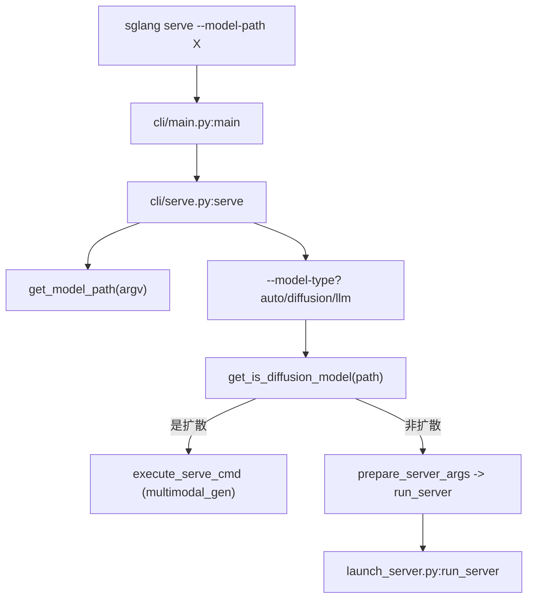

# 01.3 命令行 CLI

## 定位

`sglang` 命令行是面向运维与开发的服务启动/生成入口，由 `python/sglang/cli/` 实现，经 `pyproject.toml` 的 `[project.scripts]` 声明为 `sglang = "sglang.cli.main:main"`。本页梳理命令分发、服务端/扩散端分流，与模型路径解析。

## 职责

- `main` 作为顶层 dispatcher，按子命令路由到 `serve`/`generate`/`version`。
- `serve` 自动探测 `--model-path` 指向的是语言模型还是扩散模型，分流到 `run_server` 或扩散模型服务。
- `generate` 仅对扩散/多模态模型提供生成命令。
- `killall` 清理 SGLang 进程树。
- `utils` 提供 `get_model_path`（从 argv 取模型路径）与 `get_is_diffusion_model`（扩散模型探测）。

## 关键类与函数

| 名称 | 定义位置 | 说明 |
|---|---|---|
| `main` | `python/sglang/cli/main.py:12` | 顶层 dispatcher：注册 `serve`/`generate`/`version`，按 `args.subcommand` 路由 |
| `version` | `python/sglang/cli/main.py:7` | 打印 `__version__` 与 git revision |
| `serve` | `python/sglang/cli/serve.py:56` | 探测扩散模型并分流；最终调 `launch_server.run_server` 或扩散 `execute_serve_cmd` |
| `_extract_model_type_override` | `python/sglang/cli/serve.py:16` | 解析 `--model-type {auto,llm,diffusion}` 覆盖 |
| `_normalize_positional_model_path` | `python/sglang/cli/serve.py:49` | 允许 `sglang serve <model>` 位置参数写法 |
| `generate` | `python/sglang/cli/generate.py:6` | 仅扩散模型生成，语言模型抛错 |
| `main` (killall) | `python/sglang/cli/killall.py:452` | `killall_sglang` 入口 |
| `get_model_path` | `python/sglang/cli/utils.py:102` | 从 `extra_argv` 解析 `--model-path`/`--model` |
| `get_is_diffusion_model` | `python/sglang/cli/utils.py:59` | 探测 path 是否指向扩散模型（本地 dir / HF / ModelScope / gated repo） |
| `get_git_commit_hash` | `python/sglang/cli/utils.py:131` | `@lru_cache` 缓存的 git revision |

## 数据流 / 控制流

`serve` 的关键设计是"由模型决定服务类型"：除非显式 `--model-type diffusion/llm`，否则用 `get_is_diffusion_model` 自动探测。探测顺序：overlay registry → 本地 `model_index.json`（含 `_diffusers_version`）→ 已知非-diffusers 扩散名单 → multimodal_gen 注册表 → 远端 HF/ModelScope 拉 `model_index.json`；对 gated repo 退化为读 HF model card 的 `library_name`。任何失败都回退到标准 LLM 服务路径，避免误判阻断启动。最终语言模型路径落到 `launch_server.run_server`（见 [01.4](01.4-launch-server.md)）。

`generate` 子命令结构类似，但仅对扩散模型可用；语言模型会抛 `"Generate subcommand is not yet supported"`。`main.py` 对 `serve`/`generate` 用 `add_help=False` 子解析器，让对应模块自行展示帮助（因为帮助内容依赖模型类型）。

## 交叉引用

- 启动模式分发: [`01.4 launch_server 模式分发`](01.4-launch-server.md)
- 公共面: [`01.1 包与公共 API 面`](01.1-package-api.md)
- 服务入口: [`02 服务入口与 API`](../02-server-api/index.md)
- 扩散模型: [`12 多模态`](../12-multimodal/index.md)

## 进一步阅读

- 源码: `python/sglang/cli/`（`main.py`、`serve.py`、`generate.py`、`killall.py`、`utils.py`）
