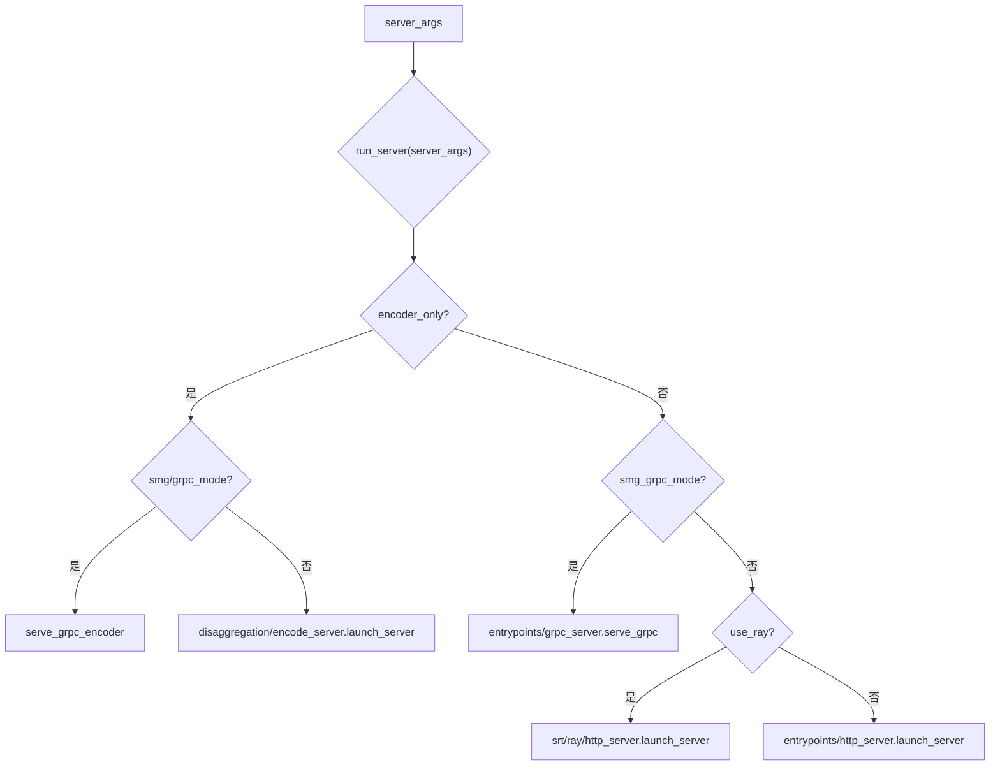

# 01.4 launch_server 模式分发

## 定位

`python/sglang/launch_server.py` 的 `run_server` 是服务端启动的最终模式分发点。`cli.serve` 在确认是语言模型后调用它，它依据 `ServerArgs` 的若干开关把启动路由到四条不同通路之一。本页只描述"分发"，各通路内部细节由 [02 服务入口](../02-server-api/index.md) 与 [09 分离式推理](../09-disaggregation/index.md) 承担。

## 职责

- 按 `encoder_only`、`smg_grpc_mode`、`use_ray` 顺序选择启动通路。
- 对分离式 encoder 模式，再按 `smg_grpc_mode`/`grpc_mode` 选 gRPC 或 HTTP 编码服务。
- 对 legacy SMG gRPC，启动 `grpc_server.serve_grpc`。
- 对 Ray 模式，启动 `srt.ray.http_server.launch_server`。
- 默认模式启动 `srt.entrypoints.http_server.launch_server`。
- 作为 `python -m sglang.launch_server` 的 `__main__`，给出"建议改用 `sglang serve`"的告警。

## 关键类与函数

| 名称 | 定义位置 | 说明 |
|---|---|---|
| `run_server` | `python/sglang/launch_server.py:15` | 模式分发函数 |
| encoder 分支 | `python/sglang/launch_server.py:17` | `server_args.encoder_only` 时走分离式 encoder |
| `serve_grpc_encoder` | `python/sglang/srt/disaggregation/encode_grpc_server.py` | encoder 的 gRPC 服务 |
| `launch_server` (encode) | `python/sglang/srt/disaggregation/encode_server.py:3609` | encoder 的 HTTP 服务 |
| smg_grpc 分支 | `python/sglang/launch_server.py:29` | legacy SMG gRPC，调 `entrypoints/grpc_server.serve_grpc` |
| ray 分支 | `python/sglang/launch_server.py:37` | `server_args.use_ray`，调 `srt/ray/http_server.launch_server` |
| 默认分支 | `python/sglang/launch_server.py:48` | `entrypoints/http_server.launch_server` |
| `__main__` 块 | `python/sglang/launch_server.py:55` | 兼容 `python -m sglang.launch_server`，告警并加载插件 |

## 数据流 / 控制流

注意 `smg_grpc_mode` 是 legacy `--smg-grpc-mode`（及被 `__post_init__` 折叠的 `--grpc-mode`）；而原生 Rust gRPC 服务器是另一条独立路径，由 `--grpc-port` 触发，会与默认 HTTP server 并行启动，不在此处分流。Ray 分支会在缺 `ray` 依赖时抛 `ImportError` 并给出安装提示。各通路的 `launch_server`/`serve_grpc` 返回后，`run_server` 的调用方（`cli.serve`）负责在 `finally` 中 `kill_process_tree` 清理。

## 备注

`__main__` 块仍兼容老用法 `python -m sglang.launch_server`，但会发 `UserWarning` 建议改用 `sglang serve`；执行前会 `load_plugins()` 以触发 `ServerArgs.__post_init__` 上的插件钩子。

## 交叉引用

- CLI 上游: [`01.3 CLI`](01.3-cli.md)
- HTTP/gRPC 通路细节: [`02 服务入口与 API`](../02-server-api/index.md)
- encoder 分离通路: [`09 分离式推理`](../09-disaggregation/index.md)
- 网关/Rust gRPC: [`18 模型网关与代理`](../18-gateway/index.md)
- 插件机制: [`16 配置与运行时上下文`](../16-config-runtime/index.md)

## 进一步阅读

- 源码: `python/sglang/launch_server.py`、`python/sglang/srt/entrypoints/http_server.py`、`python/sglang/srt/entrypoints/grpc_server.py`
