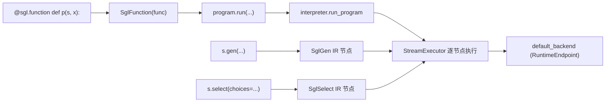

# 01.5.1 DSL 公共 API

## 定位

`python/sglang/lang/api.py` 是前端 DSL 对用户的公共 API 面：用户用这些函数声明可执行/可 traced 的提示程序。本页只列函数与其语义；其产生的中间表示见 [01.5.2 IR](01.5.2-dsl-ir.md)，执行机制见 [01.5.3 解释器](01.5.3-dsl-interpreter.md)。

## 职责

- `function` 把普通 Python 函数包装成 `SglFunction`（DSL 程序对象）。
- `gen`/`gen_int`/`gen_string` 生成文本/整数/字符串节点；`image`/`video` 注入多模态输入。
- `select` 在给定候选中做带 logprob 比较的选择（见 [01.5.5 Choices](01.5.5-dsl-choices.md)）。
- 角色 helpers（`system`/`user`/`assistant` 及 `_begin`/`_end`）构造角色边界节点。
- `separate_reasoning` 分离推理内容；`set_default_backend`/`flush_cache`/`get_server_info` 管理默认 backend。
- `Runtime`/`Engine` 两个工厂函数延迟导入对应类。

## 关键类与函数

| 名称 | 定义位置 | 说明 |
|---|---|---|
| `function` | `python/sglang/lang/api.py:23` | 装饰器，返回 `SglFunction`；可带 `num_api_spec_tokens` |
| `Runtime` | `python/sglang/lang/api.py:35` | 延迟导入 `backend.runtime_endpoint.Runtime` 并实例化 |
| `Engine` | `python/sglang/lang/api.py:42` | 延迟导入 `srt.entrypoints.engine.Engine` 并实例化 |
| `set_default_backend` | `python/sglang/lang/api.py:49` | 写 `global_config.default_backend` |
| `flush_cache` | `python/sglang/lang/api.py:53` | 经默认 backend 调 SRT `/flush_cache` |
| `get_server_info` | `python/sglang/lang/api.py:64` | 经默认 backend 取 `/server_info` |
| `gen` | `python/sglang/lang/api.py:75` | 通用生成；带 `choices` 时退化为 `SglSelect` |
| `gen_int` | `python/sglang/lang/api.py:142` | 整数生成，`dtype=int` |
| `gen_string` | `python/sglang/lang/api.py:185` | 字符串生成，`dtype=str` |
| `image` | `python/sglang/lang/api.py:228` | 包成 `SglImage` |
| `video` | `python/sglang/lang/api.py:232` | 构造 `SglVideo` |
| `select` | `python/sglang/lang/api.py:236` | 候选选择，默认 `token_length_normalized` |
| `system`/`user`/`assistant` | `python/sglang/lang/api.py:253` | 角色块 `_role_common` |
| `system_begin`/`system_end` 等 | `python/sglang/lang/api.py:265` | 角色边界开始/结束节点 |
| `separate_reasoning` | `python/sglang/lang/api.py:289` | 分离推理内容的包装节点 |

## 数据流 / 控制流

`gen` 的关键分支：当带 `choices` 时返回 `SglSelect`（候选比较而非自由生成）；否则构造 `SglGen` 并把所有采样参数装入 `SglSamplingParams`。`gen_int`/`gen_string` 是 `SglGen` 的 `dtype=int|str` 特化。`gen` 会先校验 `regex` 可编译（`re.compile`），失败即抛 `re.error`。这些 IR 节点最终由 `StreamExecutor` 在后台线程逐个发给 backend（见 [01.5.3](01.5.3-dsl-interpreter.md)）。

## 交叉引用

- IR 节点定义: [`01.5.2 DSL IR`](01.5.2-dsl-ir.md)
- 执行: [`01.5.3 解释器`](01.5.3-dsl-interpreter.md)
- 前缀预缓存: [`01.5.4 Tracer`](01.5.4-dsl-tracer.md)
- 候选选择策略: [`01.5.5 Choices`](01.5.5-dsl-choices.md)
- 默认 backend: [`01.6 Backends`](01.6-fe-backends.md)
- 全局配置: [`01.2 GlobalConfig`](01.2-global-config.md)

## 进一步阅读

- 源码: `python/sglang/lang/api.py`
