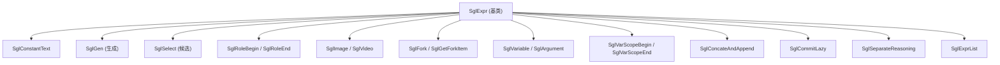

# 01.5.2 DSL 中间表示 IR

## 定位

`python/sglang/lang/ir.py` 定义前端 DSL 的中间表示（IR）。`api.py` 的函数把用户意图构造成 IR 节点，解释器与 tracer 再以统一方式遍历执行或 trace。本页梳理 IR 节点层级；执行机制见 [01.5.3 解释器](01.5.3-dsl-interpreter.md)。

## 职责

- `SglSamplingParams` 统一刻画采样/受限生成参数，并提供到各 backend kwargs 的转换。
- `SglFunction` 包装用户函数及其参数规约、绑定参数与采样默认值。
- `SglExpr` 是所有 IR 节点基类，子类表达常量文本、生成、选择、角色、fork、变量、lazy 提交等结构。
- IR 节点串成 DAG（`prev_node` 链），可被解释器流式执行，也可被 tracer 离线枚举。

## 关键类与函数

| 名称 | 定义位置 | 说明 |
|---|---|---|
| `SglSamplingParams` | `python/sglang/lang/ir.py:18` | 采样参数 dataclass；含 `to_openai_kwargs`/`to_anthropic_kwargs`/`to_vertexai_kwargs`/`to_litellm_kwargs`/`to_srt_kwargs` |
| `SglFunction` | `python/sglang/lang/ir.py:141` | 程序对象，`bind()` 生成绑定版；`run()` 进入解释器 |
| `SglExpr` | `python/sglang/lang/ir.py:327` | IR 节点基类，提供 `prev_node`/`node_id` 与 DAG 打印 |
| `SglExprList` | `python/sglang/lang/ir.py:397` | 表达式列表 |
| `SglArgument` | `python/sglang/lang/ir.py:406` | 程序参数占位符（tracer 用） |
| `SglImage`/`SglVideo` | `python/sglang/lang/ir.py:434`/`:442` | 多模态输入节点 |
| `SglGen` | `python/sglang/lang/ir.py:451` | 生成节点，封装采样参数 |
| `SglConstantText` | `python/sglang/lang/ir.py:506` | 常量文本节点 |
| `SglRoleBegin`/`SglRoleEnd` | `python/sglang/lang/ir.py:515`/`:524` | 角色边界节点 |
| `SglSelect` | `python/sglang/lang/ir.py:533` | 候选选择节点 |
| `SglFork` | `python/sglang/lang/ir.py:552` | fork 分叉节点 |
| `SglGetForkItem` | `python/sglang/lang/ir.py:565` | 取 fork 分支第 i 项 |
| `SglVariable` | `python/sglang/lang/ir.py:574` | 变量引用节点 |
| `SglVarScopeBegin`/`SglVarScopeEnd` | `python/sglang/lang/ir.py:584`/`:593` | 变量作用域边界 |
| `SglConcateAndAppend` | `python/sglang/lang/ir.py:602` | 合并并 append（fork join） |
| `SglCommitLazy` | `python/sglang/lang/ir.py:611` | 提交 lazy 操作 |
| `SglSeparateReasoning` | `python/sglang/lang/ir.py:619` | 分离推理内容包装 |

文件顶部还定义受限生成用的正则常量：`REGEX_INT`/`REGEX_FLOAT`/`REGEX_BOOL`/`REGEX_STR`（`ir.py:11`），供 `gen_int`/`gen_string` 等使用。

## 子模块树 / 节点层级

`SglSamplingParams` 的转换方法决定同一份 IR 如何映射到不同 backend：`to_srt_kwargs` 含 `regex`/`json_schema` 等仅 SRT 支持的字段；`to_openai_kwargs`/`to_anthropic_kwargs` 等会在存在 `regex` 时告警并丢弃（这些 backend 不支持受限生成）。`SglGen` 在构造时即把这些参数收进自己的 `sampling_params`，解释器据此调对应 backend 的 `generate`/`generate_stream`。

## 交叉引用

- 产生 IR 的 API: [`01.5.1 DSL API`](01.5.1-dsl-api.md)
- 执行 IR: [`01.5.3 解释器`](01.5.3-dsl-interpreter.md)
- 离线枚举 IR: [`01.5.4 Tracer`](01.5.4-dsl-tracer.md)
- backend kwargs 落点: [`01.6 Backends`](01.6-fe-backends.md)

## 进一步阅读

- 源码: `python/sglang/lang/ir.py`
