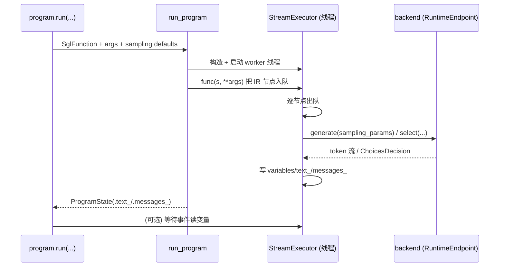

# 01.5.3 DSL 解释器

## 定位

`python/sglang/lang/interpreter.py` 是前端 DSL 的执行核心：把 `SglFunction` 转成 `StreamExecutor`，在后台线程逐节点把 IR 发给 backend，并维护程序状态（`ProgramState`/`ProgramStateGroup`）。本页梳理执行路径与状态对象；IR 节点定义见 [01.5.2 IR](01.5.2-dsl-ir.md)，前缀预缓存见 [01.5.4 Tracer](01.5.4-dsl-tracer.md)。

## 职责

- `run_program`/`run_program_batch` 是 DSL 程序的对外执行入口。
- `StreamExecutor` 在独立线程内消费一个队列，按 IR 节点顺序调 backend，产出文本/消息/变量。
- `ProgramState`/`ProgramStateGroup` 暴露程序结果（`.text_`/`.messages_`/变量/元信息）与 fork 后的多状态聚合。
- `cache_program` 经 tracer 预缓存前缀，受 `global_config.enable_precache_with_tracing` 控制。

## 关键类与函数

| 名称 | 定义位置 | 说明 |
|---|---|---|
| `run_internal` | `python/sglang/lang/interpreter.py:42` | 内部执行：构造 `StreamExecutor` 并跑 func |
| `run_program` | `python/sglang/lang/interpreter.py:57` | 单程序执行入口，返回 `ProgramState` |
| `run_program_batch` | `python/sglang/lang/interpreter.py:93` | 批量执行入口，返回 `ProgramStateGroup` |
| `_run_program_batch_generator` | `python/sglang/lang/interpreter.py:184` | 批量流式生成器 |
| `cache_program` | `python/sglang/lang/interpreter.py:242` | 经 tracer 预缓存前缀 |
| `_merge_stream_meta_info` | `python/sglang/lang/interpreter.py:257` | 合并流式元信息 |
| `StreamExecutor` | `python/sglang/lang/interpreter.py:274` | 流式执行器，后台线程消费 IR 队列 |
| `ProgramState` | `python/sglang/lang/interpreter.py:852` | 单程序状态与结果句柄 |
| `ProgramStateGroup` | `python/sglang/lang/interpreter.py:1045` | 多程序（batch）状态聚合 |

`StreamExecutor.__init__`（`interpreter.py:277`）持有 `backend`、采样默认值、chat template、变量表 `variables`、变量就绪事件 `variable_event`、流式队列 `queue`，并在 `use_thread=True` 时启动后台线程 `contextvars.copy_context().run(_run_worker_in_context)`，保证上下文变量正确传播。worker 循环从队列取 IR 节点并分派到 backend 的 `generate`/`generate_stream`/`select`/`fork_program`/`concatenate_and_append` 等方法。

## 数据流 / 控制流

关键设计：DSL 变量通过 `variable_event`（`threading.Event`）实现"先写后读"的同步——用户在程序里 `s["x"] = s.gen("x")` 后访问 `state["x"]` 会阻塞直到该变量被 worker 写入。`run_program_batch` 支持把同一程序并发跑多份（fork/批量采样），由 `ProgramStateGroup` 聚合每个子 `ProgramState`。前缀预缓存路径 `cache_program` 会调 tracer（见 [01.5.4](01.5.4-dsl-tracer.md)）拿到纯常量前缀串，再让 backend 调 `/process_memory_cache` 预热，从而对相同模板的多请求省去重复 prefill。

## 交叉引用

- 执行的 IR: [`01.5.2 DSL IR`](01.5.2-dsl-ir.md)
- API 入口: [`01.5.1 DSL API`](01.5.1-dsl-api.md)
- 前缀预缓存: [`01.5.4 Tracer`](01.5.4-dsl-tracer.md)
- backend 方法: [`01.6 Backends`](01.6-fe-backends.md)
- 优化开关: [`01.2 GlobalConfig`](01.2-global-config.md)（`enable_precache_with_tracing`/`enable_parallel_encoding`）

## 进一步阅读

- 源码: `python/sglang/lang/interpreter.py`
