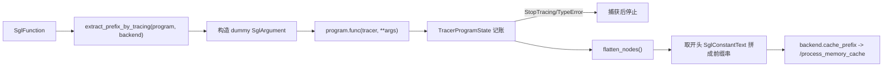

# 01.5.4 DSL Tracer

## 定位

`python/sglang/lang/tracer.py` 用"假执行"方式离线遍历 DSL 程序，提取纯常量前缀或完整 IR DAG，供解释器预缓存前缀、供 fork/变量分析。它不动用真实 backend，而是用一个 `BaseBackend` 占位并把所有节点记入列表。本页与 [01.5.3 解释器](01.5.3-dsl-interpreter.md) 的 `cache_program` 配套阅读。

## 职责

- `extract_prefix_by_tracing` 跑一次程序，只收集开头的常量文本前缀，用于 RadixAttention 预缓存。
- `trace_program` 跑一次程序，收集完整节点 DAG 与变量依赖，用于 fork/分析。
- `TracerProgramState` 是 tracer 专用的 `ProgramState`，把 `gen`/`select`/`fork`/变量读写都"记账"而非真调用。
- `TracingScope` 管理 tracer 的嵌套作用域与子状态收集。
- `StopTracing` 在条件不满足时优雅终止 trace（如遇到动态依赖）。

## 关键类与函数

| 名称 | 定义位置 | 说明 |
|---|---|---|
| `StopTracing` | `python/sglang/lang/tracer.py:25` | trace 主动终止异常 |
| `extract_prefix_by_tracing` | `python/sglang/lang/tracer.py:29` | 用 dummy 参数跑程序，取开头常量前缀 |
| `trace_program` | `python/sglang/lang/tracer.py:54` | 跑程序收集完整节点 DAG |
| `TracerProgramState` | `python/sglang/lang/tracer.py:75` | tracer 专用 ProgramState，记账式实现 |
| `TracingScope` | `python/sglang/lang/tracer.py:257` | tracer 嵌套作用域 |

`TracerProgramState.__init__`（`tracer.py:76`）为每个 `arg_names` 造一个 `SglArgument` 占位，使程序在无真实参数时也能跑；若 `backend` 带 `endpoint`（如 `RuntimeEndpoint`）则取其 `.endpoint`，从而能读到 chat template。它维护 `nodes`/`last_node`/`variables`/`messages_`/`cur_role`/`child_states`。其 `fork`/`get_fork_item`/变量读写均生成对应 IR 节点并链接 `last_node`，而非真调模型。

## 数据流 / 控制流

`extract_prefix_by_tracing` 的核心循环：遍历 `flatten_nodes()`，只要节点是 `SglConstantText` 就累计进 `prefix`，一旦遇到非常量节点（如 `SglGen`）即停止——因为前缀缓存只能覆盖纯文本部分。任何 `StopTracing`/`TypeError`/`AttributeError` 都被吞掉（动态构造路径无法 trace 时优雅回退）。得到的 `prefix` 串随后由解释器的 `cache_program` 送给 backend 预热 RadixAttention。`trace_program` 与之类似但 `only_trace_prefix=False`，保留全部节点供下游分析。

受 `global_config.enable_precache_with_tracing`（见 [01.2](01.2-global-config.md)）控制：关闭时解释器跳过 tracer 直接执行。

## 交叉引用

- 调用方: [`01.5.3 解释器`](01.5.3-dsl-interpreter.md)（`cache_program`）
- 被枚举的 IR: [`01.5.2 DSL IR`](01.5.2-dsl-ir.md)
- 预热落点: [`01.6 Backends`](01.6-fe-backends.md)（`RuntimeEndpoint.cache_prefix`）
- RadixAttention 预缓存: [`07 KV Cache`](../07-kv-cache/index.md)

## 进一步阅读

- 源码: `python/sglang/lang/tracer.py`
