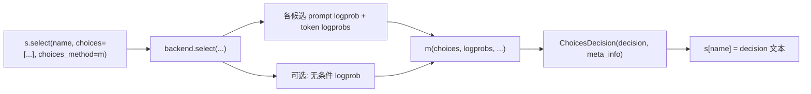

# 01.5.5 DSL Choices

## 定位

`python/sglang/lang/choices.py` 为 `sgl.select` 提供"候选比较"策略：在多个候选字符串中，依据各候选在 prompt 下的 logprob 选出最优。这是 DSL 把"分类/选择"任务表达成单次 logprob 评估而非自由生成的机制。本页梳理策略抽象与三种内置实现。

## 职责

- `ChoicesDecision` 封装最终决策与附带的 logprob 元信息。
- `ChoicesSamplingMethod` 是策略抽象基类，规定 `__call__` 接口与是否需要无条件 logprob。
- `TokenLengthNormalized` 按长度归一化的 prompt logprob 选最大（默认）。
- `GreedyTokenSelection` 逐 token 贪心比较，处理长短候选重叠。
- `UnconditionalLikelihoodNormalized` 用无条件 logprob 归一化（需要额外无条件 logprob）。

## 关键类与函数

| 名称 | 定义位置 | 说明 |
|---|---|---|
| `ChoicesDecision` | `python/sglang/lang/choices.py:9` | 结果 dataclass：`decision` + `meta_info` |
| `ChoicesSamplingMethod` | `python/sglang/lang/choices.py:14` | 抽象基类；`requires_unconditional_logprobs` 属性 |
| `TokenLengthNormalized` | `python/sglang/lang/choices.py:32` | 选 token 长度归一化 prompt logprob 最大者 |
| `token_length_normalized` | `python/sglang/lang/choices.py:53` | `TokenLengthNormalized` 单例 |
| `GreedyTokenSelection` | `python/sglang/lang/choices.py:56` | 逐 token 贪心；含 `_build_logprob_matrix`/`_greedy_selection` |
| `greedy_token_selection` | `python/sglang/lang/choices.py:107` | `GreedyTokenSelection` 单例 |
| `UnconditionalLikelihoodNormalized` | `python/sglang/lang/choices.py:110` | 需无条件 logprob；按平均 token logprob 归一化比较 |

`__call__` 接口接收：`choices`/`normalized_prompt_logprobs`/`input_token_logprobs`/`output_token_logprobs`，以及可选 `unconditional_token_logprobs`。`TokenLengthNormalized` 直接 `np.argmax(normalized_prompt_logprobs)`，最简单快速；`GreedyTokenSelection` 先把变长候选填成等长矩阵（不足位用各自平均 logprob 填充），再逐列留最大者，适合重叠候选；`UnconditionalLikelihoodNormalized` 置 `requires_unconditional_logprobs=True`，backend 需额外跑无条件 forward，用归一化后的平均 logprob 比较，对长度差异更鲁棒。

## 数据流 / 控制流

`select` 在 `api.py:236` 构造 `SglSelect`，默认 `choices_method=token_length_normalized`。执行时 backend（如 `RuntimeEndpoint`）需为每个候选计算 prompt 与输出 token 的 logprob，若策略 `requires_unconditional_logprobs` 为真则再算无条件 logprob，然后调 `method(...)` 得 `ChoicesDecision`。`runtime_endpoint.py:351` 的 `compute_normalized_prompt_logprobs` 负责把各候选的 prompt 长度差异归一化，与这里的"长度归一化"语义一致。

## 交叉引用

- API 入口: [`01.5.1 DSL API`](01.5.1-dsl-api.md)（`select`）
- IR 节点: [`01.5.2 DSL IR`](01.5.2-dsl-ir.md)（`SglSelect`）
- 执行落点: [`01.6 Backends`](01.6-fe-backends.md)（`BaseBackend.select`/`RuntimeEndpoint.select`）
- 采样与解码（受限生成相关）: [`11 采样与解码控制`](../11-sampling-control/index.md)

## 进一步阅读

- 源码: `python/sglang/lang/choices.py`、`python/sglang/lang/backend/runtime_endpoint.py`
