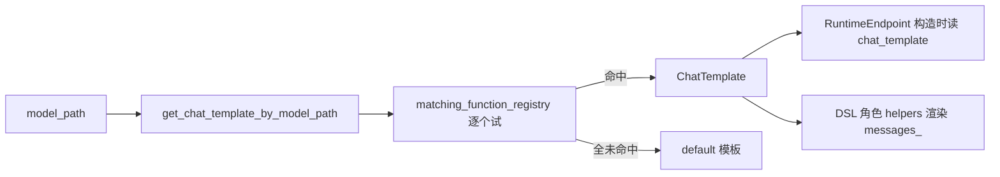

# 01.5.6 DSL Chat Template

## 定位

`python/sglang/lang/chat_template.py` 维护前端 DSL 的 chat template 注册表：把 OpenAI 风格的 messages 列表渲染为原始 prompt 串，并按模型路径自动匹配模板。它在 `RuntimeEndpoint` 构造与 DSL 角色 helpers 渲染时被使用。本页梳理数据结构、注册与匹配机制，以及已注册模板清单。

## 职责

- `ChatTemplate` dataclass 描述一个模板：默认 system prompt、各 role 的前后缀、stop 串、image/audio token、样式。
- `ChatTemplateStyle` 区分 `PLAIN` 与 `LLAMA2` 两类渲染逻辑（LLAMA2 对首个 system 有特殊拼接）。
- `register_chat_template`/`register_chat_template_matching_function` 注册模板与匹配函数。
- `get_chat_template`/`get_chat_template_by_model_path` 按名/按模型路径取模板，匹配失败回退 `default`。
- 预注册约 27 个常见模型模板，并注册若干按模型路径匹配的函数。

## 关键类与函数

| 名称 | 定义位置 | 说明 |
|---|---|---|
| `ChatTemplateStyle` | `python/sglang/lang/chat_template.py:7` | `PLAIN`/`LLAMA2` 枚举 |
| `ChatTemplate` | `python/sglang/lang/chat_template.py:13` | 模板 dataclass；`get_prefix_and_suffix`/`get_prompt` |
| `chat_template_registry` | `python/sglang/lang/chat_template.py:57` | 名→模板 dict |
| `matching_function_registry` | `python/sglang/lang/chat_template.py:58` | 匹配函数列表 |
| `register_chat_template` | `python/sglang/lang/chat_template.py:61` | 注册模板 |
| `register_chat_template_matching_function` | `python/sglang/lang/chat_template.py:65` | 注册匹配函数 |
| `get_chat_template` | `python/sglang/lang/chat_template.py:69` | 按名取 |
| `get_chat_template_by_model_path` | `python/sglang/lang/chat_template.py:73` | 遍历匹配函数，未命中回退 `default` |

## 已注册模板（约 27 个）

按注册顺序（行号即 `name="..."` 出现处）：`default`(83)、`claude`(95)、`chatml`(107)、`chatml-llava`(121)、`qwen`(139)、`qwen2-vl`(154)、`vicuna_v1.1`(170)、`llama-2-chat`(186)、`mistral`(200)、`llama-3-instruct`(214)、`minicpmv`(238)、`janus-pro`(252)、`minicpmo`(276)、`janus`(291)、`llama-3-instruct-llava`(315)、`llama-4`(339)、`yi-1.5`(363)、`yi-vl`(378)、`gemma-it`(394)、`gemma-4-it`(409)、`dbrx-instruct`(422)、`c4ai-command-r`(435)、`internvl-2-5`(455)、`interns1`(468)、`granite-3-instruct`(481)、`deepseek-v3`(503)、`glm-4v`(526)。

## 匹配函数

模型路径匹配函数在文件后段（`chat_template.py:541` 起）注册：`match_deepseek`(541)、`match_orion`(549)、`match_deepseek_janus_pro`(555)、`match_dbrx`(561)、`match_vicuna`(569)、`match_llama2_chat`(575)、`match_mistral`(585)、`match_llama3_instruct`(591)、`match_chat_ml`(597)、`match_chat_yi`(617)、`match_gemma`(627)、`match_openbmb_minicpm`(635)、`match_c4ai_command_r`(643)、`match_granite_instruct`(649)、`match_internvl_chat`(655)、`match_interns1_chat`(661)。`get_chat_template_by_model_path` 按注册顺序遍历这些函数，第一个返回非 `None` 者胜出。

## 数据流 / 控制流

`RuntimeEndpoint.__init__`（`runtime_endpoint.py:27`）在拿到 `/get_model_info` 后，若用户未指定 `chat_template_name` 就调 `get_chat_template_by_model_path(model_info["model_path"])` 自动匹配。DSL 角色 helpers（`system`/`user`/`assistant`，见 [01.5.1](01.5.1-dsl-api.md)）产生 `SglRoleBegin`/`SglRoleEnd`，`StreamExecutor` 依据当前 `chat_template` 把它们映射为前后缀串与 messages。`ChatTemplate.get_prompt` 对 `system` content 为 `None` 的情况用 `default_system_prompt`，`None` 则跳过，保证可省略 system。

## 交叉引用

- 使用方: [`01.6 Backends`](01.6-fe-backends.md)（`RuntimeEndpoint` 构造）
- 角色 API: [`01.5.1 DSL API`](01.5.1-dsl-api.md)
- 服务端 tokenizer/chat template（SRT 侧另有实现）: [`05 模型加载`](../05-model-loading/index.md)

## 进一步阅读

- 源码: `python/sglang/lang/chat_template.py`
