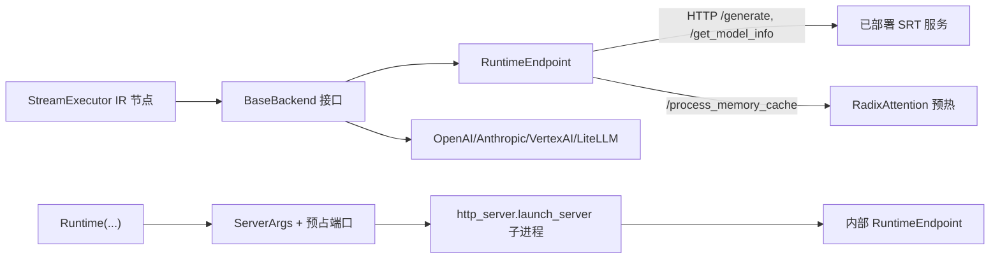

# 01.6 前端后端 Backends

## 定位

`python/sglang/lang/backend/` 是前端 DSL 的"输出侧"适配层：`BaseBackend` 规定接口，各子类把 `generate`/`select`/`fork` 等调用翻译成对具体推理服务（SRT、OpenAI、Anthropic、VertexAI、LiteLLM、Crusoe）的请求。`RuntimeEndpoint` 是 DSL 连到已部署 SRT 服务的主桥；`Runtime` 是进程内自起 SRT 服务的便捷封装。

## 职责

- `BaseBackend` 定义 backend 接口：`generate`/`generate_stream`/`select`/`fork_program`/`concatenate_and_append`/`cache_prefix`/`flush_cache`/`get_server_info` 等方法，默认抛 `NotImplementedError` 或空实现。
- `RuntimeEndpoint` 经 HTTP 调 SRT 端点（`/generate`、`/flush_cache`、`/server_info`、`/get_model_info`、`/process_memory_cache` 等），是 DSL 默认 backend。
- `Runtime` 构造 `ServerArgs`、预占端口、在进程内起一个 SRT HTTP server 并暴露其 `endpoint`，用于 `sgl.Runtime(...)` 便捷起服。
- `OpenAI`/`Anthropic`/`VertexAI`/`LiteLLM`/`Crusoe` 把请求转译到对应云 SDK，承载受限生成不支持的回退路径。
- `compute_normalized_prompt_logprobs` 配合 `select`（见 [01.5.5](01.5.5-dsl-choices.md)）做候选 logprob 归一化。

## 关键类与函数

| 名称 | 定义位置 | 说明 |
|---|---|---|
| `BaseBackend` | `python/sglang/lang/backend/base_backend.py:9` | backend 抽象基类；`support_concate_and_append`、默认 chat template `default` |
| `RuntimeEndpoint` | `python/sglang/lang/backend/runtime_endpoint.py:26` | HTTP 调 SRT；`cache_prefix` 预热 RadixAttention |
| `compute_normalized_prompt_logprobs` | `python/sglang/lang/backend/runtime_endpoint.py:351` | 候选 logprob 长度归一化 |
| `Runtime` | `python/sglang/lang/backend/runtime_endpoint.py:356` | 进程内自起 SRT server 的便捷类 |
| `OpenAI` | `python/sglang/lang/backend/openai.py:56` | OpenAI backend；含 `TokenUsage`(48) |
| `openai_completion` | `python/sglang/lang/backend/openai.py:383` | 非流式补全 helper |
| `openai_completion_stream` | `python/sglang/lang/backend/openai.py:425` | 流式补全 helper |
| `Anthropic` | `python/sglang/lang/backend/anthropic.py:12` | Anthropic backend |
| `VertexAI` | `python/sglang/lang/backend/vertexai.py:20` | VertexAI backend |
| `LiteLLM` | `python/sglang/lang/backend/litellm.py:15` | LiteLLM backend |
| `Crusoe` | `python/sglang/lang/backend/crusoe.py:10` | Crusoe backend，继承 `OpenAI` |

## 子模块树

- `python/sglang/lang/backend/`
  - `base_backend.py` — 接口基类
  - `runtime_endpoint.py` — SRT HTTP 适配 + `Runtime` 便捷起服
  - `openai.py` — OpenAI 适配
  - `anthropic.py` — Anthropic 适配
  - `vertexai.py` — VertexAI 适配
  - `litellm.py` — LiteLLM 适配
  - `crusoe.py` — Crusoe（OpenAI 兼容）

## 数据流 / 控制流

`RuntimeEndpoint.__init__`（`runtime_endpoint.py:27`）先 `/get_model_info` 取模型路径，再据此匹配 chat template（见 [01.5.6](01.5.6-dsl-chat-template.md)）。`Runtime`（`runtime_endpoint.py:366`）则相反：先构 `ServerArgs`、`is_port_available` 找空闲端口、`http_server.launch_server` 起子进程，再把自身包成 `RuntimeEndpoint` 暴露给 DSL。`OpenAI` 系 backend 通过 `SglSamplingParams.to_openai_kwargs` 等转换参数；遇到 `regex` 受限生成会告警丢弃（IR 层行为，见 [01.5.2](01.5.2-dsl-ir.md)）。`RuntimeEndpoint` 因 SRT 原生支持 `regex`/`json_schema`，是受限生成的唯一完整 backend。

## 交叉引用

- IR→backend 参数转换: [`01.5.2 DSL IR`](01.5.2-dsl-ir.md)
- 执行调度: [`01.5.3 解释器`](01.5.3-dsl-interpreter.md)
- chat template 匹配: [`01.5.6 Chat Template`](01.5.6-dsl-chat-template.md)
- SRT HTTP 服务端: [`02 服务入口与 API`](../02-server-api/index.md)
- RadixAttention 预热: [`07 KV Cache`](../07-kv-cache/index.md)

## 进一步阅读

- 源码: `python/sglang/lang/backend/`
