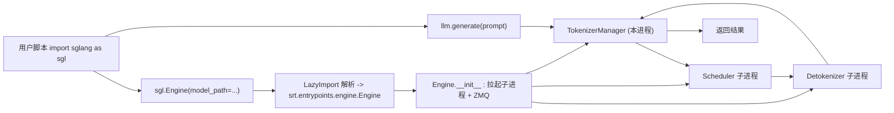

# 01.7 Engine 客户端 API

## 定位

`sgl.Engine` 是面向离线推理与进程内服务的客户端 API，跳过前端 DSL 与 HTTP，直接在当前进程构造 `srt.entrypoints.engine.Engine`。本页梳理其用法面、与 DSL 路径的关系，以及 `examples/runtime/engine/` 下的示例集合。Engine 的内部进程拓扑见 [00.4 进程与线程模型](../00-overview/00.4-process-model.md)。

## 职责

- 提供不依赖 DSL 的离线批量推理入口（`generate`/`async_generate` 等，由 `EngineScoreMixin`/`EngineBase` 提供）。
- 在进程内拉起 TokenizerManager/Scheduler/Detokenizer 三组件，可不经 HTTP 直接调用。
- 支持嵌入、VLM、EAGLE 投机、1M 长上下文等变体用法。
- 支持自定义 FastAPI、远程/分片 state 保存等高阶用法。

## 关键类与函数

| 名称 | 定义位置 | 说明 |
|---|---|---|
| `Engine` (运行时) | `python/sglang/srt/entrypoints/engine.py:183` | 真实引擎类，组合三组件 |
| `Engine` (懒导出) | `python/sglang/__init__.py:79` | `LazyImport` 暴露为 `sgl.Engine` |
| `Engine` (API helper) | `python/sglang/lang/api.py:42` | 延迟导入并实例化运行时 `Engine` |
| `EngineBase` | `python/sglang/srt/entrypoints/EngineBase.py:7` | Engine 抽象基类 |
| `EngineScoreMixin` | `python/sglang/srt/entrypoints/engine_score_mixin.py:28` | 评分/embedding 相关方法 |

注意：`sgl.Engine` 与 DSL 的 `sgl.Runtime` 是两条不同路径。`sgl.Runtime`（`lang/backend/runtime_endpoint.py:356` 的 `Runtime`）会起一个 HTTP server 再用 `RuntimeEndpoint` 经 HTTP 调；`sgl.Engine` 则进程内直接构造 `Engine` 并调用其方法，省掉 HTTP 序列化与网络栈，适合离线批处理与 RL rollout。

## 示例集合

`examples/runtime/engine/` 提供完整示例（实际目录核实）：

| 示例文件 | 用途 |
|---|---|
| `launch_engine.py` | 最小离线推理：`sgl.Engine(...).generate(...)` |
| `offline_batch_inference.py` | 离线批量推理同步用法 |
| `offline_batch_inference_async.py` | 异步批量推理 |
| `offline_batch_inference_eagle.py` | EAGLE 投机解码离线用法 |
| `offline_batch_inference_vlm.py` | 视觉语言模型离线推理 |
| `offline_batch_inference_qwen_1m.py` | Qwen 1M 长上下文用法 |
| `embedding.py` | 嵌入模型用法 |
| `fastapi_engine_inference.py` | 自定义 FastAPI 包裹 Engine |
| `custom_server.py` | 自定义服务用法 |
| `save_remote_state.py` / `save_sharded_state.py` | 远程/分片 state 保存 |

`launch_engine.py` 的核心即两行：`llm = sgl.Engine(model_path=...)` 与 `llm.generate("...")`，末尾 `llm.shutdown()`；其注释强调 `if __name__ == "__main__"` 是必须的，因为 Engine 用 `spawn` 方式派生子进程，缺少守卫会无限递归 spawn。

## 数据流 / 控制流

调用 `llm.generate(prompt)` 时，请求在本进程内直接进 TokenizerManager，经 ZMQ 到 Scheduler 子进程跑 forward，再经 Detokenizer 回传——与 HTTP 路径的请求生命周期相同，只是省掉 HTTP/FastAPI 层。因此 [00.4 进程与线程模型](../00-overview/00.4-process-model.md) 描述的拓扑对 `sgl.Engine` 同样适用。

## 交叉引用

- Engine 内部拓扑: [`00.4 进程与线程模型`](../00-overview/00.4-process-model.md)
- 对比 DSL 路径: [`01.6 Backends`](01.6-fe-backends.md)（`Runtime` 经 HTTP）
- 编排下游: [`03 核心调度与编排`](../03-orchestration/index.md)
- 模型执行: [`04 模型执行`](../04-model-execution/index.md)

## 进一步阅读

- 源码: `python/sglang/srt/entrypoints/engine.py`、`python/sglang/srt/entrypoints/EngineBase.py`、`python/sglang/srt/entrypoints/engine_score_mixin.py`
- 示例: `examples/runtime/engine/`（含 `readme.md`）
