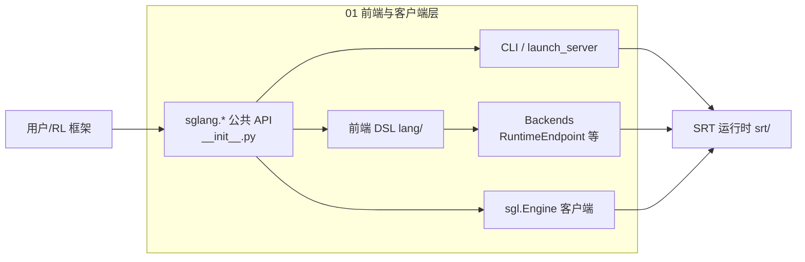

# 01 前端与客户端层

## 定位

本子系统是用户触达 SGLang 的最上层：包级公共 API、命令行、`launch_server` 模式分发、前端 DSL（语言/IR/解释器/tracer/choices/chat template）、各 backend 适配，以及 `sgl.Engine` 客户端用法。它把"用户意图"翻译成对 SRT 运行时（`srt/`）的调用，本身不持有 GPU 资源。

## 职责

- 暴露 `sglang.*` 公共 API 并处理平台兼容（macOS MPS/Triton stub、HF patch、懒导入）。
- 提供 `sglang serve/generate/version` 命令分发与 `run_server` 模式路由。
- 把可编程提示程序编译为中间表示（IR），再由解释器/tracer 执行或预缓存前缀。
- 维护 chat template 注册表与多 backend 适配（RuntimeEndpoint/OpenAI/Anthropic/VertexAI/LiteLLM/Crusoe）。
- 提供 `sgl.Engine` 离线/进程内推理客户端入口。

## 子系统内导航

- [01.1 包与公共 API 面](01.1-package-api.md)
- [01.2 全局配置 GlobalConfig](01.2-global-config.md)
- [01.3 命令行 CLI](01.3-cli.md)
- [01.4 launch_server 模式分发](01.4-launch-server.md)
- [01.5.1 DSL 公共 API](01.5.1-dsl-api.md)
- [01.5.2 DSL 中间表示 IR](01.5.2-dsl-ir.md)
- [01.5.3 DSL 解释器](01.5.3-dsl-interpreter.md)
- [01.5.4 DSL Tracer](01.5.4-dsl-tracer.md)
- [01.5.5 DSL Choices](01.5.5-dsl-choices.md)
- [01.5.6 DSL Chat Template](01.5.6-dsl-chat-template.md)
- [01.6 前端后端 Backends](01.6-fe-backends.md)
- [01.7 Engine 客户端 API](01.7-engine-client.md)

## 子系统边界图

前端层所有出口最终汇入 SRT（`python/sglang/srt/`）：CLI 经 `launch_server` 起 server 进程；DSL 经 `RuntimeEndpoint` HTTP 调 SRT；`sgl.Engine` 可进程内直接构造 `srt.entrypoints.engine.Engine` 绕过 HTTP。

## 交叉引用

- 上游入口: [`00 总览`](../00-overview/index.md)
- 下游: [`02 服务入口与 API`](../02-server-api/index.md) — `launch_server` 落到 HTTP/gRPC server
- 下游: [`03 核心调度与编排`](../03-orchestration/index.md) — `sgl.Engine` 直连编排管线
- 配置底座: [`16 配置与运行时上下文`](../16-config-runtime/index.md)
