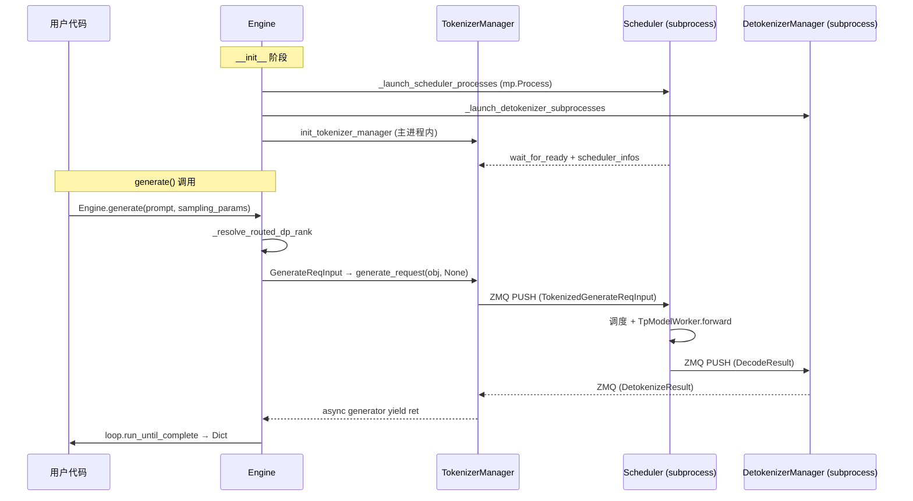

# 02.1 Engine

## 定位

`Engine` 是 SGLang 在 Python 进程内直接暴露的推理引擎入口，相当于"没有 HTTP server 的 SGLang Runtime"。它同构地编排 `TokenizerManager`（主进程）、`Scheduler`（子进程）与 `DetokenizerManager`（子进程），并把 `generate/score/encode/权重更新` 等 API 包装成同步或 async 调用。HTTP server 与 Engine 共用底层三个组件，区别仅在最外层协议封装。

## 职责

- 解析 `ServerArgs`、加载插件、建立 `PortArgs`（ZMQ IPC 端口分配）。
- 拉起 Scheduler 子进程（TP/PP 分组或 DataParallelController），并在多节点场景下区分 `node_rank=0` 与非零节点。
- 拉起 Detokenizer 子进程；当 `detokenizer_worker_num > 1` 时额外启动 `MultiDetokenizerRouter`。
- 启动 `TokenizerManager`/`MultiTokenizerRouter`、`TemplateManager`，注册 `SubprocessWatchdog`。
- 提供 `generate` / `async_generate` / `encode` / `score` 等用户 API，把参数构造成 `GenerateReqInput`/`EmbeddingReqInput` 并交给 `tokenizer_manager.generate_request`。
- 提供 `shutdown`、`flush_cache`、`open_session`/`close_session`、`update_weights_from_*`、`load_lora_adapter`/`unload_lora_adapter`、`release_memory_occupation` 等控制面 API。

## 关键类与函数

| 名称 | 定义位置 | 说明 |
|---|---|---|
| `Engine` | `python/sglang/srt/entrypoints/engine.py:183` | `EngineScoreMixin, EngineBase` 的子类；推理引擎 Python 入口 |
| `Engine.__init__` | `python/sglang/srt/entrypoints/engine.py:204` | 解析 args、`load_plugins()`、`_launch_subprocesses`、建 ZMQ、enable tracing |
| `Engine.generate` | `python/sglang/srt/entrypoints/engine.py:318` | 同步生成：构造 `GenerateReqInput`，`loop.run_until_complete` 拉取生成器 |
| `Engine.async_generate` | `python/sglang/srt/entrypoints/engine.py:417` | 异步生成：返回 `AsyncIterator[Dict]` 或单次结果 |
| `Engine.encode` | `python/sglang/srt/entrypoints/engine.py:511` | 调用 `EmbeddingReqInput` 路径，用于 embedding/rerank/score 等隐藏状态请求 |
| `Engine._launch_scheduler_processes` | `python/sglang/srt/entrypoints/engine.py:591` | 类方法：按 `dp_size`/`ep_join_mode` 决定直接派发 TP/PP 进程还是启动 `DataParallelController` |
| `Engine._launch_detokenizer_subprocesses` | `python/sglang/srt/entrypoints/engine.py:707` | 类方法：派发单/多 detokenizer worker + `MultiDetokenizerRouter` |
| `Engine._launch_subprocesses` | `python/sglang/srt/entrypoints/engine.py:764` | 调用上面两个方法并组装 `SchedulerInitResult`、`SubprocessWatchdog` |
| `Engine.shutdown` | `python/sglang/srt/entrypoints/engine.py:911` | 关停 watchdog、关闭 RPC socket、`kill_process_tree` |
| `EngineBase` | `python/sglang/srt/entrypoints/EngineBase.py:7` | 抽象基类：`generate`/`flush_cache`/`update_weights_from_tensor`/`release_memory_occupation`/`shutdown` 的接口约定 |
| `EngineScoreMixin` | `python/sglang/srt/entrypoints/engine_score_mixin.py:28` | 通过 `TokenizerManager.score_request` 提供 `score`/`async_score` |
| `EngineInfoBootstrapServer` | `python/sglang/srt/entrypoints/engine_info_bootstrap_server.py:26` | 主进程内 uvicorn 守护线程，收集 per-rank transfer-engine 注册信息，供 RemoteInstance 权重加载使用 |

## 子模块树

- `entrypoints/EngineBase.py` — 抽象 API 面（与 HTTP 派生类共享）。
- `entrypoints/engine_score_mixin.py` — 把 `TokenizerManagerScoreMixin.score_request` 暴露成 `Engine.score`。
- `entrypoints/engine_info_bootstrap_server.py` — 轻量 FastAPI server，仅用于权重 transfer-engine 注册/查询。
- `entrypoints/http_server_engine.py` — `launch_server_process`：在子进程跑 `launch_server`，供 Engine 客户端用。

## 数据流 / 控制流

Engine 一次 `generate(prompt, stream=False)` 的关键路径如下：

流式分支（`stream=True`）则用 `generator_wrapper` 把 `async generator.__anext__` 桥接到同步迭代器；`async_generate` 直接返回 `AsyncIterator`。

## Engine 与 HTTP server 的关系

`launch_server`（`http_server.py:2597`）在子进程层级调用 `Engine._launch_subprocesses`，再 `_setup_and_run_http_server`。即 HTTP server 复用 Engine 的全部子进程编排逻辑，只在主进程额外挂一层 FastAPI（含 OpenAI/Anthropic/Ollama handlers）。`Engine` 自身则把 Python API 直挂到同一个 `TokenizerManager` 上。

## 交叉引用

- 上游: [`01.7 Engine 客户端`](../01-frontend/01.7-engine-client.md) — 在另一进程通过 HTTP 消费 Engine
- 下游: [`03.3 TokenizerManager`](../03-orchestration/03.3.1-tokenizer-manager.md) — `generate_request` 的执行者
- 下游: [`03.4 Scheduler`](../03-orchestration/03.4.1-scheduler-structure.md) — 子进程内调度
- 下游: [`03.7 DetokenizerManager`](../03-orchestration/03.7-detokenizer.md) — 子进程解码
- 相关: [`05 模型加载`](../05-model-loading/index.md)、[`16.1 ServerArgs`](../16-config-runtime/16.1-server-args-port-args.md)
- 相关: [02.2.1 原生 API](02.2.1-native-api.md)、[02.2.6 负载与弹性 EP](02.2.6-loads-elastic-ep.md)

## 进一步阅读

- 源码: `python/sglang/srt/entrypoints/engine.py`、`EngineBase.py`、`engine_score_mixin.py`、`engine_info_bootstrap_server.py`
- 启动入口: `python/sglang/srt/entrypoints/http_server.py:2597 launch_server`
