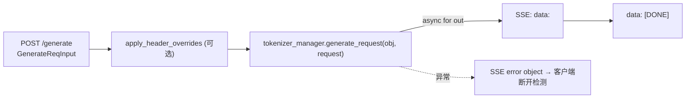

# 02.2.1 原生 API

## 定位

SGLang 在 `python/sglang/srt/entrypoints/http_server.py` 上挂载的"原生" HTTP 端点，是最贴近内部请求模型的协议：直接以 `GenerateReqInput` / `EmbeddingReqInput` 为入参，返回 SGLang 自定义 JSON。它是 Engine 的 HTTP 镜像，也是其他兼容层（OpenAI/Anthropic/Ollama）最终翻译的目标。

## 职责

- 暴露推理原语：`/generate`、`/encode`、`/classify`、`/v1/score`、`/v1/rerank`、`/v1/audio/transcriptions` 等。
- 暴露运维/控制面：`/flush_cache`、`/health`、`/health_generate`、`/get_load`、`/get_model_info`、`/get_server_info`、`/get_weight_version`、profile/trace/gc、`/start_profile`/`/stop_profile`、`/freeze_gc`、专家分布记录。
- 暴露权重管理：`/update_weights_from_disk`、`/update_weights_from_tensor`、`/update_weights_from_distributed`、`/update_weights_from_ipc`、`/init_weights_update_group`、`/destroy_weights_update_group`、`/update_weight_version`、`/get_weights_by_name`、`/check_weights`、RemoteInstance 系列（`/init_weights_send_group_for_remote_instance`、`/send_weights_to_remote_instance`、`/get_remote_instance_transfer_engine_info`）。
- 暴露 LoRA：`/load_lora_adapter`、`/load_lora_adapter_from_tensors`、`/unload_lora_adapter`。
- 暴露 session：`/open_session`、`/close_session`。
- 暴露管理动作：`/abort_request`、`/pause_generation`、`/continue_generation`、`/configure_logging`、`/slow_down`、`/parse_function_call`、`/separate_reasoning`、Dumper control `/dumper_control`。
- 暴露 HiCache 外存：`/add_external_corpus`、`/remove_external_corpus`、`/list_external_corpora`、`/hicache/storage-backend`、`/clear_hicache_storage_backend`、`/attach_hicache_storage_backend`、`/detach_hicache_storage_backend`。

## 关键类与函数

| 名称 | 定义位置 | 说明 |
|---|---|---|
| `app` (FastAPI 实例) | `http_server.py` 顶部 | 模块级 `app = FastAPI(...)`，所有路由挂载点 |
| `_GlobalState` | `http_server.py:195` | 模块级全局：`tokenizer_manager` + `template_manager` + `scheduler_info` |
| `generate_request` | `http_server.py:823` | `/generate` 路由：流式走 SSE，非流式走 `__anext__` 一次拿值 |
| `encode_request` | `http_server.py:872`（路由名 `/encode`） | embedding 路径，参数为 `EmbeddingReqInput` |
| `classify_request` | `http_server.py:884`（`/classify`） | 与 `/encode` 同形，落入分类/打分内部路径 |
| `flush_cache` | `http_server.py:895`（`/flush_cache`） | `tokenizer_manager.flush_cache(timeout_s=...)`，`@auth_level(ADMIN_OPTIONAL)` |
| `health_generate` | `http_server.py:608` | health 同 `health_generate`：构造 1-token 请求验证 detokenizer 回声 |
| `lifespan` | `http_server.py:266` | FastAPI 启停钩子；初始化所有 `openai_serving_*` handlers 与 watchdog |
| `launch_server` | `http_server.py:2597` | 顶层入口：`Engine._launch_subprocesses` + `_setup_and_run_http_server` |

## 子模块树

- `http_server.py` — 原生 + 兼容端点总入口
- `http_server_engine.py` — 把 `launch_server` 包成子进程：`launch_server_process`
- `warmup.py` — warmup 装饰器与执行器（见 [02.2.7](02.2.7-warmup-health.md)）
- `v1_loads.py` — `/v1/loads` 路由（见 [02.2.6](02.2.6-loads-elastic-ep.md)）
- `elastic_ep.py` — `/_scale_elastic_ep` 路由（见 [02.2.6](02.2.6-loads-elastic-ep.md)）

## 数据流 / 控制流

`/generate` 流式请求的完整流转：

非流式 `/generate`、`/encode`、`/classify` 直接拿 `__anext__` 一次再走 `orjson_response`。`/flush_cache` 等 admin 接口以 `@auth_level(AuthLevel.ADMIN_OPTIONAL)` 装饰，由 `utils.auth` 决定是否要 admin API key。

## 鉴权与中间件

- `validate_json_request`（`http_server.py:587`）在 OpenAI 兼容路径上强制 `Content-Type: application/json`，避免表单误入。
- `apply_header_overrides`（`request_headers.py:22`）允许上游网关用 `x-override-*` 头覆盖 `rid`/`priority`/`routed_dp_rank` 等字段（见 [02.7 入口辅助](02.7-entrypoint-aux.md)）。
- `RequestDecompressionMiddleware`（`http_request_decompression.py:37`）透明解压 zstd 请求体。
- 当 `--api-key` 或 `--admin-api-key` 配置后，`add_api_key_middleware` 在 ASGI 链上做 bearer token 校验。
- `add_prometheus_track_response_middleware` 在 `--enable-metrics` 时埋点。

## 交叉引用

- 上游: [`01 前端`](../01-frontend/index.md) — CLI/SDK 通过这些端点调用 SGLang
- 下游: [`03.3 TokenizerManager`](../03-orchestration/03.3.1-tokenizer-manager.md) — 所有请求最终进入 `generate_request`
- 同子系统: [02.1 Engine](02.1-engine.md)、[02.2.2 OpenAI 兼容](02.2.2-openai-compat.md)、[02.2.7 warmup/health](02.2.7-warmup-health.md)、[02.7 入口辅助](02.7-entrypoint-aux.md)
- 相关: [`14 session-state`](../14-session-state/index.md)、[`07.9 HiCache`](../07-kv-cache/07.9-hicache.md)、[`13 LoRA`](../13-lora/index.md)

## 进一步阅读

- 源码: `python/sglang/srt/entrypoints/http_server.py`（前 1550 行覆盖原生端点）；权重更新相关还涉及 `managers/io_struct.py` 的 `UpdateWeightsFrom*ReqInput`。
- 启动链路: `python/sglang/srt/entrypoints/http_server.py:2348 _setup_and_run_http_server`
