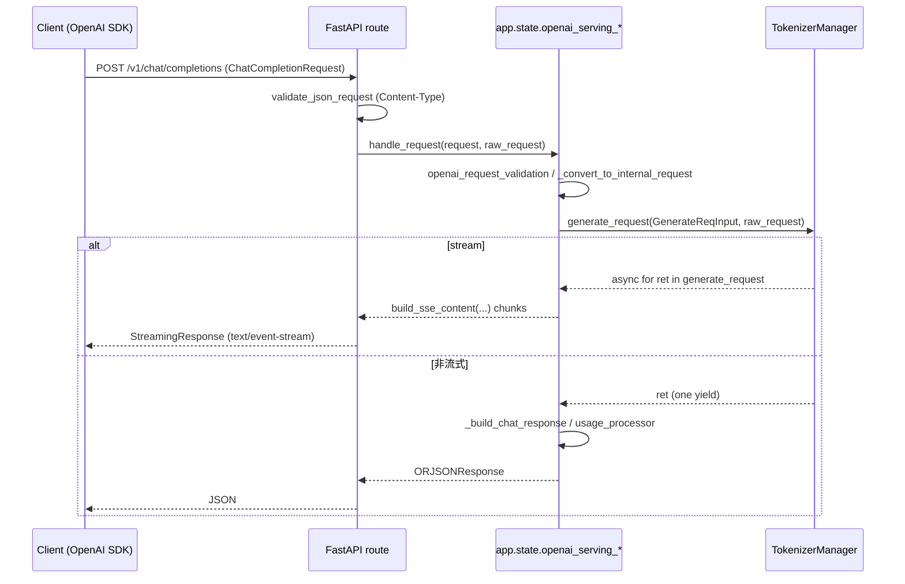

# 02.2.2 OpenAI 兼容端点

## 定位

SGLang 在同一个 FastAPI `app` 上挂载 OpenAI API 兼容端点（`/v1/...`），让任意 OpenAI SDK / 兼容客户端无需改动即可调用。每个端点都是薄路由层，把 pydantic 校验后的请求转发给挂载在 `app.state` 上的 `OpenAIServing*` 处理类（[02.3 系列](02.3.1-openai-protocol.md)）。

## 职责

- 路由 + 鉴权（`Depends(validate_json_request)`），把请求委派给 `OpenAIServing*` handler。
- 维护兼容性"清单"：`/v1/models` 暴露 base model + 已加载 LoRA adapter；`/v1/models/{model}` 单模型详情。
- /v1/responses 的"后台响应"语义：`POST /v1/responses` 可同步/流式/后台；`GET /v1/responses/{id}` 查询、`POST /v1/responses/{id}/cancel` 取消。
- /v1/audio 系列：`POST /v1/audio/transcriptions`（文件上传）、`/v1/realtime`（WebSocket）见 [02.3.4](02.3.4-openai-tokenize-transcription-asr.md)/[02.3.6](02.3.6-openai-realtime-ws.md)。

## 关键类与函数

| 名称 | 定义位置 | 说明 |
|---|---|---|
| `openai_v1_completions` | `http_server.py:1642`（路由 `/v1/completions`） | 委托 `app.state.openai_serving_completion.handle_request` |
| `openai_v1_chat_completions` | `http_server.py:1650`（`/v1/chat/completions`） | 委托 `openai_serving_chat.handle_request` |
| `openai_v1_embeddings` | `http_server.py:1664`（`/v1/embeddings`） | `openai_serving_embedding.handle_request` |
| `openai_v1_classify` | `http_server.py:1676`（`/v1/classify`） | `openai_serving_classify.handle_request` |
| `openai_v1_tokenize` / `openai_v1_detokenize` | `http_server.py:1693` / `1712` | 同名/简短路径双载，委托 `openai_serving_tokenize`/`detokenize` |
| `openai_v1_audio_transcriptions` | `http_server.py:1719`（`/v1/audio/transcriptions`） | 文件上传，委托 `openai_serving_transcription.create_transcription` |
| `openai_v1_realtime_transcription` | `http_server.py:1760`（`/v1/realtime`，WS） | WebSocket，委托 `openai_serving_transcription.handle_websocket` |
| `available_models` / `retrieve_model` | `http_server.py:1771` / `1803` | `/v1/models` 列表 + `/v1/models/{model}` 详情 |
| `v1_score_request` | `http_server.py:1828`（`/v1/score`） | `openai_serving_score.handle_request`，详见 [02.3.3](02.3.3-openai-embed-classify-score-rerank.md) |
| `v1_responses_request` | `http_server.py:1836`（`/v1/responses`） | 调 `create_responses`；若返回 `AsyncGenerator` 则包成 `StreamingResponse`，详见 [02.3.5](02.3.5-openai-responses-harmony-tool.md) |
| `v1_retrieve_responses` / `v1_cancel_responses` | `http_server.py:1855` / `1863` | 后台响应的查询/取消 |
| `v1_rerank_request` | `http_server.py:1873`（`/v1/rerank`，POST/PUT） | 委托 `openai_serving_rerank.handle_request` |

## 子模块树

- 路由层只有 `http_server.py`；handler 实现全部在 `entrypoints/openai/serving_*.py`（见 [02.3.2](02.3.2-openai-base-chat-completions.md) – [02.3.5](02.3.5-openai-responses-harmony-tool.md)）。

## 数据流 / 控制流

`/v1/responses` 多一层：当请求 `background=True` 时 `create_responses` 仅返回 `{"id":..., "status":"queued"}`，背景任务在 `_run_background_request`（[02.3.5](02.3.5-openai-responses-harmony-tool.md)）执行，结果落盘以便后续 `GET /v1/responses/{id}` 取回。

## Lifespan 内的 handler 注入

所有 `OpenAIServing*` 在 FastAPI `lifespan` 启动钩子（`http_server.py:266`）中实例化并写入 `fast_api_app.state`：`openai_serving_completion`、`openai_serving_chat`、`openai_serving_embedding`、`openai_serving_classify`、`openai_serving_score`、`openai_serving_rerank`、`openai_serving_tokenize`、`openai_serving_detokenize`、`openai_serving_transcription`、`openai_serving_responses`、`anthropic_serving`、`ollama_serving`，等。`server_args.serving_chat_class` 允许插件替换 `OpenAIServingChat` 子类。

## 交叉引用

- 上游: [`01 前端`](../01-frontend/index.md) — 大多数客户端走这层
- 下游: [`03.3 TokenizerManager`](../03-orchestration/03.3.1-tokenizer-manager.md)
- 同子系统: [02.3.1 protocol](02.3.1-openai-protocol.md)、[02.3.2 chat/completions](02.3.2-openai-base-chat-completions.md)、[02.3.3 embed/classify/score/rerank](02.3.3-openai-embed-classify-score-rerank.md)、[02.3.4 tokenize/ASR](02.3.4-openai-tokenize-transcription-asr.md)、[02.3.5 responses](02.3.5-openai-responses-harmony-tool.md)、[02.3.6 realtime](02.3.6-openai-realtime-ws.md)、[02.3.7 chat 编码/SSE/usage](02.3.7-openai-chat-encoding-sse-usage.md)
- 相关: [`11.6 parser`](../11-sampling-control/11.6.2-parser-conversation-template.md)、[`12 多模态`](../12-multimodal/index.md)

## 进一步阅读

- 源码: `python/sglang/srt/entrypoints/http_server.py` 第 1641–1900 行
- 协议定义: `python/sglang/srt/entrypoints/openai/protocol.py`
