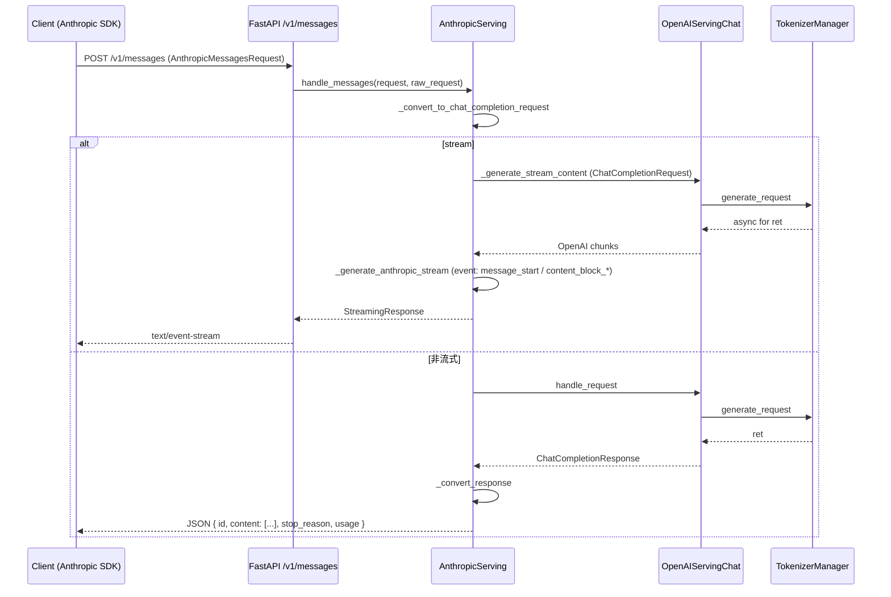

# 02.2.3 Anthropic 兼容

## 定位

SGLang 把 Anthropic Messages API（`/v1/messages`、`/v1/messages/count_tokens`）作为薄兼容层挂在同一个 FastAPI 上。该层把 `AnthropicMessagesRequest` 翻译为内部的 `ChatCompletionRequest`，复用 `OpenAIServingChat` 的全部推理与流式管线，再把 OpenAI 风格响应反向翻译成 Anthropic 块（`TextBlock`/`ToolUseBlock`/`ThinkingBlock`、SSE `message_start`/`content_block_delta`/`message_stop`）。

## 职责

- 路由 + 鉴权：`/v1/messages` 强制 JSON；`/v1/messages/count_tokens` 同上。
- 把 Anthropic 的 system/messages/tools/thinking 参数转换为 OpenAI 字段。
- 把 OpenAI 流式 chunk 转换成 Anthropic SSE 事件流，含 `message_delta` 里的 `stop_reason` 与 `usage`。
- 在 FastAPI 校验失败时按 Anthropic 错误协议响应（`type: error`、`error.type: invalid_request_error` 等），通过模块级 `validation_exception_handler`（`http_server.py:542`）接管。
- 错误信息脱敏：`_scrub_error_message` 在 4xx 与 5xx 中按是否泄露内部细节分别处理。

## 关键类与函数

| 名称 | 定义位置 | 说明 |
|---|---|---|
| `anthropic_v1_messages` | `http_server.py:1929`（路由 `/v1/messages`） | 委托 `app.state.anthropic_serving.handle_messages` |
| `anthropic_v1_count_tokens` | `http_server.py:1939`（`/v1/messages/count_tokens`） | 委托 `anthropic_serving.handle_count_tokens` |
| `AnthropicServing` | `python/sglang/srt/entrypoints/anthropic/serving.py:184` | 兼容层主类，构造时接收 `OpenAIServingChat` 引用 |
| `AnthropicServing.handle_messages` | `anthropic/serving.py:206` | 主入口：转换 → `_handle_streaming` 或 `_handle_non_streaming` |
| `AnthropicServing._convert_to_chat_completion_request` | `anthropic/serving.py:229` | Anthropic 入参 → OpenAI `ChatCompletionRequest` |
| `AnthropicServing._handle_streaming` | `anthropic/serving.py:764` | 调用 `openai_serving_chat._generate_stream_content`，按 Anthropic 事件协议重新打包 |
| `AnthropicServing._generate_anthropic_stream` | `anthropic/serving.py:813` | 流式事件构造器 |
| `AnthropicServing._convert_response` | `anthropic/serving.py:1234` | OpenAI 非流式响应 → Anthropic 响应结构 |
| `AnthropicServing.handle_count_tokens` | `anthropic/serving.py:1391` | token 计数 |
| `_anthropic_usage_from_openai` | `anthropic/serving.py:110` | OpenAI `UsageInfo` → `AnthropicUsage`（input/output/cache 字段映射） |
| `_cached_prompt_tokens` / `_anthropic_input_tokens` | `anthropic/serving.py:88` / `:93` | 处理 cache_creation/cache_read tokens |
| `_wrap_sse_event` | `anthropic/serving.py:156` | 把 dict 序列化为 Anthropic SSE 帧 `event: <type>\ndata: <json>\n\n` |

## 子模块树

- `anthropic/__init__.py`
- `anthropic/protocol.py` — Pydantic 模型族：`AnthropicMessagesRequest`、`AnthropicMessage`、`TextBlock`、`ToolUseBlock`、`ThinkingBlock`、各 SSE delta 类型；`_tool_discriminator`（[protocol.py:199]( ../../../../python/sglang/srt/entrypoints/anthropic/protocol.py)）做 union 反序列化。
- `anthropic/serving.py` — 主处理类与流式/非流式转换器。

## 数据流 / 控制流

流式阶段的关键差异：Anthropic 的 SSE 帧需要按 `event: <type>` 分类（`message_start`、`content_block_start`、`content_block_delta`、`content_block_stop`、`message_delta`、`message_stop`、`ping`），所以不能直接复用 OpenAI 的 `sse_utils.build_sse_content`；`_wrap_sse_event` 把每个事件包成两行 SSE。

## 错误协议接管

FastAPI 默认的 `RequestValidationError` 响应不符合 Anthropic 格式。`http_server.py:448 _anthropic_validation_message` + `:473 _anthropic_error_response` 把校验错误转成 Anthropic 错误结构。`validation_exception_handler`（`:485` / `:542`）按请求路径前缀路由到 Anthropic / OpenAI / 默认三套响应体。

## 交叉引用

- 上游: [`01 前端`](../01-frontend/index.md) — Anthropic SDK
- 下游: [`03.3 TokenizerManager`](../03-orchestration/03.3.1-tokenizer-manager.md)
- 同子系统: [02.2.2 OpenAI 兼容](02.2.2-openai-compat.md)、[02.3.2 chat/completions](02.3.2-openai-base-chat-completions.md)、[02.4 Anthropic/Ollama handlers](02.4-anthropic-ollama-handlers.md)
- 相关: [`11.6.3 parser harmony`](../11-sampling-control/11.6.3-parser-harmony.md)、[`11.7 function call`](../11-sampling-control/11.7.1-function-call-parser.md)

## 进一步阅读

- 源码: `python/sglang/srt/entrypoints/anthropic/serving.py`、`anthropic/protocol.py`
- 端口挂载: `python/sglang/srt/entrypoints/http_server.py:1929`
