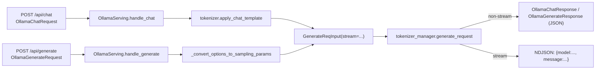

# 02.2.4 Ollama 兼容

## 定位

SGLang 提供 Ollama REST 协议（`/api/chat`、`/api/generate`、`/api/tags`、`/api/show`）的兼容层，让 `ollama` CLI、`ollama-python`、或第三方 IDE/agent 工具直接连到 SGLang 服务器。路由路径可由环境变量覆盖，便于在已有的 Ollama 反代/中间件下复用同一个上游 SGLang 实例。

## 职责

- 暴露 Ollama Chat 与 Generate API：把 `OllamaChatRequest`/`OllamaGenerateRequest` 在 `OllamaServing` 内转换成 `GenerateReqInput`，调用 `tokenizer_manager.generate_request`。
- 暴露元信息：`/api/tags` 返回已加载模型与已注册 LoRA 适配器；`/api/show` 返回 `OllamaShowResponse`（虚化 modelinfo）。
- 提供独立 CLI 智能路由器 `SmartRouter`：用 LLM-judge 把请求二分为简单/复杂，分别路由到本地 Ollama 或远端 SGLang。

## 关键类与函数

| 名称 | 定义位置 | 说明 |
|---|---|---|
| `ollama_chat` | `http_server.py:1901`（路由 `/api/chat`） | 委托 `app.state.ollama_serving.handle_chat` |
| `ollama_generate` | `http_server.py:1907`（`/api/generate`） | 委托 `ollama_serving.handle_generate` |
| `ollama_tags` | `http_server.py:1915`（`/api/tags`） | 返回 `OllamaTagsResponse`，含 LoRA adapter |
| `ollama_show` | `http_server.py:1921`（`/api/show`） | 委托 `ollama_serving.get_show` |
| `OllamaServing` | `python/sglang/srt/entrypoints/ollama/serving.py:31` | 主处理类，持有 `tokenizer_manager` |
| `OllamaServing.handle_chat` | `ollama/serving.py:68` | `apply_chat_template` → `GenerateReqInput`，分发 stream 或非 stream |
| `OllamaServing._stream_chat_response` | `ollama/serving.py:132` | 把 `tokenizer_manager.generate_request` 转 NDJSON 流 |
| `OllamaServing.handle_generate` | `ollama/serving.py:173` | 单轮补全路径 |
| `OllamaServing.get_tags` | `ollama/serving.py:289` | 返回 base model + LoRA adapters 列表 |
| `OllamaServing.get_show` | `ollama/serving.py:310` | 返回模型 family/context_len 等极简 modelinfo |
| `SmartRouter` | `ollama/smart_router.py:23` | LLM-judge 路由器，独立 CLI（`smart_router.py:244 main`） |

## 子模块树

- `ollama/__init__.py`
- `ollama/protocol.py` — Pydantic 模型：`OllamaChatRequest`、`OllamaGenerateRequest`、`OllamaOptions`、`OllamaChatResponse`、`OllamaTagsResponse`、`OllamaShowResponse`、流式 chunk 等。
- `ollama/serving.py` — 主处理类。
- `ollama/smart_router.py` — 独立进程入口，需本机安装 `ollama` Python 客户端。
- `ollama/README.md` — 用法说明。

## 数据流 / 控制流

Ollama 的流式不是 SSE，而是 newline-delimited JSON。每个 chunk 形如 `{"model":..., "created_at":..., "message":{"role":"assistant","content":"..."}, "done":false}`，最后一帧 `done:true` 且 `total_duration` 等指标齐全。

## 路径覆盖

环境变量允许把 Ollama 路由改写到其它路径，便于与已有反代共存：

- `SGLANG_OLLAMA_CHAT_ROUTE`（默认 `/api/chat`）
- `SGLANG_OLLAMA_GENERATE_ROUTE`（默认 `/api/generate`）
- `SGLANG_OLLAMA_TAGS_ROUTE`（默认 `/api/tags`）
- `SGLANG_OLLAMA_SHOW_ROUTE`（默认 `/api/show`）
- `SGLANG_OLLAMA_ROOT_ROUTE`（覆盖 `/` 根，返回 `"Ollama is running"`）

## SmartRouter

`SmartRouter`（`ollama/smart_router.py:23`）是 Ollama-CLI 用户从本地小模型无感切换到 SGLang 的工具。它把客户端 prompt 提交给 LLM-judge 模型分类：

- `SIMPLE` → 转发到本地 `ollama`（`local_host`，默认 `http://localhost:11434`）
- `COMPLEX` → 转发到远端 SGLang（`remote_host`，默认 `http://localhost:30001`）

判定 prompt 由 `CLASSIFICATION_PROMPT` 字符串模板给出，要求 judge 只回 `SIMPLE` 或 `COMPLEX`。`SmartRouter` 是独立的 Python 类，运行时通过 `:244 main` 起一个简单服务，不属于 `http_server.py` 的 FastAPI 进程。

## 交叉引用

- 上游: [`01 前端`](../01-frontend/index.md) — `ollama` CLI / SDK
- 下游: [`03.3 TokenizerManager`](../03-orchestration/03.3.1-tokenizer-manager.md)
- 同子系统: [02.2.1 原生 API](02.2.1-native-api.md)、[02.2.2 OpenAI 兼容](02.2.2-openai-compat.md)、[02.4 Anthropic/Ollama handlers](02.4-anthropic-ollama-handlers.md)
- 相关: [`13 LoRA`](../13-lora/index.md) — `/api/tags` 把 LoRA adapter 当成 Ollama 模型返回

## 进一步阅读

- 源码: `python/sglang/srt/entrypoints/ollama/`
- 路由挂载: `python/sglang/srt/entrypoints/http_server.py:1900`
- 用法: `python/sglang/srt/entrypoints/ollama/README.md`
