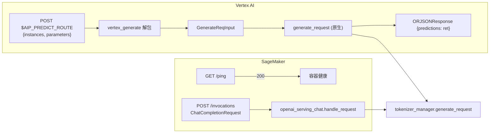

# 02.2.5 SageMaker / Vertex

## 定位

AWS SageMaker 与 Google Vertex AI 都把推理容器焊死在固定协议上：SageMaker 要求 `/ping`（健康检查） + `/invocations`（推理入口）；Vertex AI 由 `AIP_PREDICT_ROUTE` 环境变量指定路径（无设置时为 `/vertex_generate`）。SGLang 在同一个 FastAPI 上同时挂载这三类路由，作为兼容云容器协议的薄壳。

## 职责

- `/ping`：返回 200，给 SageMaker 容器健康探针使用。真正的深度健康检查仍走 `/health_generate`（见 [02.2.7](02.2.7-warmup-health.md)）。
- `/invocations`：把 SageMaker 推理请求复用为 `/v1/chat/completions` 的等价入口，直接调用 `openai_serving_chat.handle_request`。
- `/vertex_generate`（或 `AIP_PREDICT_ROUTE`）：解析 Vertex 的 `instances[]` 结构（`text`/`input_ids`/`input_embeds` + `image_data` + `parameters`），构造 `GenerateReqInput`，调用 `generate_request`，输出 `{"predictions": ret}`。

## 关键类与函数

| 名称 | 定义位置 | 说明 |
|---|---|---|
| `sagemaker_health` | `http_server.py:1950`（路由 `/ping`） | 返回 `Response(status_code=200)` |
| `sagemaker_chat_completions` | `http_server.py:1956`（`/invocations`） | 接收 `ChatCompletionRequest`，委托 `openai_serving_chat.handle_request` |
| `vertex_generate` | `http_server.py:1967`（路由 `AIP_PREDICT_ROUTE` 或 `/vertex_generate`） | 解包 `VertexGenerateReqInput`，构造 `GenerateReqInput` |
| `VertexGenerateReqInput` | `python/sglang/srt/managers/io_struct.py:1984` | msgspec 模型：`instances: List[Dict]`、`parameters: Optional[Dict]` |

## 数据流 / 控制流

`/invocations` 在 SageMaker 容器场景通常是 OpenAI 风格请求体（因为 SageMaker inference toolkit 的 OpenAI serializer 把客户端请求原样转发）。`/vertex_generate` 则是 Vertex 风格：以 `instances` 数组为承载，每个 instance 含 `text`/`input_ids`/`image_data` 之一，全局 `parameters` 透传到 `GenerateReqInput` 字段。`image_data` 仅当所有 instance 都非空时被收集成 list，否则置 `None`。

## 路由可见性

`/ping`、`/invocations`、`/vertex_generate` 注册到 FastAPI 的方式与其它端点一致，会出现在 `/docs` OpenAPI 中。生产环境通常会在前置 ALB/Cloud Load Balancer 上只暴露 `/ping` 与 `/invocations`/`AIP_PREDICT_ROUTE`，其余路径仅内部使用。

## 交叉引用

- 上游: 云平台容器（SageMaker inference toolkit / Vertex AI prediction container）
- 下游: [`03.3 TokenizerManager`](../03-orchestration/03.3.1-tokenizer-manager.md)
- 同子系统: [02.2.1 原生 API](02.2.1-native-api.md)、[02.2.2 OpenAI 兼容](02.2.2-openai-compat.md)、[02.2.7 warmup/health](02.2.7-warmup-health.md)
- 相关: [`19.2 Docker`](../19-build-ci-dev/19.2-docker.md) — 部署到 SageMaker/Vertex 的容器构建

## 进一步阅读

- 源码: `python/sglang/srt/entrypoints/http_server.py:1950-1996`
- 协议契约: AWS SageMaker containers contract、Google Vertex AI prediction request format
