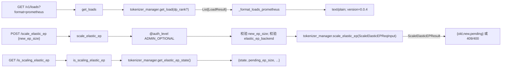

# 02.2.6 负载与弹性 EP

## 定位

`v1_loads.py` 与 `elastic_ep.py` 是两个独立的 `APIRouter` 模块，被 `http_server.py` 通过 `include_router` 挂载，分别提供：（1）细粒度运行时负载快照 `/v1/loads`；（2）弹性专家并行（Elastic EP）在线扩缩容 `/scale_elastic_ep` + 状态查询 `/is_scaling_elastic_ep`。它们是 SGLang 控制面 API 的两个主力端点。

## 职责

- `/v1/loads`：返回所有 DP rank 的综合负载，覆盖核心队列/吞吐、内存（KV pool/Radix tree）、投机解码、LoRA、disaggregation、queue 长度等维度。支持 `dp_rank`、`include`（按维度过滤）、`format=json|prometheus` 查询参数。
- Prometheus 输出：`_format_loads_prometheus` 把每个 metric 转成 `sglang_<section>_<key>{dp_rank=".."} <value>` 文本格式，适合被现有 Prometheus 抓取流程直接复用。
- `/scale_elastic_ep`：异步触发 EP 扩容（只支持扩，不支持缩）。请求体只需 `new_ep_size: int`，校验合法性后通过 `tokenizer_manager.scale_elastic_ep(ScaleElasticEPReqInput)` 下发。
- `/is_scaling_elastic_ep`：查询当前弹性 EP 状态（`pending_ep_size`、`old_ep_size` 等），供编排器轮询扩容完成情况。

## 关键类与函数

| 名称 | 定义位置 | 说明 |
|---|---|---|
| `router`（v1_loads） | `python/sglang/srt/entrypoints/v1_loads.py`（顶部） | 独立 `APIRouter()`，由 `http_server.py` include |
| `_get_tokenizer_manager` | `v1_loads.py:33` | 依赖注入器：从 `_global_state` 取 `tokenizer_manager` |
| `_format_loads_prometheus` | `v1_loads.py:40` | 把 load dict 转成 Prometheus 文本格式 |
| `get_loads` | `v1_loads.py:73`（路由 `/v1/loads`） | 主查询入口，支持 JSON/Prometheus |
| `router`（elastic_ep） | `python/sglang/srt/entrypoints/elastic_ep.py`（顶部） | 独立 `APIRouter()` |
| `scale_elastic_ep` | `elastic_ep.py:16`（`/scale_elastic_ep`） | `@auth_level(ADMIN_OPTIONAL)` 之后异步下发扩容 |
| `is_scaling_elastic_ep` | `elastic_ep.py:77`（`/is_scaling_elastic_ep`） | 镜像 `tokenizer_manager.get_elastic_ep_state()` |

## 子模块树

- `entrypoints/v1_loads.py` — 负载查询 router（123 行）
- `entrypoints/elastic_ep.py` — 弹性 EP 控制 router（87 行）

## 数据流 / 控制流

`/v1/loads` 内部依次遍历 `tokenizer_manager.get_load()` 返回的 `List[LoadResult]`：把每个 dict 展平为 metric。`section_prefixes = {"speculative": "spec", "disaggregation": "disagg"}` 控制 Prometheus metric 前缀翻译；只有 `int/float` 值进入指标，子字典递归一层后用 `<section>_<sub_key>` 命名。

`/scale_elastic_ep` 是**异步非阻塞**端点：`scale_elastic_ep` 立刻返回成功的 `{"old_ep_size":..., "new_ep_size":..., "message":...}`；实际扩容在 Scheduler/Worker 上分多步完成，阶段进度通过 `/is_scaling_elastic_ep` 的 `pending_ep_size` 反映。当后端处于正在扩容状态时再次调用，会返回 `409 Conflict`。`elastic_ep_backend is None`（即未启动 `--elastic-ep-backend`）时返回 `404`。

## 交叉引用

- 上游: 编排器/网关（如 [`18 gateway`](../18-gateway/index.md) 的 router、PD 控制器）调用这些端点做调度
- 下游: [`03.8 DataParallelController`](../03-orchestration/03.8-dp-controller.md) `get_load`，`sglang/srt/elastic_ep/` `ExpertBackupManager` 与 worker 协议
- 同子系统: [02.2.1 原生 API](02.2.1-native-api.md)、[02.2.7 warmup/health](02.2.7-warmup-health.md)
- 相关: [`08.9 Elastic EP`](../08-distributed/08.9-elastic-ep.md)、[`08.10 EPLB/LPLB`](../08-distributed/08.10-eplb-lplb.md)、[`17.1 Prometheus metrics`](../17-observability-ops/17.1-prometheus-metrics.md)

## 进一步阅读

- 源码: `python/sglang/srt/entrypoints/v1_loads.py`、`python/sglang/srt/entrypoints/elastic_ep.py`
- 后端实现: `python/sglang/srt/elastic_ep/`
