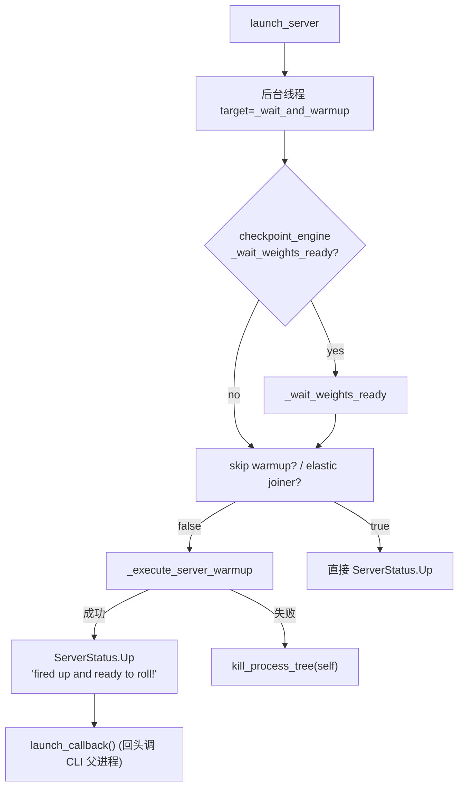
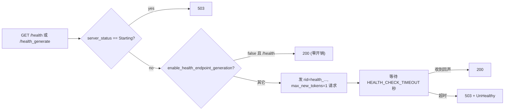

# 02.2.7 warmup / health

## 定位

服务器实例从"启动完成"到"对外就绪"之间有两类逻辑要做：（1）warmup：先用一个最小请求把 cuda graph、torch.compile、xgrammar FSM、远程 disaggregation bootstrap 等首次开销预付掉；（2）health：在运行期持续验证 detokenizer/scheduler 真的能回声，避免出现"端口已监听但 workers 已死"的假活。这两类逻辑分散在 `entrypoints/warmup.py` 与 `http_server.py` 中。

## 职责

- `warmup` 装饰器 + 注册表 `_warmup_registry`：把任意 `async def` 注册成"按名字触发"的 warmup 任务。
- `execute_warmups`：批量执行多个注册过的 warmup，配合 `--warmup` CLI 选项使用。
- `_execute_server_warmup`（`http_server.py:2067`）：默认 warmup 实现，轮询 `/model_info` 直到服务起，再根据 `is_generation` 选择 `/generate`、`/v1/chat/completions`（VLM）或 `/encode`，发一个 `max_new_tokens=8` 的小请求。
- `_wait_and_warmup`（`http_server.py:2218`）：服务启动后台线程入口，串联 `checkpoint_engine_wait_weights` → `_execute_server_warmup` → 标记 `ServerStatus.Up`。
- `health_generate`（`http_server.py:608`）：`/health` 与 `/health_generate` 的统一实现，"无业务负载时发 1-token 探针，有负载时不增开销"。
- `_wait_weights_ready`（`http_server.py:2254`）：等待 checkpoint engine 在 `SGLANG_WAIT_WEIGHTS_READY_TIMEOUT` 内把权重准备好。
- 特殊 warmup：`whisper_autodetect`（`warmup.py:42`，预编译 Whisper xgrammar）、`voice_chat`/`prefill_shapes`（disaggregation 模式下的专用 warmup）。

## 关键类与函数

| 名称 | 定义位置 | 说明 |
|---|---|---|
| `warmup` | `python/sglang/srt/entrypoints/warmup.py:20` | 装饰器，把函数注册到 `_warmup_registry[name]` |
| `execute_warmups` | `warmup.py:28` | 按 `warmup_names` 列表依次 await 注册函数 |
| `whisper_autodetect` | `warmup.py:42`（`@warmup("whisper_autodetect")`） | 用两段静音 WAV 预热 xgrammar notimestamps/timestamps 两个 FSM |
| `voice_chat` | `warmup.py:109`（`@warmup("voice_chat")`） | PD 分离模式 voice chat 的预热 |
| `prefill_shapes` | `warmup.py:131`（`@warmup("prefill_shapes")`） | 预热 disaggregation prefill 形状 |
| `_execute_server_warmup` | `http_server.py:2067` | 轮询 `/model_info` 直到 200，再发 1-token 请求 |
| `_wait_and_warmup` | `http_server.py:2218` | warmup_thread 入口，操作 `ServerStatus` |
| `_wait_weights_ready` | `http_server.py:2254` | 等权重就绪，超时上限 `SGLANG_WAIT_WEIGHTS_READY_TIMEOUT` |
| `health_generate` | `http_server.py:608` | `/health`、`/health_generate` 路由实现 |

## 数据流 / 控制流

健康检查内部逻辑：

关键点：`/health` 在 `SGLANG_ENABLE_HEALTH_ENDPOINT_GENERATION` 关闭时返回 200 不发请求，避免对在线系统产生周期性 1-token 负载；只有显式开 flag 或访问 `/health_generate` 时才发探针。探针 rid 以 `HEALTH_CHECK_RID_PREFIX` 开头 + uuid，避免与业务 rid 冲突。

## Warmup 注册机制

`warmup(name)` 装饰器只把函数登记到 `_warmup_registry`，不修改函数本身。`execute_warmups(disaggregation_mode, warmup_names, tokenizer_manager)` 按 `server_args.warmup` 列表里的名字逐个触发，缺失名字则 warning。`whisper_autodetect` 已默认存在；`voice_chat`/`prefill_shapes` 用于 PD disagg 模式；用户可以在 plugin 中 `@warmup("custom")` 注册自己的预热逻辑（见 [`16.7 plugins`](../16-config-runtime/16.7-plugins.md)）。

## 交叉引用

- 上游: [`01 CLI`](../01-frontend/01.3-cli.md) — `--warmup`、`--skip-server-warmup`
- 下游: [`03.3 TokenizerManager`](../03-orchestration/03.3.1-tokenizer-manager.md) — warmup 与 health 实际发的请求仍走 `generate_request`
- 下游: [`09 分离式`](../09-disaggregation/index.md) — PD 模式 _send_disaggregation_warmup_requests
- 同子系统: [02.2.1 原生 API](02.2.1-native-api.md)、[02.1 Engine](02.1-engine.md)
- 相关: [`14.4 checkpoint engine`](../14-session-state/14.4-checkpoint-engine.md)、[`17.4 request metrics`](../17-observability-ops/17.4-request-metrics-time-stats.md)、[`15 kernels`](../15-kernels-hardware/index.md)（cuda graph 预热）

## 进一步阅读

- 源码: `python/sglang/srt/entrypoints/warmup.py`、`python/sglang/srt/entrypoints/http_server.py:608`、`:2027 _send_disaggregation_warmup_requests`、`:2067 _execute_server_warmup`、`:2218 _wait_and_warmup`
