# 02.3.1 OpenAI protocol

## 定位

`python/sglang/srt/entrypoints/openai/protocol.py` 是 SGLang 全部 OpenAI 兼容端点的 Pydantic 模型仓库，1794 行覆盖从请求到响应、从流式 delta 到 logprobs、从 embedding/score/rerank 到 responses/transcription 的所有结构体。它锚定了"对外契约 = Pydantic 类"，让上层 handler 只需要 `.model_dump()`/`.model_validate()` 就能完成 JSON 转换，而不必手写字段映射。

## 职责

- 定义 OpenAI 风格请求模型：`CompletionRequest`、`ChatCompletionRequest`、`EmbeddingRequest`、`ClassifyRequest`、`ScoringRequest`、`V1RerankReqInput`、`TokenizeRequest`、`DetokenizeRequest`、`TranscriptionRequest`、`ResponsesRequest`。
- 定义响应模型：`CompletionResponse(Choice)`、`CompletionStreamResponse(Choice)`、ChatCompletionResponse(StreamChoice)、`EmbeddingResponse`、`ClassifyResponse`、`ScoringResponse`、`RerankResponse`、`TokenizeResponse`、`DetokenizeResponse`、`TranscriptionResponse`、`TranscriptionStreamResponse`、`ModelCard`/`ModelList`。
- 定义通用结构：`UsageInfo`、`PromptTokensDetails`、`CachedTokensDetails`、`LogProbs`、`TopLogprob`、`ChatCompletionTokenLogprob`、`ChoiceLogprobs`、`ErrorResponse`。
- 定义扩展字段：`SglExt`（`:404`）承载 SGLang 在 OpenAI 之外的私有能力（如 `return_hidden_states`、`return_routed_experts`、`reasoning_effort` 等）。
- 提供 `OpenAIServingRequest` Protocol（pydantic `Protocol` 类型）作为 `OpenAIServingBase` 的泛型约束。
- 兼容性迁移：`_migrate_deprecated_dp_rank`（`:302`）把废弃的 `data_parallel_rank` 字段在 `__init__` 之前自动迁移到 `routed_dp_rank`。

## 关键类与函数

| 名称 | 定义位置 | 说明 |
|---|---|---|
| `ErrorResponse` | `protocol.py:87` | 统一错误响应：`{message,type,param,code,soft_validation_errors,...}` |
| `UsageInfo` | `protocol.py:196` | 包含 `prompt_tokens`/`completion_tokens`/`total_tokens`/`reasoning_tokens` + `prompt_tokens_details.cached_tokens` |
| `CachedTokensDetails` / `PromptTokensDetails` | `protocol.py:156` / `:176` | 子结构 |
| `CompletionRequest` | `protocol.py:316` | Text completion 入参；`SglExt` 字段透传给后端 |
| `SglExt` | `protocol.py:404` | SGLang 私有扩展字段集合 |
| `CompletionResponse` / `CompletionStreamResponse` | `protocol.py:437` / `:471` | 非流/流式响应 |
| `ChatCompletionRequest` | `protocol.py:654` | chat completion 入参；含工具、response_format、reasoning_effort 等 |
| `ToolCall` / `FunctionResponse` | `protocol.py:562` / `:555` | 工具调用相关 |
| `ChatCompletionMessageContent*Part` | `protocol.py:488-525` | 多模态 content part 族（text/image/video/audio） |
| `EmbeddingRequest` / `ClassifyRequest` / `ScoringRequest` / `V1RerankReqInput` | `protocol.py:1063` / `:1094` / `:1129` / `:1165` | embedding/score/rerank 入参 |
| `TokenizeRequest` / `DetokenizeRequest` | `protocol.py:1222` / `:1238` | tokenize/detokenize 入参 |
| `ResponsesRequest` | `protocol.py:1353` | `/v1/responses` 入参，包含 `input`(str|list)、`reasoning`、`text.format`、`tools` |
| `TranscriptionRequest` / `TranscriptionStreamResponse` | `protocol.py:1731` / `:1786` | ASR 请求/流式响应 |
| `ModelCard` / `ModelList` | `protocol.py:68` / `:80` | `/v1/models` 模型卡片 |
| `_migrate_deprecated_dp_rank` | `protocol.py:302` | 字段迁移 hook |

## 子模块树

- `openai/protocol.py` — 全部 OpenAI 兼容 Pydantic 模型（单文件 1794 行）
- 配套：`anthropic/protocol.py`、`ollama/protocol.py`、`openai/realtime/protocol.py` — 各协议族自己的模型，复用本文件部分类型（如 `UsageInfo`、`ErrorResponse`）。

## 数据流 / 控制流

```mermaid
flowchart LR
    JSON["客户端 JSON"] -->|"model_validate"| REQ["ChatCompletionRequest<br/>(protocol.py:654)"]
    REQ -->|"__init__ migration"| MIG["_migrate_deprecated_dp_rank"]
    MIG --> HS["OpenAIServingChat.handle_request"]
    HS -->|"生成 GenerateReqInput"| TM["TokenizerManager"]
    TM -->|"ret dict"| BLD["_build_chat_response"]
    BLD -->|"UsageInfo / Choice / LogProbs"| RESP["ChatCompletionResponse"]
    RESP -->|"model_dump() + orjson"| JSON2["HTTP JSON"]
```

任意 OpenAI 兼容端点的处理过程都遵循这一循环：JSON → `model_validate` → handler → 构造响应模型 → `model_dump`。Pydantic 同时承担类型校验（FastAPI 自动捕获 `RequestValidationError`）与默认值注入（如 `max_tokens=None` 默认值、`temperature=0`/1 取舍、`n=1`）。

## 字段约束与扩展

- `StreamingResponse` 路径上，SGLang 使用 `sse_utils.StreamDelta`（msgspec）而非 `ChoiceDelta`，原因见 [02.3.7](02.3.7-openai-chat-encoding-sse-usage.md)：pydantic 把 `reasoning_content` 当 `extra` 字段会丢键，msgspec `omit_defaults=True` 但显式声明字段能正确序列化 `null`。
- `SglExt` 是 SGLang 私有扩展的合集（如 `return_hidden_states`、`return_routed_experts`、`bootstrap_host`、`routed_dp_rank` 等），由 `OpenAIServingBase` 在 `_convert_to_internal_request` 时透传给 `GenerateReqInput`，不破坏 OpenAI SDK 客户端的字段集合。
- `ChatCompletionRequest.chat_template_kwargs` 允许 jinja 模板参数动态注入，配合 [`11.6.2 conversation template`](../11-sampling-control/11.6.2-parser-conversation-template.md) 使用。

## 交叉引用

- 上游: [`01 前端`](../01-frontend/index.md) — OpenAI/Anthropic SDK 把 JSON 直接送来
- 下游: [`03.2 io_struct`](../03-orchestration/03.2-io-struct.md) — 转换目标 `GenerateReqInput`/`EmbeddingReqInput`
- 同子系统: [02.3.2 chat/completions](02.3.2-openai-base-chat-completions.md)、[02.3.3 embed/classify/score/rerank](02.3.3-openai-embed-classify-score-rerank.md)、[02.3.4 tokenize/ASR](02.3.4-openai-tokenize-transcription-asr.md)、[02.3.5 responses](02.3.5-openai-responses-harmony-tool.md)、[02.3.7 SSE](02.3.7-openai-chat-encoding-sse-usage.md)
- 相关: [`11.6 parser`](../11-sampling-control/11.6.2-parser-conversation-template.md)、[`12 多模态`](../12-multimodal/index.md)

## 进一步阅读

- 源码: `python/sglang/srt/entrypoints/openai/protocol.py`
- Anthropic 模型对应: `python/sglang/srt/entrypoints/anthropic/protocol.py`
- Ollama 模型对应: `python/sglang/srt/entrypoints/ollama/protocol.py`
- Realtime 模型对应: `python/sglang/srt/entrypoints/openai/realtime/protocol.py`
