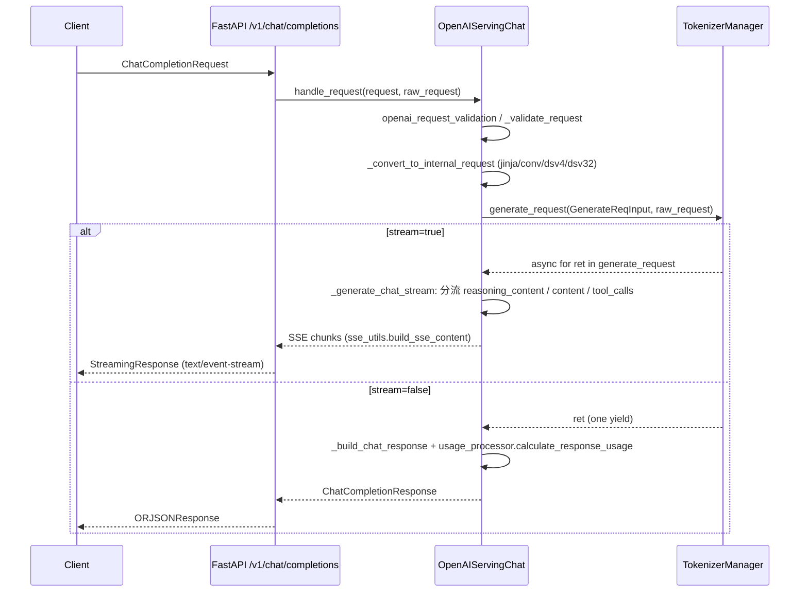

# 02.3.2 OpenAI chat/completions

## 定位

`OpenAIServingBase`（`serving_base.py:26`）是 SGLang 所有 OpenAI 兼容 handler 的抽象父类；`OpenAIServingChat` 与 `OpenAIServingCompletion` 分别对应 `/v1/chat/completions` 与 `/v1/completions`。它们把 pydantic 校验后的请求转换成 `GenerateReqInput`，调用 `tokenizer_manager.generate_request`，再把 ret 字典重组为 OpenAI 风格响应或 SSE 流帧。

## 职责

- `OpenAIServingBase`：
  - 持有 `tokenizer_manager`、`template_manager`、`model_name`、`request_id_prefix`。
  - `handle_request` 模板方法：`openai_request_validation` → `_validate_request` → `_convert_to_internal_request` → 发请求 → `_handle_streaming_request` 或 `_handle_non_streaming_request`。
  - 提取 `custom_labels` / `routing_key` / `routed_dp_rank` 给上游路由器和 metrics。
  - `create_error_response` / `create_streaming_error_response` 统一错误格式。
  - 子类必须实现的钩子：`_validate_request`、`_convert_to_internal_request`、`_handle_streaming_request`、`_handle_non_streaming_request`、`_request_id_prefix`、`_compute_extra_key`、`_generate_request_id_base`。
- `OpenAIServingCompletion`（`serving_completions.py:43`）：text completion 路径，支持 echo、`n`、`logprobs`、最佳 of 等。
- `OpenAIServingChat`（`serving_chat.py:160`）：chat completion 路径，支持多模态 content、reasoning_effort、tool calls、jinja/conv 两条 chat template 路径、`chat_template_kwargs`、流式 reasoning 与 tool call delta。

## 关键类与函数

| 名称 | 定义位置 | 说明 |
|---|---|---|
| `OpenAIServingBase` | `serving_base.py:26` | 抽象基类，提供 `handle_request` 模板方法 |
| `OpenAIServingBase.handle_request` | `serving_base.py:74` | 模板方法：校验→转换→分发到 stream/non-stream |
| `OpenAIServingBase._request_id_prefix` | `serving_base.py:136` | 子类 hook：rid 前缀（chat-、comp-、emb-、...） |
| `OpenAIServingBase.extract_custom_labels` | `serving_base.py:243` | 从 `x-custom-label-*` 头取自定义 metric label |
| `OpenAIServingBase.extract_routing_key` / `extract_routed_dp_rank_from_header` | `serving_base.py:272` / `:277` | 路由 key 与 dp rank 头解析 |
| `OpenAIServingCompletion` | `serving_completions.py:43` | text completion 实现 |
| `OpenAIServingCompletion._convert_to_internal_request` | `serving_completions.py:65` | 把 prompt + n + echo 转 `GenerateReqInput` |
| `OpenAIServingCompletion._build_sampling_params` | `serving_completions.py:139` | 把请求字段映射到内部 sampling params |
| `OpenAIServingChat` | `serving_chat.py:160` | chat completion 实现 |
| `OpenAIServingChat._convert_to_internal_request` | `serving_chat.py:535` | messages → prompt_ids / text → `GenerateReqInput` |
| `OpenAIServingChat._apply_jinja_template` | `serving_chat.py:724` | 走 HF jinja chat template 路径 |
| `OpenAIServingChat._apply_conversation_template` | `serving_chat.py:948` | 走 fastchat conv 路径 |
| `OpenAIServingChat._handle_streaming_request` | `serving_chat.py:1014` | 流式分支入口 |
| `OpenAIServingChat._generate_chat_stream` | `serving_chat.py:1042` | 构造 SSE 流：reasoning/text/tool_call delta |
| `OpenAIServingChat._handle_non_streaming_request` | `serving_chat.py:1281` | 非流式分支入口 |
| `OpenAIServingChat._build_chat_response` | `serving_chat.py:1306` | 构造 `ChatCompletionResponse` |
| `OpenAIServingChat._resolve_chat_encoding_spec` | `serving_chat.py:294` | 决定是否启用 dsv4/dsv32 编码（见 [02.3.7](02.3.7-openai-chat-encoding-sse-usage.md)） |
| `OpenAIServingChat._process_tool_calls` | `serving_chat.py:1524` | 把输出中的 tool_calls 字段标准化 |
| `ThinkingMode` | `serving_chat.py:13` | enum：`chat` / `thinking`，决定 harmony 的解析模式 |
| `is_gpt_oss` | `OpenAIServingChat` 属性 | 是否为 gpt-oss 家族，决定走 harmony 路径 |
| `OpenAIServingResponses` | `serving_responses.py:83` | 继承自 `OpenAIServingChat`，处理 `/v1/responses`（见 [02.3.5](02.3.5-openai-responses-harmony-tool.md)） |

## 子模块树

- `openai/serving_base.py` — 抽象基类（277 行）
- `openai/serving_completions.py` — text completion（约 600 行）
- `openai/serving_chat.py` — chat completion（2093 行，OpenAI 兼容最复杂 handler）

## 数据流 / 控制流

`_convert_to_internal_request` 的关键决策树：若 `is_gpt_oss`（harmony 模型）→ 走 harmony 编码路径（不调用 jinja）；否则按 `_resolve_chat_encoding_spec` 决定 dsv4/dsv32/None；None 时若 `chat_template` 非空走 jinja，否则走 fastchat conv。多模态 content 会被 `_encode_messages` 拆分为 token_ids 与 `image_data`/`audio_data`/`video_data` 数组（见 [`12.3 mm_utils`](../12-multimodal/12.3-mm-utils.md)）。

`reasoning_effort` 字段会从 `chat_template_kwargs` 中提取并升级到 `request.reasoning_effort`，避免 SGLang 私有字段在 jinja 渲染时被忽略。

## 错误与软校验

- `_validate_request` 子类 hook 在转内部请求前做语义层校验（如 `return_prompt_token_ids` 与 stream 互斥、`max_tokens` 超过 `max_model_len` 等），返回字符串则被 `create_error_response` 包成 `ErrorResponse`。
- `ErrorHandler`：`ValidationError` 在 FastAPI 自动转 422，handler 内的运行期错误通过 `ErrorResponse` 返回 400/500。

## 交叉引用

- 上游: [02.2.2 OpenAI 兼容](02.2.2-openai-compat.md)
- 下游: [`03.3 TokenizerManager`](../03-orchestration/03.3.1-tokenizer-manager.md)、[`03.2 io_struct`](../03-orchestration/03.2-io-struct.md) `GenerateReqInput`
- 同子系统: [02.3.1 protocol](02.3.1-openai-protocol.md)、[02.3.5 responses](02.3.5-openai-responses-harmony-tool.md)、[02.3.7 chat 编码/SSE/usage](02.3.7-openai-chat-encoding-sse-usage.md)
- 相关: [`11.6.2 conv template`](../11-sampling-control/11.6.2-parser-conversation-template.md)、[`11.7 function call`](../11-sampling-control/11.7.1-function-call-parser.md)、[`12 多模态`](../12-multimodal/index.md)

## 进一步阅读

- 源码: `python/sglang/srt/entrypoints/openai/serving_base.py`、`serving_completions.py`、`serving_chat.py`
