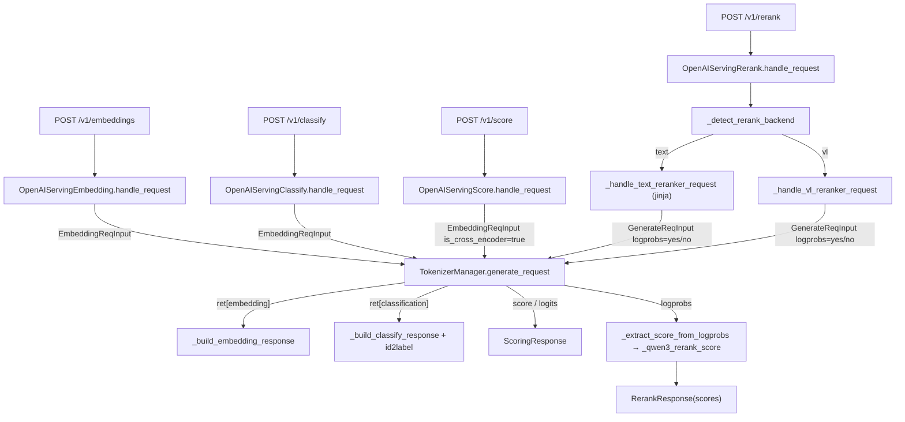

# 02.3.3 OpenAI embed/classify/score/rerank

## 定位

四个 OpenAI 兼容但语义不同的 handler：`OpenAIServingEmbedding`（`/v1/embeddings`）、`OpenAIServingClassify`（`/v1/classify`）、`OpenAIServingScore`（`/v1/score`）、`OpenAIServingRerank`（`/v1/rerank`）。它们共享 `OpenAIServingBase` 模板方法，但 `_convert_to_internal_request` 把请求转成 `EmbeddingReqInput`（embedding/classify/score）或 `GenerateReqInput`（rerank 走 logprobs 路径），对应不同的模型后端（embedding 模型/CausalLM/SequenceClassification/Reranker）。

## 职责

- Embedding：把字符串/字符串数组转 `EmbeddingReqInput`，调用 `tokenizer_manager.generate_request`，从 `ret["embedding"]`/`ret["pooled_hidden_states"]` 提取向量，组装 `EmbeddingResponse`。
- Classify：调用 SequenceClassification 模型，返回每个输入的类别概率/标签。`_get_id2label_mapping`（`serving_classify.py:111`）从 `model_config` 中读 `id2label` 映射。
- Score：给 query + items 计算分数。CausalLM 模式取 `label_token_ids` 的 logprob；SequenceClassification 模式直接读 `logits`。`OpenAIServingScore._handle_non_streaming_request` 通过 `EmbeddingReqInput(is_cross_encoder_request=True)` 走 score 内部路径，与 `Engine.score` 对齐。
- Rerank：对 (query, doc) pairs 排序。SGLang 支持两种 reranker 后端：text-reranker（如 Qwen3-Reranker）与 VL-reranker。`_detect_rerank_backend`（`serving_rerank.py:88`）通过 `chat_template`/`model_path` 自动判定。scores 通过 `_extract_score_from_logprobs`（`:535`）从 "yes"/"no" token 的 logprob 反推。

## 关键类与函数

| 名称 | 定义位置 | 说明 |
|---|---|---|
| `OpenAIServingEmbedding` | `python/sglang/srt/entrypoints/openai/serving_embedding.py:28` | embedding handler |
| `OpenAIServingEmbedding._convert_to_internal_request` | `serving_embedding.py:77` | 输入 → `EmbeddingReqInput` |
| `OpenAIServingEmbedding._apply_jinja_template_to_embedding_inputs` | `serving_embedding.py:178` | 对支持 chat template 的 embedding 模型用 jinja 包装输入 |
| `OpenAIServingEmbedding._build_embedding_response` | `serving_embedding.py:260` | 组装 `EmbeddingResponse` |
| `OpenAIServingClassify` | `python/sglang/srt/entrypoints/openai/serving_classify.py:28` | 分类 handler |
| `OpenAIServingClassify._get_id2label_mapping` | `serving_classify.py:111` | 解析 `model_config.id2label` |
| `OpenAIServingClassify._build_classify_response` | `serving_classify.py:151` | 组装 `ClassifyResponse` |
| `OpenAIServingScore` | `python/sglang/srt/entrypoints/openai/serving_score.py:19` | score handler，与 `Engine.score`/`EngineScoreMixin` 共享内部路径 |
| `OpenAIServingRerank` | `python/sglang/srt/entrypoints/openai/serving_rerank.py:205` | rerank handler |
| `OpenAIServingRerank._detect_rerank_backend` | `serving_rerank.py:88` | 自动判定 text / VL reranker 后端 |
| `OpenAIServingRerank._handle_text_reranker_request` | `serving_rerank.py:354` | text reranker：jinja render (Qwen3-Reranker style) |
| `OpenAIServingRerank._handle_vl_reranker_request` | `serving_rerank.py:398` | VL reranker：多模态 content 渲染 |
| `OpenAIServingRerank._extract_score_from_logprobs` | `serving_rerank.py:535` | 从 "yes"/"no" logprob 计算 score |
| `_get_yes_no_token_ids` | `serving_rerank.py:24` | 缓存式取 tokenizer 的 "yes"/"no" token id |
| `_qwen3_rerank_score` | `serving_rerank.py:114` | `p_yes / (p_yes + p_no)` 标准化 |
| `_qwen3_rerank_template` jinja 环境 | `serving_rerank.py:121 _get_jinja_env`/`:138 _render_jinja_chat_template` | 渲染 Reranker 专用 chat template |

## 子模块树

- `openai/serving_embedding.py` — embedding handler
- `openai/serving_classify.py` — classify handler
- `openai/serving_score.py` — score handler
- `openai/serving_rerank.py` — rerank handler（含 backend dispatch 与 jinja 渲染）

## 数据流 / 控制流

注意 score 与 classify 共用 `EmbeddingReqInput`：内部由 `is_cross_encoder_request=True` 触发 cross-encoder 模式（query+item 而非纯文本）。Rerank 走 `GenerateReqInput` 是因为需要逐 token 的 logprobs 来反推 yes/no 概率，与 text-completion 路径同构。

## Reranker 后端识别

Qwen3-Reranker 系列用专用 chat template（jinja），由 `_is_qwen3_reranker_template`/`_is_qwen3_vl_reranker_template` 通过 `"<|im_start|>"` 等关键字识别。VL reranker（如 Qwen3-VL-Reranker）则通过 `is_vlm` + `model_path` 关键字识别。识别失败时回退到通用 text-reranker 路径并 warning。`_get_yes_no_token_ids` 会缓存 tokenizer 的 "yes"/"no" token id（避免每次 rerank 都查询），用于 score 计算。

## 交叉引用

- 上游: [02.2.2 OpenAI 兼容](02.2.2-openai-compat.md)、[`01 Engine 客户端`](../01-frontend/01.7-engine-client.md)
- 下游: [`03.3 TokenizerManager`](../03-orchestration/03.3.1-tokenizer-manager.md)、[`03.3.6 TM ScoreMixin`](../03-orchestration/03.3.6-tm-score-mixin.md)
- 同子系统: [02.1 Engine](02.1-engine.md)（`Engine.score` 走同一条内部路径）、[02.3.1 protocol](02.3.1-openai-protocol.md)、[02.3.2 chat/completions](02.3.2-openai-base-chat-completions.md)
- 相关: [`05.5 模型实现模式`](../05-model-loading/05.5-model-pattern.md) Embedding/SequenceClassification/Reward 模型

## 进一步阅读

- 源码: `python/sglang/srt/entrypoints/openai/serving_embedding.py`、`serving_classify.py`、`serving_score.py`、`serving_rerank.py`
- 内部协议: `python/sglang/srt/managers/io_struct.py EmbeddingReqInput.is_cross_encoder_request`
