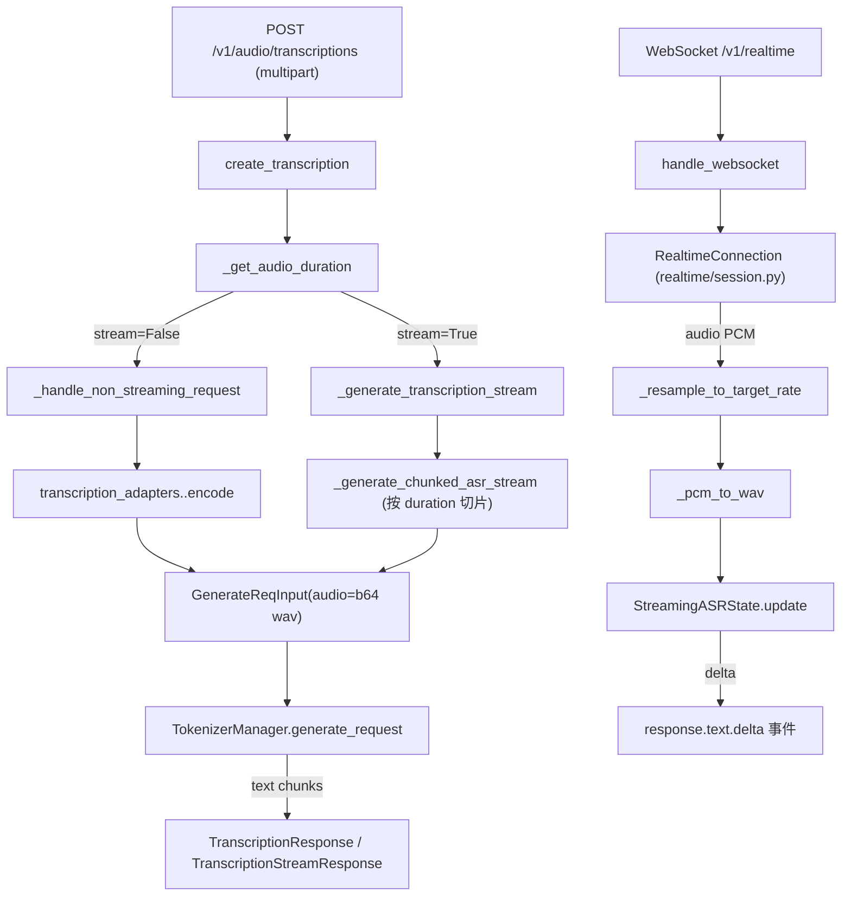

# 02.3.4 OpenAI tokenize / 转录 / 流式 ASR

## 定位

`OpenAIServingTokenize`/`OpenAIServingDetokenize` 暴露文本↔token 双向工具；`OpenAIServingTranscription` 提供 `/v1/audio/transcriptions`（文件上传单轮）与 `/v1/realtime`（WebSocket 流式）；`streaming_asr.py` 是流式 ASR 的前端状态机，负责"前缀已 commit、后续 chunk 增量"问题。下方 `transcription_adapters/` 是 ASR 模型适配层，每个 ASR 模型一种 adapter。

## 职责

- Tokenize：把文本（或 chat messages 经 `apply_chat_template`）转成 token_ids；`/v1/tokenize` 与 `/tokenize` 双路径。
- Detokenize：token_ids → text，复用 DetokenizerManager 的 vocab 与特殊 token 处理。
- Transcription：multipart/form-data 上传 audio file，可选 `stream=True` 走流式。非流式 → `_handle_non_streaming_request`（一次性 ASR）；流式 → `_generate_transcription_stream`（按音频分块多次 ASR）；ASR 内部仍是 `GenerateReqInput` 调 `tokenizer_manager.generate_request`，模型由 `whisper`/`qwen3_asr`/`mimo_v2_asr` adapter 选择。
- WebSocket Realtime：`handle_websocket`（`serving_transcription.py:459`）维护 `RealtimeConnection`，接 audio PCM 帧、做 resample、转 WAV、按 VAD/silence 切片送入模型，把转写增量通过 OpenAI Realtime 事件协议（`response.text.delta` 等）发回客户端。

## 关键类与函数

| 名称 | 定义位置 | 说明 |
|---|---|---|
| `OpenAIServingTokenize` | `python/sglang/srt/entrypoints/openai/serving_tokenize.py:20` | tokenize handler |
| `OpenAIServingTokenize._tokenize_chat_request` | `serving_tokenize.py:87` | 用 `tokenizer.apply_chat_template` 把 chat 转 token_ids |
| `OpenAIServingDetokenize` | `serving_tokenize.py:118` | detokenize handler |
| `OpenAIServingTranscription` | `python/sglang/srt/entrypoints/openai/serving_transcription.py:64` | 转录主类 |
| `OpenAIServingTranscription._get_audio_duration` | `serving_transcription.py:109` | 用 ffprobe/soundfile 估时长，决定分块策略 |
| `OpenAIServingTranscription.create_transcription` | `serving_transcription.py:120` | `/v1/audio/transcriptions` 主入口，分派 stream/non-stream |
| `OpenAIServingTranscription._generate_chunked_asr_stream` | `serving_transcription.py:372` | 分块流式 ASR |
| `OpenAIServingTranscription.handle_websocket` | `serving_transcription.py:459` | `/v1/realtime` WS 入口 |
| `StreamingASRState` | `python/sglang/srt/entrypoints/openai/streaming_asr.py:27` | 流式 ASR 状态机：维护已 commit 文本，新转录来时算出增量 delta |
| `StreamingASRState.update` | `streaming_asr.py:61` | 计算增量 delta 文本 |
| `StreamingASRState.finalize` | `streaming_asr.py:83` | 收尾，可能补一个残余 delta |

## 子模块树

- `openai/serving_tokenize.py` — tokenize + detokenize
- `openai/serving_transcription.py` — file upload + WS ASR
- `openai/streaming_asr.py` — 增量 delta 状态机
- `openai/transcription_adapters/`
  - `base.py` — adapter ABC
  - `whisper.py` — OpenAI Whisper family
  - `qwen3_asr.py` — Qwen3-Audio ASR
  - `mimo_v2_asr.py` — MiMo v2 ASR
- `openai/realtime/` — Realtime WebSocket 协议与 session，详见 [02.3.6](02.3.6-openai-realtime-ws.md)

## 数据流 / 控制流

`StreamingASRState` 的核心难点：每次模型重转录一个完整片段，但前半部分与已发送内容重合，需要"算最长公共前缀、把增量发送、前缀之后若 changed 还要发 `response.text.clear`+重写"。`update()` 用 `os.path.commonprefix` 找最长公共前缀，`_record_emit` 记录已 emit 文本；`finalize()` 处理"转录完成但保留态"。

## Tokenize 错误与边界

- `OpenAIServingTokenize._tokenize_chat_request` 只支持 chat 形态；非 chat 形态走 `tokenizer.encode(text, add_special_tokens=request.add_special_tokens)`。
- ASR 必须区分 `response_format`（json/text/verbose_json/srt/vtt），每种 format 调用不同 builder，包含的时间戳粒度由 `timestamp_granularities` 控制。
- whisper_autodetect warmup（见 [02.2.7](02.2.7-warmup-health.md)）预编译 xgrammar FSM，避免首请求 15–20s 编译延迟。

## 交叉引用

- 上游: [02.2.2 OpenAI 兼容](02.2.2-openai-compat.md)、`openai-whisper` / Qwen3-Audio SDK
- 下游: [`03.3 TokenizerManager`](../03-orchestration/03.3.1-tokenizer-manager.md) `GenerateReqInput.audio_data`
- 同子系统: [02.3.1 protocol](02.3.1-openai-protocol.md)、[02.3.6 realtime](02.3.6-openai-realtime-ws.md)、[02.2.7 warmup](02.2.7-warmup-health.md)
- 相关: [`12 多模态`](../12-multimodal/index.md)（音频作为多模态输入）、[`11.5 受限解码`](../11-sampling-control/11.5.1-constrained-base-registry.md)（ASR 用 xgrammar 限制输出格式）

## 进一步阅读

- 源码: `python/sglang/srt/entrypoints/openai/serving_tokenize.py`、`serving_transcription.py`、`streaming_asr.py`、`transcription_adapters/`
