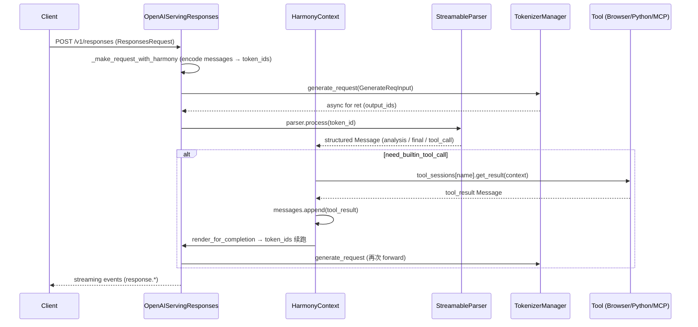

# 02.3.5 OpenAI responses (Harmony) + tool

## 定位

`/v1/responses` 是 OpenAI 新一代 Reasoning + Tool API（替代 `/v1/chat/completions` 用于 agentic 场景）。SGLang 在 `OpenAIServingResponses`（`serving_responses.py:83`）中实现，它直接继承自 `OpenAIServingChat`，但走 Harmony 编码路径（专为 gpt-oss 家族设计）。Harmony 是一种 tokens-as-actions 编码：assistant 输出由特殊 token 划分（`<|channel|analysis>` `<|channel|final>` `<|start|assistant|tool_call>` 等），由 `openai_harmony.StreamableParser` 流式解析。`context.py` 把这种对话状态封装成 `HarmonyContext`，`tool.py` 提供内置工具（浏览器/Python），`tool_server.py` 提供 MCP 工具桥。

## 职责

- `OpenAIServingResponses.create_responses`：把 `ResponsesRequest` 转换为 Harmony 消息序列，构造 `GenerateReqInput`，可选 background 模式（落盘后异步跑）。
- `responses_stream_generator`（`serving_responses.py:1293`）：流式生成器，按 harmony 解析事件产生 `response.output_item.added` / `response.output_item.done` / `response.completed` 等 OpenAI events。
- `responses_stream_generator_non_harmony`（`:1738`）：走标准 chat 路径的降级实现，给非 gpt-oss 模型用。
- `HarmonyContext`：在多轮 + tool 场景维护对话状态，每次 assistant 输出后 `append_output` 用 parser 把 token_ids 解析成结构化 Message；`need_builtin_tool_call` 判断是否需要触发内置工具；`call_tool` 执行后把结果回写到 messages。
- `StreamingHarmonyContext`：流式版本，支持增量解析（边产生 token 边打 message）。
- `Tool` 抽象 + `HarmonyBrowserTool`（Exa search）/`HarmonyPythonTool`（Python sandbox）：工具调用通过 `tool_config` 注入到 harmony system message。
- `ToolServer`（`tool_server.py:74`）+ 实现：MCP/Local/Remote Tool Server，把外部 MCP 工具纳入 harmony 工具命名空间。
- `harmony_utils.py`：构造 system/developer/user message、`get_streamable_parser_for_assistant`、token 渲染、stop tokens、output→Message 反向解析。

## 关键类与函数

| 名称 | 定义位置 | 说明 |
|---|---|---|
| `OpenAIServingResponses` | `python/sglang/srt/entrypoints/openai/serving_responses.py:83` | 继承 `OpenAIServingChat` |
| `OpenAIServingResponses.create_responses` | `serving_responses.py:180` | 主入口；分 harmony / non-harmony / background |
| `OpenAIServingResponses._make_request` | `serving_responses.py:460` | 内部请求构造 |
| `OpenAIServingResponses._make_request_with_harmony` | `serving_responses.py:495` | harmony 路径：用 `harmony_utils.get_system_message` + `encode_messages` |
| `OpenAIServingResponses.responses_full_generator` | `serving_responses.py:509` | 非流式聚合器（输出 + usage） |
| `OpenAIServingResponses.responses_stream_generator` | `serving_responses.py:1293` | harmony 流式生成器 |
| `OpenAIServingResponses.responses_stream_generator_non_harmony` | `serving_responses.py:1738` | non-harmony 流式回退 |
| `OpenAIServingResponses._run_background_request` | `serving_responses.py:1183` | background 模式执行器，结果落盘 |
| `OpenAIServingResponses.retrieve_responses` / `cancel_responses` | `serving_responses.py:1228` / `:1242` | 后台响应的查询/取消 |
| `HarmonyContext` | `python/sglang/srt/entrypoints/context.py:63` | harmony 对话状态 |
| `HarmonyContext.append_output` | `context.py:83` | 把 output_ids 喂 parser，更新 messages |
| `HarmonyContext.call_tool` | `context.py:119` | 分派到 `tool_sessions[name].get_result(context)` |
| `HarmonyContext.render_for_completion` | `context.py:135` | 把 messages 渲染回 token_ids 供下一次 forward |
| `StreamingHarmonyContext` | `context.py:175` | 流式版本 |
| `ConversationContext` / `SimpleContext` | `context.py:26` / `:45` | 抽象基类 + 简化实现 |
| `Tool` (ABC) | `python/sglang/srt/entrypoints/tool.py:22` | 内置工具抽象 |
| `HarmonyBrowserTool` | `tool.py:29` | Exa 搜索/取页内容工具 |
| `HarmonyPythonTool` | `tool.py:259` | Python sandbox 工具 |
| `ToolServer` (ABC) / `MCPToolServer` / `DemoToolServer` / `NativeToolServer` | `python/sglang/srt/entrypoints/openai/tool_server.py:74` / `:88` / `:145` / `:187` | 外部工具服务桥 |
| `harmony_utils.get_system_message` | `harmony_utils.py:64` | 构造 harmony system message |
| `harmony_utils.get_streamable_parser_for_assistant` | `harmony_utils.py:235` | 取 `openai_harmony.StreamableParser` |
| `harmony_utils.parse_output_into_messages` | `harmony_utils.py:385` | token_ids → Message list |
| `harmony_utils.render_for_completion` | `harmony_utils.py:223` | Message list → token_ids |

## 子模块树

- `openai/serving_responses.py` — `/v1/responses` 主 handler（2408 行）
- `entrypoints/context.py` — ConversationContext 抽象 + HarmonyContext/StreamingHarmonyContext
- `entrypoints/harmony_utils.py` — harmony 编码/解析助手
- `entrypoints/tool.py` — Tool ABC + Harmony*Tool 内置实现
- `entrypoints/openai/tool_server.py` — ToolServer ABC + MCP/Local/Native 实现
- `entrypoints/search/exa_client.py` — Exa Search HTTP 客户端

## 数据流 / 控制流

Harmony key insight：每个 assistant 输出 token先送进 `StreamableParser`，parser 在遇到 `<|channel|final>` 等切换 token时把已累积内容闭包成 Message。`StreamingHarmonyContext` 进一步支持"还没收完就先吐部分 delta"，是流式 `response.text.delta` / `response.function_call_arguments.delta` 事件的来源。

工具调用循环：harmony 模式下 assistant 输出 `<|channel|analysis>...<|channel|tool_call>{json}<|end|assistant|tool_call>` 时，parser 标记为 tool_call message，`need_builtin_tool_call` 返回 True，`call_tool` 找到对应 `tool_sessions[name]` 调用工具，结果以 `<|start|tool|...><|message|>` 形式 append 到 messages，重新 `render_for_completion` → 继续生成。这跟 OpenAI Responses API 的 "function_call → function_call_output → 继续" 语义一致。

## Background 模式

`ResponsesRequest.background == True` 时，`create_responses` 同步返回 `{id, status:"queued"}`；后台任务通过 `_run_background_request` 执行，结果序列化到内存字典（按 `response_id` 索引），客户端拿到 id 后用 `GET /v1/responses/{id}` 取回，未完成则返回进行中状态；可通过 `POST /v1/responses/{id}/cancel` 取消（实际是 abort 内部 rid）。

## 工具：内置 vs MCP

- 内置工具（`entrypoints/tool.py`）：`HarmonyBrowserTool` 通过 `exa_client.ExaClient` 调 Exa search API；`HarmonyPythonTool` 调本地 Python sandbox（demo 用）。
- 外部工具（`entrypoints/openai/tool_server.py`）：`ToolServer` ABC 中 `list_server_and_tools` 通过 MCP SSE 拉远端工具列表，`get_tool_description`/`get_tool_session` 分别取 schema 与 per-call session；`trim_schema` 调整 JSON schema 以符合 harmony 命名。
- `NativeToolServer`（`:187`）继承 `DemoToolServer`，是 SGLang 默认 Python-side tool server 实现。

## 交叉引用

- 上游: [02.2.2 OpenAI 兼容](02.2.2-openai-compat.md)、gpt-oss SDK
- 下游: [`03.3 TokenizerManager`](../03-orchestration/03.3.1-tokenizer-manager.md)、`openai_harmony` 库
- 同子系统: [02.3.1 protocol](02.3.1-openai-protocol.md)、[02.3.2 chat/completions](02.3.2-openai-base-chat-completions.md)、[02.7 入口辅助](02.7-entrypoint-aux.md)
- 相关: [`11.6.3 parser harmony`](../11-sampling-control/11.6.3-parser-harmony.md)、[`11.7 function call`](../11-sampling-control/11.7.1-function-call-parser.md)

## 进一步阅读

- 源码: `python/sglang/srt/entrypoints/openai/serving_responses.py`、`entrypoints/context.py`、`harmony_utils.py`、`tool.py`、`openai/tool_server.py`、`search/exa_client.py`
- 协议: OpenAI Responses API 文档、openai-harmony GitHub 仓库
