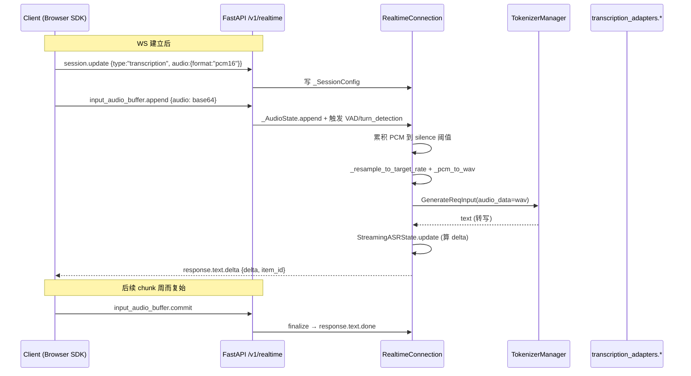

# 02.3.6 OpenAI realtime WebSocket

## 定位

OpenAI Realtime API 是为低延迟双向语音/文本对话设计的 WebSocket 接口。SGLang 在 `/v1/realtime` 上实现 Transcription 子集（chat 模式由 `Literal["transcription"]` 强校验拒绝，需要客户端走 `ResponsesRequest`）。三件套 `realtime/protocol.py`（事件模型）、`realtime/session.py`（连接状态机）、`realtime/handler.py`（FastAPI WebSocket 入口）共同实现"客户端音频流 → ASR 转写 → 实时事件"链路。

## 职责

- `protocol.py`：定义 Realtime events（`SessionUpdateEvent`、`ConversationItemCreate`、`ResponseCreateEvent`、`TranscriptionSessionConfig`、`TranscriptionSessionConfig` 等）与音频 MIME 别名（`AudioPCM`/`AudioPCMU`/`AudioPCMA`，`protocol.py:38-47`）。
- `session.py`：`RealtimeConnection`（`session.py:167`）维护会话状态：`_SessionConfig`（输入格式/turn_detection/timeout 等）、`_AudioState`（已收/已处理的累计 PCM）、`_ItemState`（item 队列）。负责客户端事件分发、ASR 任务调度、SSE-like 实时事件发生。
- `handler.py`：HTTP/WebSocket 入口，`handle_realtime_transcription`（`handler.py:64`）— 接收 WS、`_reject_before_session` 拒绝未授权连接、`_safe_send`/`_safe_close` 容错发送。

## 关键类与函数

| 名称 | 定义位置 | 说明 |
|---|---|---|
| `_SessionConfig` | `python/sglang/srt/entrypoints/openai/realtime/session.py:127` | 会话配置：音频 input/output format、turn detection、timeout 等 |
| `_AudioState` | `session.py:141` | 累积收到的 PCM、采样率、活动 item 引用 |
| `_ItemState` | `session.py:156` | 单个对话 item 状态 |
| `RealtimeConnection` | `session.py:167` | 主连接类，处理 WS 协议 |
| `RealtimeConnection.handle_event` | session.py 中 | 客户端事件分发：session.update → 写 _SessionConfig；input_audio_buffer.append → 累积；response.create → 触发 ASR |
| `_resample_to_target_rate` | `session.py:86` | 客户端采样率（24kHz pcm16）→ ASR 模型目标采样率（如 16kHz） |
| `_pcm_to_wav` | `session.py:102` | 把 PCM bytes 包成完整 WAV（含 header） |
| `_parse_client_event` | `session.py:117` | 把 raw JSON 解析为对应 Realtime 事件 pydantic 模型 |
| `AudioPCM`/`AudioPCMU`/`AudioPCMA`/`AudioTranscription` | `protocol.py:38`-57 | 音频格式别名与 input config 模型 |
| `TranscriptionSessionConfig` | `protocol.py:73` | `type: Literal["transcription"]` 强校验，chat 模式 session.update 会被拒 |
| `SessionUpdateEvent` | `protocol.py:77` | session.update 事件，session 字段是 union |
| `handle_realtime_transcription` | `python/sglang/srt/entrypoints/openai/realtime/handler.py:64` | `/v1/realtime` WS 入口 |
| `_safe_send` / `_safe_close` / `_reject_before_session` | `handler.py:26` / `:33` / `:40` | WS 容错辅助 |

## 子模块树

- `openai/realtime/__init__.py`
- `openai/realtime/protocol.py` — 事件与音频格式 pydantic 模型
- `openai/realtime/session.py` — `RealtimeConnection` 与音频工具（740 行）
- `openai/realtime/handler.py` — WS 入口（119 行）

## 数据流 / 控制流

关键点：

1. WS 一上来要先 `session.update`，否则所有事件都会被 `_reject_before_session` 拒绝并 close。
2. 音频 arrive 时按 chunk 累积，由 `_SessionConfig.turn_detection` 决定切片策略（`server_vad` / `none`）。切片完成后构造一次 ASR 请求。
3. ASR 转写结果通过 `StreamingASRState`（[02.3.4](02.3.4-openai-tokenize-transcription-asr.md)）算出增量 delta，发送 `response.text.delta` 事件；多个 chunk 的 delta 拼接即完整转写。`response.text.done` 在 commit 或 silence 时发。
4. chat 模式（`type:"session"` 而非 "transcription"）会触发 `Literal["transcription"]` 校验失败，由协议层拒绝——SGLang 当前只接 transcription，chat 模式仍走 HTTP `/v1/responses`。

## 错误处理

`handler.py` 全程用 `_safe_send` 与 `_safe_close`：任何异常都会先发 `{"type":"error","error":{"type":"server_error",...}}` 再优雅 close，避免 client 看到突然断开无错误。`_reject_before_session` 处理 "事件在 session.update 之前到达" 的情况，发 `invalid_request_error` 后 close。

## 交叉引用

- 上游: [02.2.2 OpenAI 兼容](02.2.2-openai-compat.md)、openai-realtime SDK
- 下游: [`03.3 TokenizerManager`](../03-orchestration/03.3.1-tokenizer-manager.md)、`streaming_asr.StreamingASRState`
- 同子系统: [02.3.4 tokenize/ASR](02.3.4-openai-tokenize-transcription-asr.md)、[02.3.1 protocol](02.3.1-openai-protocol.md)
- 相关: [`12 多模态`](../12-multimodal/index.md)（音频路径共享）

## 进一步阅读

- 源码: `python/sglang/srt/entrypoints/openai/realtime/`
- 端口: `python/sglang/srt/entrypoints/http_server.py:1760 openai_v1_realtime_transcription`
