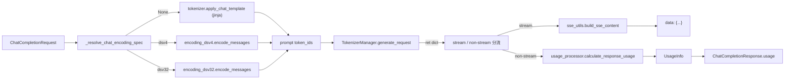

# 02.3.7 OpenAI chat 编码 / SSE / usage

## 定位

这一页归纳 chat completion/responses 路径下的三件"基础设施"：编码（把 messages + tools 编成 prompt token_ids）、SSE（按 OpenAI 流式协议打出 chunk）、usage（把 GPU 返回的 token 计数重新汇总成 `UsageInfo`）。它们散布在 `chat_encoding.py`/`encoding_dsv4.py`/`encoding_dsv32.py`/`sse_utils.py`/`usage_processor.py` 中，是 [02.3.2 chat/completions](02.3.2-openai-base-chat-completions.md) 与 [02.3.5 responses](02.3.5-openai-responses-harmony-tool.md) 的公共地基。

## 职责

- `chat_encoding.py`：`resolve_chat_encoding_spec`（`:13`）按 `tool_call_parser` + `hf_config.architectures` + 是否有 `chat_template` 决定使用 `dsv4` / `dsv32` / None。`encode_simple_chat`（`:40`）是离线工具（benchmark/eval）的简化入口，复用 dsv4/dsv32 编码但去掉 tools/multimodal。
- `encoding_dsv4.py`：DeepSeek V4 风格 harmony 编码。`encode_messages`（`:579`，主入口，文件 854 行）把 messages + tools 渲染为字符串（带 `<|channel|...>` `<|start|assistant|...>` 等 special token），`render_message`（`:247`）渲染单条消息，`parse_message_from_completion_text`（`:781`）把模型产生的字符串反向解析成 OpenAI Message（含 `reasoning_content`、`tool_calls`）。
- `encoding_dsv32.py`：DeepSeek V3 风格编码（早期版本，471 行）。`encode_messages`（`:317`）入口，与 dsv4 接口对齐但细节不同。
- `sse_utils.py`：用 msgspec（不是 pydantic）定义 `StreamDelta`/`StreamChoice`/`StreamChunk`（`:13`/`:28`/`:38`），`build_sse_content`（`:52`）拼装 `data: {json}\n\n` 帧。msgspec 选型原因见 [02.3.1 protocol](02.3.1-openai-protocol.md) 中关于 `reasoning_content` 字段的说明。
- `usage_processor.py`：`UsageProcessor`（`:9`）stateless 工具类，`calculate_response_usage`（`:18`）从 ret 列表 + n_choices 算 `prompt_tokens`/`completion_tokens`/`reasoning_tokens`/`cached_tokens`，处理 image/audio/video token 计数。

## 关键类与函数

| 名称 | 定义位置 | 说明 |
|---|---|---|
| `resolve_chat_encoding_spec` | `python/sglang/srt/entrypoints/openai/chat_encoding.py:13` | 返回 `"dsv4"`/`"dsv32"`/None |
| `encode_simple_chat` | `chat_encoding.py:40` | 离线简化编码入口 |
| `encode_messages` (dsv4) | `encoding_dsv4.py:579` | dsv4 主编码器 |
| `render_message` (dsv4) | `encoding_dsv4.py:247` | 渲染单条 message |
| `parse_message_from_completion_text` (dsv4) | `encoding_dsv4.py:781` | completion text → OpenAI message dict |
| `parse_tool_calls` (dsv4) | `encoding_dsv4.py:706` | 解析 tool_calls |
| `merge_tool_messages` (dsv4) | `encoding_dsv4.py:458` | 合并 tool / tool_result 序列 |
| `sort_tool_results_by_call_order` (dsv4) | `encoding_dsv4.py:528` | 按调用顺序排序 tool 结果 |
| `tools_from_openai_format` / `tool_calls_to_openai_format` (dsv4) | `encoding_dsv4.py:109` / `:125` | tools JSON ↔ dsv4 内部表示 |
| `encode_arguments_to_dsml` / `decode_dsml_to_arguments` (dsv4) | `encoding_dsv4.py:139` / `:173` | DSML（deepseek markup language）工具参数编解码 |
| `encode_messages` (dsv32) | `encoding_dsv32.py:317` | dsv32 主编码器 |
| `parse_message_from_completion_text` (dsv32) | `encoding_dsv32.py:421` | dsv32 反向解析 |
| `DS32EncodingError` | `encoding_dsv32.py:8` | dsv32 编码异常 |
| `StreamDelta` / `StreamChoice` / `StreamChunk` | `python/sglang/srt/entrypoints/openai/sse_utils.py:13` / `:28` / `:38` | msgspec SSE 结构 |
| `build_sse_content` | `sse_utils.py:52` | 拼装 SSE 帧 |
| `UsageProcessor` | `python/sglang/srt/entrypoints/openai/usage_processor.py:9` | usage 计算工具 |
| `UsageProcessor.calculate_response_usage` | `usage_processor.py:18` | 主计算方法 |
| `UsageProcessor._details_if_cached` | `usage_processor.py:13` | 仅当 cached_tokens>0 时填 details，避免 JSON 膨胀 |

## 子模块树

- `openai/chat_encoding.py` — 编码 spec 决议 + 离线简化编码（81 行）
- `openai/encoding_dsv4.py` — DeepSeek V4 harmony 编码（854 行）
- `openai/encoding_dsv32.py` — DeepSeek V3 编码（471 行）
- `openai/sse_utils.py` — SSE chunk 构造（99 行）
- `openai/usage_processor.py` — UsageInfo 计算（126 行）

## 数据流 / 控制流



`resolve_chat_encoding_spec` 决策表：

| 条件 | spec |
|---|---|
| `tool_call_parser == "deepseekv4"` | `dsv4` |
| `tool_call_parser == "deepseekv32"` | `dsv32` |
| `architectures[0]` 含 `"DeepseekV4"` | `dsv4` |
| `architectures[0]` 含 `"DeepseekV3"` 且无 `chat_template` | `dsv32` |
| 其他 | `None`（jinja 路径） |

dsv4 编码与 [02.3.5 harmony](02.3.5-openai-responses-harmony-tool.md) 差异：dsv4 是把 messages + tools 编码成"harmony 文本"，由 tokenizer 编码成 token_ids 后送进模型；harmony 解析侧（`harmony_utils.py` + `openai_harmony.StreamableParser`）负责把输出解码回结构化 Message。两条路径互补：encoding 进、parsing 出。

## SSE 帧格式

`build_sse_content(chunk_id, created, model, choice, usage=None)` 返回：

```
data: {"id":"chatcmpl-...","object":"chat.completion.chunk","created":...,
       "model":"...","choices":[{"index":0,"delta":{"role":"assistant","content":"..."},
       "finish_reason":null}]}\n\n
```

末尾帧 `finish_reason` 非 null，可选 `usage`（仅当 `stream_options.include_usage=true`）；最后再追加 `data: [DONE]\n\n`。msgspec 编码比 pydantic 快 3-5x，对长流式响应显著降低 CPU 开销。

## Usage 计算

`calculate_response_usage` 接受 `responses: List[Dict]` + `n_choices`：`prompt_tokens` 只取每 n_choices 个的第一个（避免重复算 prompt），`completion_tokens` 累加所有 ret 的 `meta_info.completion_tokens`。`reasoning_tokens` 来自 `meta_info.reasoning_tokens`（由 thinking parser 标记）。`cached_tokens` 仅当 `enable_cache_report=True` 时填入 `prompt_tokens_details.cached_tokens`，避免在不支持 cache report 的部署里产生误导字段。多模态 token（image/audio/video）额外累加进 `prompt_tokens`。

## 交叉引用

- 上游: [02.3.2 chat/completions](02.3.2-openai-base-chat-completions.md)、[02.3.5 responses](02.3.5-openai-responses-harmony-tool.md)
- 同子系统: [02.3.1 protocol](02.3.1-openai-protocol.md)、[02.3.6 realtime](02.3.6-openai-realtime-ws.md)
- 相关: [`11.6.3 parser harmony`](../11-sampling-control/11.6.3-parser-harmony.md)、[`11.6.2 conv template`](../11-sampling-control/11.6.2-parser-conversation-template.md)、[`11.7.1 function call parser`](../11-sampling-control/11.7.1-function-call-parser.md)、[`17.4 request metrics`](../17-observability-ops/17.4-request-metrics-time-stats.md)

## 进一步阅读

- 源码: `python/sglang/srt/entrypoints/openai/chat_encoding.py`、`encoding_dsv4.py`、`encoding_dsv32.py`、`sse_utils.py`、`usage_processor.py`
