# 02.4 Anthropic / Ollama handlers

## 定位

[02.2.3 Anthropic 兼容](02.2.3-anthropic-compat.md) 与 [02.2.4 Ollama 兼容](02.2.4-ollama-compat.md) 描述了"路由在哪里"；这一页描述"路由背后的处理类如何实现"——即 `anthropic/serving.py` 的 `AnthropicServing` 与 `ollama/serving.py` 的 `OllamaServing`。两者都是薄翻译层：Anthropic 复用 `OpenAIServingChat` 的全部推理管线，Ollama 直接调 `tokenizer_manager.generate_request`。

## 职责

### AnthropicServing

- 持有 `openai_serving_chat: OpenAIServingChat` 引用，避免重新发明 stream/non-stream 逻辑。
- 协议字段翻译：Anthropic system block / messages content blocks（text/image/tool_use/tool_result/thinking）↔ OpenAI messages content parts。
- 工具翻译：Anthropic `tools` (custom_tool / web_search / computer / bash / text_editor) ↔ OpenAI tools schema；`tool_choice` 类型映射。
- 流式事件转换：OpenAI `chat.completion.chunk` → Anthropic event family（`message_start`/`content_block_start`/`content_block_delta`/`content_block_stop`/`message_delta`/`message_stop`/`ping`）。
- usage 翻译：OpenAI `UsageInfo` → Anthropic `AnthropicUsage`，特别要还原 `cache_creation_input_tokens`/`cache_read_input_tokens`（来自 `meta_info.cached_tokens` 等）。
- count_tokens：通过估算（jinja 渲染 + tokenizer 编码）返回 `input_tokens` 估算值，不真的跑推理。

### OllamaServing

- 持有 `tokenizer_manager`，自己做了最少的转换。
- chat：`messages` → `tokenizer.apply_chat_template` 得 `prompt_ids` → `GenerateReqInput(input_ids=prompt_ids, sampling_params=_convert_options_to_sampling_params(request.options), stream=...)`。
- generate：把 `prompt` 转 `GenerateReqInput(text=prompt, ...)`。
- tags/show：直接读 `tokenizer_manager.served_model_name` + `lora_registry`，不调推理。

## 关键类与函数

### AnthropicServing（`python/sglang/srt/entrypoints/anthropic/serving.py`）

| 名称 | 行号 | 说明 |
|---|---|---|
| `AnthropicServing` | `:184` | 主类，构造时接收 `OpenAIServingChat` |
| `AnthropicServing.handle_messages` | `:206` | `/v1/messages` 主入口 |
| `AnthropicServing._convert_to_chat_completion_request` | `:229` | Anthropic 请求 → OpenAI ChatCompletionRequest |
| `AnthropicServing._handle_non_streaming` | `:710` | 调 `openai_serving_chat.handle_request`，`_convert_response` 反向打包 |
| `AnthropicServing._handle_streaming` | `:764` | 调 `openai_serving_chat._generate_stream_content` |
| `AnthropicServing._generate_anthropic_stream` | `:813` | 把 OpenAI chunk 流转成 Anthropic SSE 事件流 |
| `AnthropicServing._convert_response` | `:1234` | OpenAI 非流式响应 → Anthropic response |
| `AnthropicServing._convert_openai_error_response` | `:1312` | 把 OpenAI 风格 ErrorResponse 转 Anthropic 风格 |
| `AnthropicServing._error_response` | `:1361` | 直接构造 Anthropic 错误响应 |
| `AnthropicServing.handle_count_tokens` | `:1391` | `/v1/messages/count_tokens` |
| `_anthropic_usage_from_openai` | `:110` | usage 字段映射 |
| `_cached_prompt_tokens` / `_anthropic_input_tokens` | `:88` / `:93` | cache token 处理 |
| `_extract_system_text` | `:136` | 把 Anthropic system blocks 拼成 OpenAI `system` 字符串 |
| `_wrap_sse_event` | `:156` | 把 dict 包成 Anthropic SSE 帧（`event: ...\ndata: ...\n\n`） |
| `_scrub_error_message` | `:161` | 4xx 与 5xx 错误信息脱敏策略 |

### OllamaServing（`python/sglang/srt/entrypoints/ollama/serving.py`）

| 名称 | 行号 | 说明 |
|---|---|---|
| `OllamaServing` | `:31` | 主类 |
| `OllamaServing.handle_chat` | `:68` | `/api/chat` 主入口 |
| `OllamaServing._generate_chat_response` | `:105` | 非流式 chat 响应，构造 `OllamaChatResponse` |
| `OllamaServing._stream_chat_response` | `:132` | NDJSON 流式 chat |
| `OllamaServing.handle_generate` | `:173` | `/api/generate` 主入口 |
| `OllamaServing._generate_generate_response` | `:223` | 非流式 generate |
| `OllamaServing._stream_generate_response` | `:249` | NDJSON 流式 generate |
| `OllamaServing._convert_options_to_sampling_params` | `:41` | Ollama `options` dict → SGLang sampling params |
| `OllamaServing.get_tags` | `:289` | `/api/tags`：base model + LoRA adapters |
| `OllamaServing.get_show` | `:310` | `/api/show`：构造最小 modelinfo |

## 子模块树

- `anthropic/__init__.py` / `anthropic/protocol.py` / `anthropic/serving.py`（约 1452 行）
- `ollama/__init__.py` / `ollama/protocol.py` / `ollama/serving.py`（约 349 行）/ `ollama/smart_router.py` / `ollama/README.md`

## 数据流 / 控制流

```mermaid
flowchart TD
    subgraph AN["AnthropicServing"]
        AM["POST /v1/messages"] --> AH["handle_messages"]
        AH --> CV["_convert_to_chat_completion_request"]
        CV --> CS["openai_serving_chat.handle_request"]
        CV --> CS2["openai_serving_chat._generate_stream_content"]
        CS --> CN["_convert_response"]
        CS2 --> GA["_generate_anthropic_stream"]
        CN --> R1["Anthropic JSON response"]
        GA --> R2["Anthropic SSE event stream"]
    end

    subgraph OL["OllamaServing"]
        OC["POST /api/chat"] --> OH["handle_chat"]
        OH --> ACT["tokenizer.apply_chat_template"]
        ACT --> GEN["GenerateReqInput"]
        GEN --> TM["tokenizer_manager.generate_request"]
        OG["POST /api/generate"] --> OGH["handle_generate"]
        OGH --> GEN
        TM --> RC["_generate_chat_response / _stream_chat_response"]
        TM --> RG["_generate_generate_response / _stream_generate_response"]
    end
```

`AnthropicServing._generate_anthropic_stream` 关键挑战：OpenAI chunk 的 `delta.content` 是字符串片段，对应 Anthropic `content_block_delta` 事件中的 `text_delta`；但 OpenAI 把 tool_call 拆成 `delta.tool_calls[].function.arguments` 片段，而 Anthropic 需要发出 `content_block_start` (tool_use) + `input_json_delta`，需要做匹配映射。`_handle_streaming` 就在做这件事，按 chunk 的 delta type 分流到 text/tool_use/thinking 三路。

`OllamaServing._convert_options_to_sampling_params` 把 Ollama 的 `options: {temperature, top_p, top_k, seed, num_predict, ...}` 翻译成 SGLang sampling params。`num_predict` → `max_new_tokens`，`seed` → `random_seed`，`stop` 列表 → `stop`。Ollama 协议没有 `n`、`logprobs` 等字段，所以 OllamaServing 用单条请求 + 在客户端层面展开。

## 错误协议差异

OpenAI 错误：`{"error":{"message":...,"type":...,"code":...}}`。
Anthropic 错误：`{"type":"error","error":{"type":"invalid_request_error","message":...}}`，外加 HTTP 状态码语义不同（429/500/529 overload 等）。`AnthropicServing._convert_openai_error_response`/`_error_response`/`_scrub_error_message` 共同保证 Anthropic 客户端 SDK 能正确解析错误类型并触发重试逻辑。
Ollama 错误：`{"error":"..."}`，NDJSON 流式时一个错误帧后断流。

## 交叉引用

- 上游: [02.2.3 Anthropic 兼容](02.2.3-anthropic-compat.md)、[02.2.4 Ollama 兼容](02.2.4-ollama-compat.md)
- 下游: [`03.3 TokenizerManager`](../03-orchestration/03.3.1-tokenizer-manager.md)、[02.3.2 chat/completions](02.3.2-openai-base-chat-completions.md)
- 同子系统: [02.3.1 protocol](02.3.1-openai-protocol.md)、[02.3.7 SSE](02.3.7-openai-chat-encoding-sse-usage.md)
- 相关: [`11.7 function call`](../11-sampling-control/11.7.1-function-call-parser.md)、[`13 LoRA`](../13-lora/index.md)（ollama tags 把 LoRA 当模型）

## 进一步阅读

- 源码: `python/sglang/srt/entrypoints/anthropic/serving.py`、`python/sglang/srt/entrypoints/ollama/serving.py`
