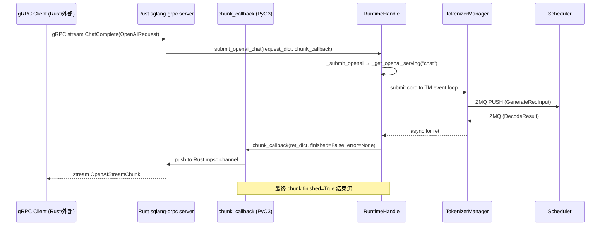

# 02.5 gRPC

## 定位

SGLang gRPC 是 Rust 服务端 + Python runtime bridge 的进程内/跨进程协议层。Rust 端（`rust/sglang-grpc/`）持 gRPC server、proto 生成代码与 PyO3 桥接；Python 端 `grpc_bridge.py` 提供 `RuntimeHandle` 把请求同步入口暴露给 Rust 调用，所有 async 工作仍在 `TokenizerManager` 的事件循环上执行。这层与 [18 模型网关](../18-gateway/index.md) 的进程内 Rust gRPC（[18.12](../18-gateway/18.12-in-process-rust-grpc.md)）同源，但本页聚焦 server-api 子系统内的协议/桥接实现。

## 职责

- proto 定义 `SglangService`（`proto/sglang/runtime/v1/sglang.proto:4`）：`TextGenerate`/`Generate`/`TextEmbed`/`Embed`/`Classify`/`Tokenize`/`Detokenize`/`HealthCheck`/`GetModelInfo`/`GetServerInfo`/`ListModels`/`GetLoad`/`Abort`/`FlushCache`/`PauseGeneration`/`ContinueGeneration` 等原生 RPC，以及 `ChatComplete`/`Complete`/`OpenAIEmbed`/`OpenAIClassify`/`Score`/`Rerank` 等 OpenAI 兼容 JSON 透传 RPC。
- `RuntimeHandle`（`grpc_bridge.py:55`）：Python 端入口，每个 method 接收 `chunk_callback`（Rust PyO3 对象），在 TM loop 上 submit coro，把每个 chunk 通过 callback 推回 Rust channel。
- `grpc_server.py:156 serve_grpc`：独立 gRPC 进程模式入口，从 `smg_grpc_servicer` 包加载 Rust 实现，起 sidecar aiohttp app 暴露 `/metrics` 与 admin 端点，直接在 Python 进程内调度 scheduler（不走 TokenizerManager.zmq 路径）。
- 权重/控制面 RPC 通过 communicator（如 NCCL）异步执行，结果以单帧 chunk 形式回传。
- OpenAI 兼容 RPC 走 JSON pass-through：Rust 不解析 JSON，只把 raw bytes 交给 Python 的 `OpenAIServing*` handler。

## 关键类与函数

| 名称 | 定义位置 | 说明 |
|---|---|---|
| `service SglangService` | `proto/sglang/runtime/v1/sglang.proto:4` | gRPC 服务定义 |
| `TextGenerateRequest/Response` | `proto:72` / `:89` | 单条文本生成请求/流式响应 |
| `GenerateRequest/Response` | `proto:97` / `:113` | 批量/通用生成请求/响应 |
| `EmbedRequest/Response`/`ClassifyRequest/Response`/`TokenizeRequest/Response`/`DetokenizeRequest/Response` | `proto:135`+ | 各原生 RPC 类型 |
| `AbortRequest/Response` | `proto:174` / `:179` | 取消请求 |
| `GetLoadRequest/Response` | `proto:237` / `:241` | 负载查询 |
| `OpenAIRequest/OpenAIResponse/OpenAIStreamChunk` | `proto` 中 | OpenAI JSON 透传载体 |
| `RuntimeHandle` | `python/sglang/srt/entrypoints/grpc_bridge.py:55` | Python ↔ Rust 主桥 |
| `RuntimeHandle.submit_request` | `grpc_bridge.py:262` | 通用请求提交入口 |
| `RuntimeHandle._submit_json_unary` | `grpc_bridge.py:197` | 单次 JSON 响应类（如 ListModels） |
| `RuntimeHandle._submit_openai` | `grpc_bridge.py:524` | OpenAI 兼容请求通用提交 |
| `RuntimeHandle.submit_openai_chat/complete/embed/classify/score/rerank` | `grpc_bridge.py:544`+ | OpenAI RPC 各自入口 |
| `RuntimeHandle.abort` | `grpc_bridge.py:343` | 取消请求 |
| `RuntimeHandle.get_model_info/server_info/health_check/tokenize/detokenize/list_models/get_load/flush_cache/pause_generation/continue_generation/start_profile/stop_profile/update_weights_from_disk` | `grpc_bridge.py:375`+ | 原生 RPC 入口 |
| `RuntimeHandle._get_openai_serving` | `grpc_bridge.py:226` | 懒加载 `OpenAIServing*` 实例（首次调用时构造） |
| `serve_grpc` | `python/sglang/srt/entrypoints/grpc_server.py:156` | 独立 gRPC server 进程入口 |
| `_add_metrics_routes` / `_add_admin_routes` | `grpc_server.py:40` / `:78` | sidecar aiohttp app 路由 |
| `_start_sidecar_server` | `grpc_server.py:26` | sidecar 启动 |
| Rust crate | `rust/sglang-grpc/` | Rust gRPC server 实现，详见 [18.12](../18-gateway/18.12-in-process-rust-grpc.md) |

## 子模块树

- `proto/sglang/runtime/v1/sglang.proto` — gRPC 契约
- `python/sglang/srt/entrypoints/grpc_bridge.py` — `RuntimeHandle` 与各类请求提交器（777 行）
- `python/sglang/srt/entrypoints/grpc_server.py` — 独立 gRPC server 进程入口（263 行）
- `rust/sglang-grpc/` — Rust 服务端 + PyO3 桥接（详见 [18.12](../18-gateway/18.12-in-process-rust-grpc.md)）
  - `src/lib.rs` / `src/bridge.rs` / `src/server.rs` / `src/tokenizers.rs` / `src/bridge/` / `src/server/` / `src/utils/`

## 数据流 / 控制流

关键点：

1. Rust 端拿到 gRPC 请求后，通过 PyO3 持有 Python GIL 极短时间——仅够调用 `RuntimeHandle.submit_*` 同步方法。`submit_*` 会把 coro `submit` 到 TM 自己的事件循环上（不阻塞 Rust）。
2. 每个响应 chunk 通过 `chunk_callback(dict, finished=bool, error=str|None)` 回调。Rust 端把 dict 序列化为 proto 响应字段（或 JSON bytes for OpenAI 类型），推到 mpsc channel，由 gRPC 流任务读出后返回给 client。
3. `_BACKPRESSURE_TIMEOUT_S = 300` 秒：若 client 慢消费导致 Rust channel 满，`_safe_callback` 会等待最多 300s 才放弃；避免慢客户端把 server 拖死。
4. `_install_on_ready`/`_uninstall_on_ready` 用于"权重未加载完成时把 chunk 排队"，等 weights ready 再 flush 给客户端，避免启动期 gRPC 请求失败。

## 独立 gRPC 模式（serve_grpc）

`serve_grpc`（`grpc_server.py:156`）入口适用 `--grpc-port` 模式：不要 HTTP server，直接在 Python 进程内起 Rust gRPC server；同时把 `metrics`/`admin` 路由挂在 sidecar aiohttp app（端口默认 `port+1`）。Scheduler 进程由 `smg-grpc-servicer` 包的 `request_manager` 直接持有（不经过 ZMQ），通信路径更短。`_on_request_manager_ready` 钩子启动 sidecar。

## 交叉引用

- 上游: [`18 模型网关`](../18-gateway/index.md) — Rust 网关作为 gRPC client
- 下游: [`03.3 TokenizerManager`](../03-orchestration/03.3.1-tokenizer-manager.md)、[`03.4 Scheduler`](../03-orchestration/03.4.1-scheduler-structure.md)
- 同子系统: [02.1 Engine](02.1-engine.md)、[02.2.1 原生 API](02.2.1-native-api.md)、[02.2.2 OpenAI 兼容](02.2.2-openai-compat.md)、[02.6 Connector](02.6-connector.md)
- 相关: [18.12 进程内 Rust gRPC](../18-gateway/18.12-in-process-rust-grpc.md)、[`16.1 ServerArgs`](../16-config-runtime/16.1-server-args-port-args.md) `--grpc-port`

## 进一步阅读

- 源码: `python/sglang/srt/entrypoints/grpc_bridge.py`、`grpc_server.py`
- proto: `proto/sglang/runtime/v1/sglang.proto`
- Rust 实现: `rust/sglang-grpc/`（详见 [18.12](../18-gateway/18.12-in-process-rust-grpc.md)）
- 独立包: pip 安装 `smg-grpc-servicer[sglang]`
