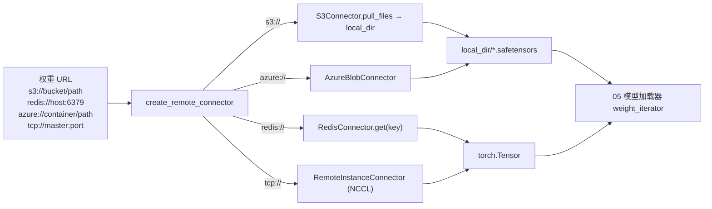

# 02.6 Connector

## 定位

`python/sglang/srt/connector/` 提供权重远程加载与跨实例权重同步的统一抽象。它把"从哪里取权重/张量"与"内核如何使用张量"解耦：模型加载器只需一个 `BaseConnector` 实例，就能透明地从本地盘、S3、Azure Blob、Redis 或另一台 GPU 实例（NCCL 直传）拉到权重或单张 tensor。这层与 [02.1 Engine](02.1-engine.md) 的 `update_weights_from_*` API 紧密绑定。

## 职责

- 抽象 `BaseConnector`：定义 `weight_iterator(rank) -> (name, Tensor)` 与 `pull_files(allow_pattern, ignore_pattern)`，并在 `__init__` 时建立本地缓存目录 `local_dir`；信号处理确保进程被 kill 时清理 `local_dir`。
- `BaseKVConnector`：在 `BaseConnector` 之上加 `get(key) -> Optional[Tensor]`/`put(key, tensor)`，给 Redis 等按 key 寻址的 KV 后端用。
- `BaseFileConnector`：以"文件集合"为单位的抽象，给 S3/Azure 用；`pull_files` 列出/下载到 `local_dir`。
- `RedisConnector`（`redis.py:16`）：基于 Redis 的 KV 存取，序列化用 `serde/`。
- `S3Connector`（`s3.py:69`）/`AzureBlobConnector`（`azure.py:66`）：文件级后端，按 `allow_pattern`/`ignore_pattern` 过滤拉取。
- `RemoteInstanceConnector`（`remote_instance.py:16`）：跨 GPU 实例权重广播，底层是 `init_custom_process_group`（NCCL）；`build_group` 协商 master address/port/group_name。
- serde：`Serializer`/`Deserializer` ABC + `SafeSerializer`/`SafeDeserializer`（基于 pickle + torch 安全保存）。
- 工厂入口：`create_remote_connector(url, device, **kwargs)`（`__init__.py:36`）按 URL scheme（`s3://`/`redis://`/`azure://`/`http://`/tcp）分发到具体实现。

## 关键类与函数

| 名称 | 定义位置 | 说明 |
|---|---|---|
| `BaseConnector` | `python/sglang/srt/connector/base_connector.py:13` | 抽象基类 |
| `BaseConnector.weight_iterator` / `pull_files` | `base_connector.py` | 子类实现 |
| `BaseConnector.close` / `_close_by_signal` | `base_connector.py` | 资源清理与信号退出 |
| `BaseKVConnector` | `base_connector.py:75` | KV 后端抽象：`get`/`put` |
| `BaseFileConnector` | `base_connector.py:98` | 文件后端抽象 |
| `RedisConnector` | `python/sglang/srt/connector/redis.py:16` | Redis 实现 |
| `S3Connector` | `python/sglang/srt/connector/s3.py:69` | AWS S3 实现 |
| `_filter_allow` / `_filter_ignore` | `s3.py:13` / `:21`（azure.py 同） | 通配符过滤辅助 |
| `list_files` (s3/azure) | `s3.py:29` / `azure.py:34` | 列举远程文件 |
| `AzureBlobConnector` | `python/sglang/srt/connector/azure.py:66` | Azure Blob 实现 |
| `_normalize_url` (azure) | `azure.py:29` | Azure URL 规范化 |
| `RemoteInstanceConnector` | `python/sglang/srt/connector/remote_instance.py:16` | NCCL 跨实例权重广播 |
| `RemoteInstanceConnector.build_group` | `remote_instance.py` (类内) | 协商 NCCL process group |
| `ConnectorType` | `python/sglang/srt/connector/__init__.py:19` | enum: KV / FILE 等 |
| `_is_azure_blob_url` | `__init__.py:25` | URL 类型探测 |
| `create_remote_connector` | `__init__.py:36` | URL-based 工厂 |
| `get_connector_type` | `__init__.py:54` | 给定已构造的 client 返回其类型 |
| `Serializer` / `Deserializer` | `python/sglang/srt/connector/serde/serde.py:9` / `:27` | serde ABC |
| `SafeSerializer` / `SafeDeserializer` | `python/sglang/srt/connector/serde/safe_serde.py:11` / `:20` | pickle + torch.save 实现 |

## 子模块树

- `connector/__init__.py` — 工厂与 `ConnectorType` enum
- `connector/base_connector.py` — 三个抽象基类
- `connector/redis.py` — RedisConnector（KV）
- `connector/s3.py` — S3Connector（File）
- `connector/azure.py` — AzureBlobConnector（File）
- `connector/remote_instance.py` — RemoteInstanceConnector（NCCL）
- `connector/utils.py` — 共享工具
- `connector/serde/`
  - `serde.py` — Serializer/Deserializer ABC
  - `safe_serde.py` — pickle-based 安全实现

## 数据流 / 控制流

`weight_iterator(rank)` 是被 `model_loader` 调用的主入口：从 connector 拉 `(name, tensor)` 序列，写入 model 各 param。`pull_files` 是非张量文件的入口：如 `.json` config、`tokenizer.json` 等。`RemoteInstanceConnector` 略特殊：它不发 request 拉，而是预先 `build_group` 协商 NCCL 组，然后通过 `dist.broadcast` 直接 GPU→GPU 拷贝；配合 [02.2.1 原生 API](02.2.1-native-api.md) 的 `/init_weights_send_group_for_remote_instance` + `/send_weights_to_remote_instance` + `/get_remote_instance_transfer_engine_info` 使用。

## 安全 serde

`SafeSerializer` 用 torch.save + pickle 包装：把 tensor 的 data/shape/dtype 等先转成可 pickle 字典，再写 bytes；`SafeDeserializer` 反过来。Redis 把 bytes 当 value 存。对 device tensor，serializer 负责先 `cpu()`、deserializer 在接收端按需 `.to(device)`。

## 交叉引用

- 上游: [02.2.1 原生 API](02.2.1-native-api.md) RemoteInstance 端点群
- 下游: [`05.3 weight_utils`](../05-model-loading/05.3-weight-utils.md)、[`05.1 加载器分发`](../05-model-loading/05.1-loader-dispatch.md)
- 同子系统: [02.1 Engine](02.1-engine.md) `update_weights_from_distributed`/`from_ipc`/`from_tensor`
- 相关: [`08.5 comm ops`](../08-distributed/08.5-comm-ops.md) `init_custom_process_group`/NCCL、[`14.4 checkpoint engine`](../14-session-state/14.4-checkpoint-engine.md)、[`09 分离式`](../09-disaggregation/index.md)（PD 跨实例 KV 传输也复用 connector 抽象思路）

## 进一步阅读

- 源码: `python/sglang/srt/connector/`
- 调用方: `python/sglang/srt/model_loader/` 与 `python/sglang/srt/entrypoints/http_server.py:1190+`（RemoteInstance 端点族）
