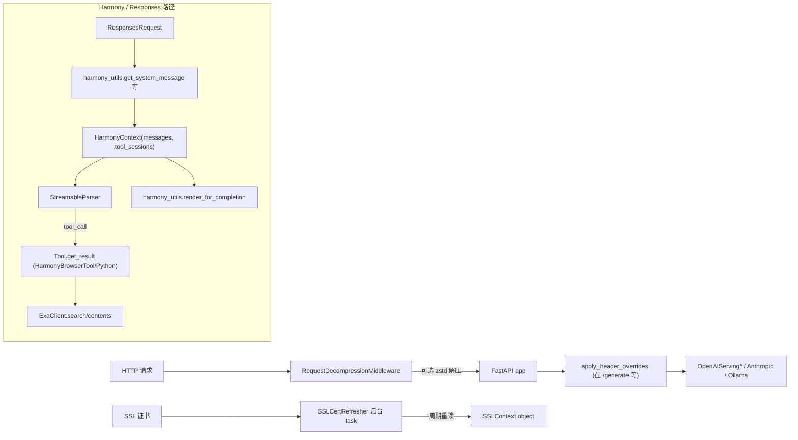

# 02.7 入口辅助模块

## 定位

`python/sglang/srt/entrypoints/` 下还有一组支持性模块，被多个协议端点共享：harmony 工具/上下文（`context.py`/`harmony_utils.py`/`tool.py`）、Exa 搜索客户端（`search/exa_client.py`）、请求头覆盖（`request_headers.py`）、HTTP 请求解压（`http_request_decompression.py`）、SSL 证书刷新（`ssl_utils.py`）。本页对它们做集中介绍；与 [02.3.5 responses/harmony](02.3.5-openai-responses-harmony-tool.md) 重叠的部分这里只复述定位与协作关系。

## 职责

- `context.py`：抽象 `ConversationContext` 与实现 `SimpleContext`/`HarmonyContext`/`StreamingHarmonyContext`，把多轮对话 + tool 调用状态封装为对象，给 `/v1/responses` 用。
- `harmony_utils.py`：纯函数集合，构造 harmony Message（system/developer/user）、解析 `response.input`、把输出 token_ids 反向 parse 成 Message、render 消息序列为 token_ids；与 `openai_harmony.StreamableParser` 协作。
- `tool.py`：Tool ABC + `HarmonyBrowserTool`（Exa 检索）+ `HarmonyPythonTool`（Python sandbox）。
- `search/exa_client.py`：异步 Exa Search 客户端，支持 `/search` 与 `/contents`，按 msgspec 配置（`ExaSearchConfig`）。
- `request_headers.py`：通过 `x-override-*` 头覆盖请求字段（rid/priority/bootstrap 等），让网关无需 re-serialize 请求体。
- `http_request_decompression.py`：FastAPI/Starlette middleware，自动解 zstd 请求体并改写 `Content-Length`。
- `ssl_utils.py`：`SSLCertRefresher` 后台 watcher，定期重读证书文件并替换 SSLContext（适配 cert-manager / kubelet 旋转的部署）。

## 关键类与函数

| 名称 | 定义位置 | 说明 |
|---|---|---|
| `ConversationContext` | `python/sglang/srt/entrypoints/context.py:26` | 抽象基类：`append_output`/`call_tool`/`need_builtin_tool_call`/`render_for_completion` |
| `SimpleContext` | `context.py:45` | 简化实现，无工具调用 |
| `HarmonyContext` | `context.py:63` | harmony 多轮状态，持 `parser: StreamableParser` |
| `HarmonyContext.call_tool` | `context.py:119` | 分派到 `tool_sessions[name].get_result(context)` |
| `HarmonyContext.call_search_tool` / `call_python_tool` | `context.py:138` / `:151` | 内置工具分派 |
| `HarmonyContext.render_for_completion` | `context.py:135` | 把 messages 经 `harmony_utils.render_for_completion` 转 token_ids |
| `StreamingHarmonyContext` | `context.py:175` | 流式版本，支持增量 append + partial parse |
| `harmony_utils.get_encoding` | `harmony_utils.py:57` | 取 harmony encoding 名 |
| `harmony_utils.get_system_message` / `get_developer_message` | `harmony_utils.py:64` / `:89` | 构造 system/developer message |
| `harmony_utils.get_user_message` | `harmony_utils.py:130` | 构造 user message |
| `harmony_utils.parse_response_input` / `parse_response_output` / `parse_chat_input` | `harmony_utils.py:134` / `:195` / `:211` | 各种输入/输出 → Message |
| `harmony_utils.render_for_completion` | `harmony_utils.py:223` | Message list → token_ids |
| `harmony_utils.get_stop_tokens_for_assistant_actions` | `harmony_utils.py:231` | assistant action 的 stop token 列表 |
| `harmony_utils.get_streamable_parser_for_assistant` | `harmony_utils.py:235` | 取 `openai_harmony.StreamableParser` |
| `harmony_utils.parse_remaining_state` | `harmony_utils.py:345` | 收尾解析，把 parser 累积状态落成 message |
| `harmony_utils.parse_output_into_messages` | `harmony_utils.py:385` | token_ids → Message list（便捷封装） |
| `Tool` (ABC) | `python/sglang/srt/entrypoints/tool.py:22` | 工具抽象 |
| `HarmonyBrowserTool` | `tool.py:29` | Exa search/browse/find 工具 |
| `HarmonyBrowserTool._dispatch_browser_call` | `tool.py:66` | 分派到 search/contents/find |
| `HarmonyPythonTool` | `tool.py:259` | Python sandbox 工具（demo） |
| `ExaClientError` / `ExaSearchConfig` / `ExaClient` | `search/exa_client.py:21` / `:25` / `:58` | Exa 客户端族 |
| `ExaClient.search` / `ExaClient.contents` | `exa_client.py` 异步方法 | HTTP API 调用 |
| `apply_header_overrides` | `python/sglang/srt/entrypoints/request_headers.py:22` | 应用 `x-override-*` 头覆盖 |
| `_HEADER_OVERRIDES` | `request_headers.py:10`（字典字面量） | 头→字段映射表 |
| `_zstd_decompress` / `_rewrite_headers` | `python/sglang/srt/entrypoints/http_request_decompression.py:19` / `:26` | zstd 解压与头改写 |
| `RequestDecompressionMiddleware` | `http_request_decompression.py:37` | ASGI middleware |
| `SSLCertRefresher` | `python/sglang/srt/entrypoints/ssl_utils.py:13` | 证书 watcher |
| `SSLCertRefresher.stop` | `ssl_utils.py:84` | 取消后台 task |

## 子模块树

- `entrypoints/context.py` — conversation context 抽象与 harmony 实现（249 行）
- `entrypoints/harmony_utils.py` — harmony helpers（389 行）
- `entrypoints/tool.py` — Tool ABC + 内置工具（286 行）
- `entrypoints/search/__init__.py` / `entrypoints/search/exa_client.py` — Exa 异步客户端
- `entrypoints/request_headers.py` — 头覆盖（约 60 行）
- `entrypoints/http_request_decompression.py` — zstd 解压 middleware（约 95 行）
- `entrypoints/ssl_utils.py` — SSL 证书旋转 watcher（约 88 行）

## 数据流 / 控制流

`apply_header_overrides` 在 `/generate`、`/encode`、`/classify` 等原生端点里被显式调用，让前级网关能用头改写请求字段，避免重新 deserialize+re-serialize 整个 body（对大 payload 尤其重要）。`x-override-*` 头的字段映射在 `_HEADER_OVERRIDES` 字典中显式列出；非法值（如非数字 priority）会 400。

`RequestDecompressionMiddleware` 检查 `Content-Encoding: zstd`，调用 `_zstd_decompress(raw)` 解压，再用 `_rewrite_headers` 改 `Content-Length`/移除 `Content-Encoding`。后续 handler 看到的就是普通 JSON body。

`SSLCertRefresher` 用于 `--ssl-certfile` + `--ssl-keyfile` 部署：每个证书文件起一个 watcher task，监控 mtime 变化，变化时 call `ctx.load_cert_chain` 重载；`stop()` 取消所有 task。这适配 K8s 中 cert-manager 周期重发证书的场景，避免必须重启 server 才能用新证书。

## 交叉引用

- 上游: [02.2.1 原生 API](02.2.1-native-api.md)、[02.2.2 OpenAI 兼容](02.2.2-openai-compat.md)
- 下游: [`03.3 TokenizerManager`](../03-orchestration/03.3.1-tokenizer-manager.md)
- 同子系统: [02.3.5 responses/harmony](02.3.5-openai-responses-harmony-tool.md)、[02.3.6 realtime](02.3.6-openai-realtime-ws.md)、[02.3.7 chat 编码/SSE/usage](02.3.7-openai-chat-encoding-sse-usage.md)
- 相关: [`11.6.3 parser harmony`](../11-sampling-control/11.6.3-parser-harmony.md)、[`18 网关`](../18-gateway/index.md) — 上游网关常用 `x-override-*` 头

## 进一步阅读

- 源码: `python/sglang/srt/entrypoints/context.py`、`harmony_utils.py`、`tool.py`、`search/exa_client.py`、`request_headers.py`、`http_request_decompression.py`、`ssl_utils.py`
