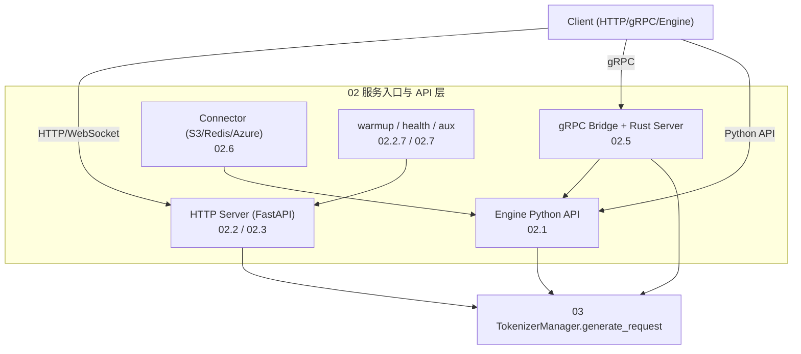

# 02 服务入口与 API 层

## 定位

SGLang 服务入口与 API 层位于 `python/sglang/srt/entrypoints/` 与 `python/sglang/srt/connector/`，是外部请求（HTTP、gRPC、WebSocket、Engine Python API）进入推理管线的唯一通道。它把异构协议（SGLang 原生 API、OpenAI 兼容、Anthropic Messages、Ollama、SageMaker/Vertex）统一翻译为 `GenerateReqInput` / `EmbeddingReqInput`，再交给 [03 核心编排](../03-orchestration/index.md) 的 `TokenizerManager`；同时承担进程编排、warmup、健康检查、权重热更新、负载查询、弹性 EP 控制面等运行时职责。

## 子系统边界

## 子模块导航

- [02.1 Engine](02.1-engine.md) — `Engine` 类与并行进程编排（Python API 入口）
- 02.2 协议端点
  - [02.2.1 原生 API](02.2.1-native-api.md) — `/generate`、`/encode`、`/classify`、`/flush_cache`、health/info/权重/LoRA/session/admin
  - [02.2.2 OpenAI 兼容端点](02.2.2-openai-compat.md) — `/v1/completions`、`/v1/chat/completions`、`/v1/embeddings`、`/v1/models`、`/v1/responses`、`/v1/rerank`
  - [02.2.3 Anthropic 兼容](02.2.3-anthropic-compat.md) — `/v1/messages`
  - [02.2.4 Ollama 兼容](02.2.4-ollama-compat.md) — `/api/chat`、`/api/generate`
  - [02.2.5 SageMaker / Vertex](02.2.5-sagemaker-vertex.md) — `/ping`、`/invocations`、`/vertex_generate`
  - [02.2.6 负载与弹性 EP](02.2.6-loads-elastic-ep.md) — `/v1/loads`、`/scale_elastic_ep`
  - [02.2.7 warmup / health](02.2.7-warmup-health.md) — `_execute_server_warmup`、`health_generate`
- 02.3 OpenAI 协议与处理类
  - [02.3.1 openai protocol](02.3.1-openai-protocol.md) — Pydantic 请求/响应模型
  - [02.3.2 chat/completions](02.3.2-openai-base-chat-completions.md) — `OpenAIServingBase` / `OpenAIServingChat` / `OpenAIServingCompletion`
  - [02.3.3 embed/classify/score/rerank](02.3.3-openai-embed-classify-score-rerank.md)
  - [02.3.4 tokenize/转录/流式 ASR](02.3.4-openai-tokenize-transcription-asr.md)
  - [02.3.5 responses(harmony)+tool](02.3.5-openai-responses-harmony-tool.md)
  - [02.3.6 realtime WebSocket](02.3.6-openai-realtime-ws.md)
  - [02.3.7 chat 编码/SSE/usage](02.3.7-openai-chat-encoding-sse-usage.md)
- [02.4 Anthropic/Ollama 处理类](02.4-anthropic-ollama-handlers.md)
- [02.5 gRPC](02.5-grpc.md) — proto 契约、`RuntimeHandle`、`serve_grpc`、Rust 进程内 gRPC
- [02.6 Connector](02.6-connector.md) — `BaseConnector`、S3/Redis/Azure/RemoteInstance、serde
- [02.7 入口辅助模块](02.7-entrypoint-aux.md) — `context.py`、`harmony_utils.py`、`tool.py`、`search/`、`request_headers.py`、解压/SSL

## 端到端请求生命周期

`v1/chat/completions` 一条请求从进入到返回，跨越如下阶段（详见 [02.1 Engine](02.1-engine.md) 的序列图）：

1. FastAPI 在 `http_server.py:1649` 将请求路由进 `openai_v1_chat_completions`。
2. 委托给 `app.state.openai_serving_chat.handle_request`（`OpenAIServingChat`，见 [02.3.2](02.3.2-openai-base-chat-completions.md)）。
3. handler 在 `_convert_to_internal_request` 中把 `ChatCompletionRequest` 编码为 `GenerateReqInput`，可能调用 `encoding_dsv4`/`dsv32`/`encoding_dsv4`（[02.3.7](02.3.7-openai-chat-encoding-sse-usage.md)）。
4. 调用 `tokenizer_manager.generate_request(obj, request)` —— 进入 [03 编排管线](../03-orchestration/03.3.2-tm-generate-lifecycle.md)。
5. 流式分支通过 `sse_utils.build_sse_content` 生成 `data: {...}\n\n` 帧；非流式分支由 `usage_processor` 计算 `UsageInfo` 后返回 JSON。

## 交叉引用

- 上游: [`01 前端`](../01-frontend/index.md) — CLI/DSL/Engine 客户端发起请求
- 下游: [`03 编排`](../03-orchestration/index.md) — `TokenizerManager.generate_request`
- 相关: [`16 配置`](../16-config-runtime/index.md) `ServerArgs` / `RuntimeContext`；[`17 观测`](../17-observability-ops/index.md) metrics/tracing；[`18 网关`](../18-gateway/index.md) Rust 网关与 [18.12 进程内 Rust gRPC](../18-gateway/18.12-in-process-rust-grpc.md)

## 进一步阅读

- 源码根目录: `python/sglang/srt/entrypoints/`
- 顶层启动函数: `python/sglang/srt/entrypoints/http_server.py:2597 launch_server`
