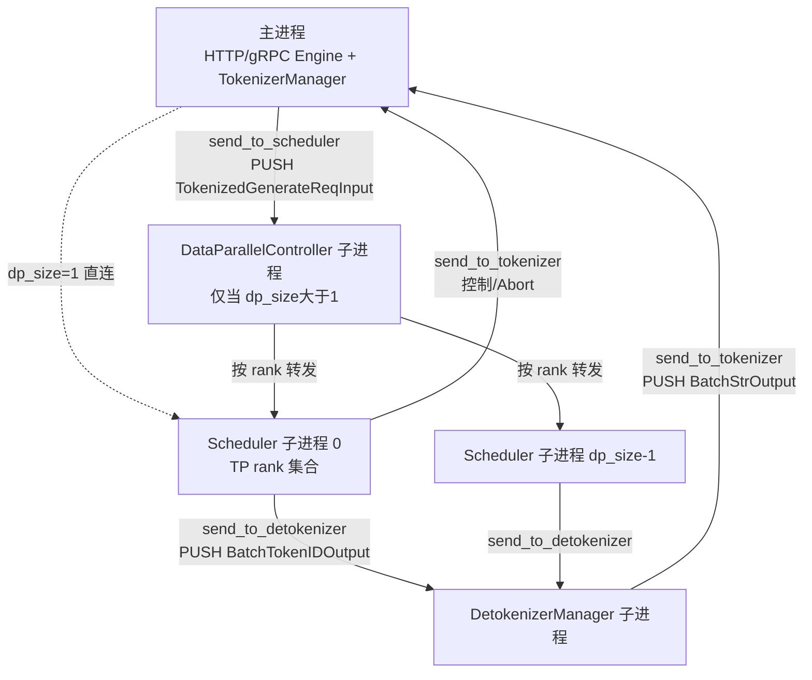

# 03.1 管线总览

## 定位

本页给出 SGLang serving 管线的"骨架视图"：哪些进程、哪些 IPC 通道、哪些消息类型把一次 generate 请求从 HTTP 推到 token 输出再回流到客户端。后续 03.2–03.10 都围绕这条主线展开。

## 职责

- 描述 `TokenizerManager` / `Scheduler` / `DetokenizerManager` 三组件契约
- 描述各自所在进程、相互通信的 ZMQ socket 拓扑
- 描述 io_struct 消息族在管线上的流向
- 在 DP/PP/Spec 引入时管线如何分叉

## 关键类与函数

| 名称 | 定义位置 | 说明 |
|---|---|---|
| `Engine` | `python/sglang/srt/entrypoints/engine.py:183` | 三组件的所有者；`__init__` 拉起子进程 |
| `Engine` 三组件注释 | `python/sglang/srt/entrypoints/engine.py:187` | TM/Scheduler/Detokenizer 三段契约 |
| `init_tokenizer_manager` | `python/sglang/srt/entrypoints/engine.py:138` | 主进程内构造 TM |
| `run_scheduler_process` | `python/sglang/srt/managers/scheduler.py:4540` | 子进程入口 |
| `run_detokenizer_process` | `python/sglang/srt/managers/detokenizer_manager.py:488` | 子进程入口 |
| `run_data_parallel_controller_process` | `python/sglang/srt/managers/data_parallel_controller.py:807` | DP 控制器子进程入口 |

## 进程树与 IPC 拓扑

## io_struct 消息流

请求下行由 `TokenizerManager.generate_request`（`tokenizer_manager.py:624`）走 `_send_one_request`（`tokenizer_manager.py:1367`）把 `TokenizedGenerateReqInput`（`io_struct.py:788`）经 `send_to_scheduler` PUSH 给调度端。`Scheduler` 通过 `request_receiver`（`scheduler_components/request_receiver.py:46`）接收，`handle_generate_request`（`scheduler.py:2055`）把它转成内部 `Req`（`schedule_batch.py:714`）入 `waiting_queue`。

前向后，`TpModelWorker.forward_batch_generation`（`tp_worker.py:498`）产出 `GenerationBatchResult`（`managers/utils.py:39`），由 `process_batch_result`（`scheduler.py:3544`）消费；decode token id 经 `SchedulerOutputStreamer`（`scheduler_components/output_streamer.py:39`）封成 `BatchTokenIDOutput`（`io_struct.py:1209`）发给 Detokenizer。`DetokenizerManager.event_loop`（`detokenizer_manager.py:161`）解码后回 `BatchStrOutput`（`io_struct.py:1300`），由 `TokenizerManager.handle_loop`（`tokenizer_manager.py:1884`）经 `_coalesce_streaming_chunks`（`tokenizer_manager.py:1401`）聚合并推回客户端。

控制面消息（`AbortReq:1795`、`FlushCacheReqInput:1418`、权重更新、LoRA、session、pause）经 `TokenizerControlMixin`（`tokenizer_control_mixin.py:126`）的 `FanOutCommunicator`（`communicator.py:13`）广播到所有 Scheduler；详见 [03.3.5](03.3.5-tm-control-mixin.md)。

## 数据流文字说明

1. TM 主进程内分词与多模态预处理（[03.3.3](03.3.3-tm-tokenize-mm.md)），构造 `TokenizedGenerateReqInput`
2. PUSH 到 `scheduler_input` socket；DP 模式经 `MultiTokenizerRouter`（[03.3.7](03.3.7-tm-multi-tokenizer.md)）或 `DataParallelController`（[03.8](03.8-dp-controller.md)）转发
3. Scheduler 一个事件循环迭代 = recv → `get_next_batch_to_run` → `run_batch` → `process_batch_result`（[03.4.3](03.4.3-scheduler-event-loop.md)）
4. `run_batch` 调 `TpModelWorker.forward_batch_generation` → `ModelRunner.forward`（[03.6](03.6-tp-worker.md)、[`04.1`](../04-model-execution/04.1-model-runner.md)）
5. 结果分两路：稳态 token id 给 Detokenizer；控制/Abort 直接给 TM
6. Detokenizer 解码 + trim stop（[03.7](03.7-detokenizer.md)），回 TM
7. TM `handle_loop` 聚合后通过 SSE 推客户端

## 交叉引用

- 上游: [`02 服务入口`](../02-server-api/index.md) — HTTP server 构造 `Engine`
- 下游: [`04 模型执行`](../04-model-execution/index.md) — TpModelWorker 直接调用
- 下游: [`08 分布式`](../08-distributed/index.md) — TP/PP/DP 进程组
- 相关: [03.2 io_struct](03.2-io-struct.md)、[03.3.4 TM handle_loop](03.3.4-tm-handle-loop-streaming.md)、[03.4.3 事件循环](03.4.3-scheduler-event-loop.md)

## 进一步阅读

- 源码: `python/sglang/srt/entrypoints/engine.py`、`python/sglang/srt/managers/io_struct.py`
