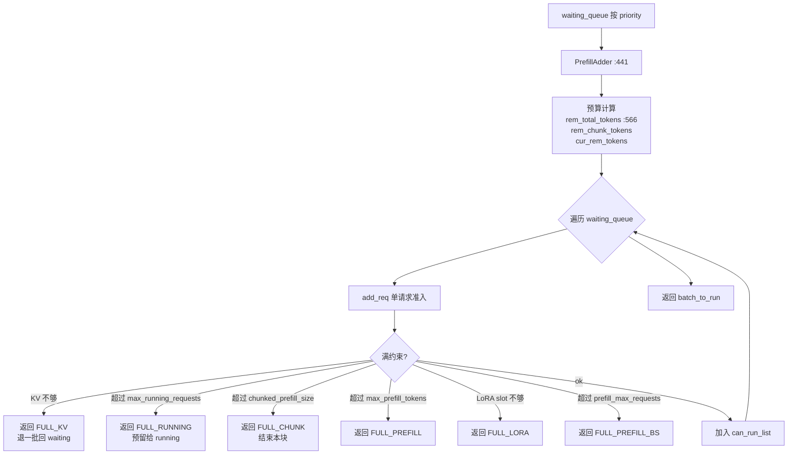

# 03.10 schedule_policy 准入策略

## 定位

`PrefillAdder`（`schedule_policy.py:441`）在 `get_new_batch_prefill`（[03.4.4](03.4.4-scheduler-next-batch.md)）里负责"从 `waiting_queue` 里挑哪些请求进入本迭代的 prefill 批"。它综合 KV budget、最大并发、LoRA slot、priority 与 chunked prefill 长度等阈值决策；返回 `AddReqResult` 状态机。

## 职责

- 计算 `rem_total_tokens` / `rem_chunk_tokens` / `cur_rem_tokens` 三种剩余预算
- 按 priority 等级排序 `waiting_queue`
- 在 `max_prefill_tokens` / `chunked_prefill_size` / `max_running_requests` / KV budget / LoRA slots / `prefill_max_requests` 等约束下贪心准入
- 暴露 `AddReqResult` 反映"为何停"
- HiCache / mamba / swa 的不同 token 计费路径

## 关键类与函数

| 名称 | 定义位置 | 说明 |
|---|---|---|
| `SchedulePolicy` | `managers/schedule_policy.py:163` | 上层策略包装 |
| `CacheAwarePolicy` | `managers/schedule_policy.py:147` | cache-aware 枚举（lpm/lcs） |
| `CacheAgnosticPolicy` | `managers/schedule_policy.py:154` | cache-agnostic 枚举 |
| `AddReqResult` | `managers/schedule_policy.py:435` | 准入状态枚举 |
| `PrefillAdder` | `managers/schedule_policy.py:441` | 主准入门 |
| `rem_total_tokens` | `managers/schedule_policy.py:566` | 剩余总 token 预算 |
| `rem_chunk_tokens` | `managers/schedule_policy.py` | 剩余 chunk token |
| `add_req` | `managers/schedule_policy.py` | 单请求准入判定 |
| `match_prefix_for_req` | `managers/schedule_policy.py:92` | cache-aware 排序辅助 |

## 子模块树

- `schedule_policy.py`
  - 枚举: `CacheAwarePolicy` / `CacheAgnosticPolicy` / `AddReqResult`
  - 上层: `SchedulePolicy`
  - 准入: `PrefillAdder`
  - 辅助: `match_prefix_for_req`

## 数据流

## 实现要点

`PrefillAdder.__init__`（`:442` 起约 100 行）接受 `running_batch`（占用 KV 的 baseline）、`new_token_ratio`（来自 `NewTokenRatioTracker` 决定每请求 KV 预留估值）、`max_prefill_tokens`、`chunked_prefill_size`、`max_running_requests`、`max_prefill_bs`、`prefill_max_requests`、`prefill_delayer_single_pass`、`dllm_config` 等。由此初始：

- `rem_total_tokens`（:566）= 全局可用 token − running 估值 − mamba gap reserve（:523）
- `rem_chunk_tokens` = `min(rem_total_tokens, chunked_prefill_size)`（:809）
- `cur_rem_tokens` = 当前可用页

`add_req` 对每条候选请求做"按约"检查（实际函数 `add_req` 内常驻数百行）：估算含 radix hit 后的真实新增 token，分别用 `total_tokens`（全 KV 占用，:1011-1043）与 `chunk`（本块长度）两道预算过滤；LoRA slot 检查 batch 已用 lora 集合是否还能加新 lora；`prefill_max_requests` 限制本批最大请求数。

`AddReqResult`（:435）枚举含 `FULL_KV / FULL_RUNNING / FULL_CHUNK / FULL_PREFILL / FULL_LORA / FULL_PREFILL_BS / SKIP / ADD`。`FULL_KV` 时触发 [03.4.10](03.4.10-scheduler-retract-oom.md) 的 retract；其余"FULL"通常意味着本片 prefill 截断，下迭代再试。

`SchedulePolicy:163` 在 `init_schedule_policy`（`scheduler.py:1036`）实例化；它持有 `tree_cache`、`enable_hierarchical_cache`、`priority` 开关等，对 waiting_queue 做 cache-aware 排序（`match_prefix_for_req:92` 让同 prefix 的请求合并入批以共享 KV）。HiCache 与 mamba 路径里 token 计费不同（`rem_total_tokens` 计入 host_pool、mamba 单独计 budget，:663-734），由 PrefillAdder 内部条件分支处理。

## 交叉引用

- 上游: [03.4.4 下一批](03.4.4-scheduler-next-batch.md)、[03.4.8 chunked](03.4.8-scheduler-chunked-prefill.md)
- 下游: [03.4.10 retract](03.4.10-scheduler-retract-oom.md) —FULL_KV 触发
- 相关: [03.5 协作者](03.5-scheduler-components.md)（`NewTokenRatioTracker`、`PoolStatsObserver`）
- 相关: [`07 KV Cache`](../07-kv-cache/index.md)（radix cache / HiCache / mamba）、[`13 LoRA`](../13-lora/index.md)（slot）、[`11 采样控制`](../11-sampling-control/index.md)（间接）

## 进一步阅读

- 源码: `python/sglang/srt/managers/schedule_policy.py`、`python/sglang/srt/managers/scheduler_components/new_token_ratio_tracker.py`
