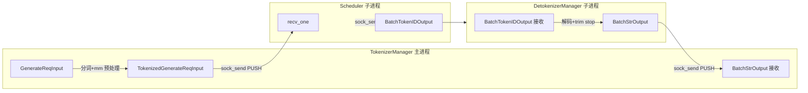

# 03.2 io_struct 消息契约

## 定位

`io_struct.py` 是 SGLang 三组件之间的"接口契约集合"。所有跨进程消息（请求下行、token 上行、控制广播）均以 `msgspec.Struct` 定义，并用 msgpack 经 ZMQ 传输；本模块是 [`03.1`](03.1-pipeline-overview.md) 管线的"协议层"。

## 职责

- 定义所有跨进程消息结构与 `tag` 多态编码
- 提供 `PickleWrapper` 透明承载 msgpack 不能直接编码的对象（多模态张量、time_stats 等）
- 提供 `sock_send` / `sock_recv` 的统一编解码入口与 `dec_hook`/`enc_hook`

## 关键类与函数

| 名称 | 定义位置 | 说明 |
|---|---|---|
| `BaseReq` | `managers/io_struct.py:74` | 所有单请求消息基类，`tag=True` 多态 |
| `BaseBatchReq` | `managers/io_struct.py:85` | 所有批输出/批控制基类 |
| `PickleWrapper` | `managers/io_struct.py:99` | 包裹任意对象为 pickle payload |
| `GenerateReqInput` | `managers/io_struct.py:155` | HTTP/api 入参，含 text/ids/mm/lora/session |
| `TokenizedGenerateReqInput` | `managers/io_struct.py:788` | TM→Scheduler 下行主消息 |
| `BatchTokenIDOutput` | `managers/io_struct.py:1209` | Scheduler→Detokenizer 上行 |
| `BatchStrOutput` | `managers/io_struct.py:1300` | Detokenizer→TM 上行终态 |
| `FlushCacheReqInput` | `managers/io_struct.py:1418` | 控制族：清空 KV cache |
| `AbortReq` | `managers/io_struct.py:1795` | 控制族：按 rid 中止 |
| `sock_send` | `managers/io_struct.py:2252` | msgpack 编码 + ZMQ send |
| `sock_recv` | `managers/io_struct.py:2260` | ZMQ recv + msgpack 解码 |

## 子模块树

- `io_struct.py` — 消息结构 + 编解码工具
  - 输入族: `GenerateReqInput` / `TokenizedGenerateReqInput` / `AbortReq` / `FlushCacheReqInput`
  - 输出族: `BatchTokenIDOutput` / `BatchStrOutput` / `BatchEmbeddingOutput`
  - 控制族: `WeightReqInput`、`UpdateWeightReqInput`、`LoadWeightReqInput`、`UploadLoRAReqInput`、`PauseReq` 等
  - 工具: `PickleWrapper`、`wrap_as_pickle`、`sock_send`、`sock_recv`、`recv_one` / `async_recv_one`

## 数据流

## 编码细节

`sock_send` 用全局 msgspec `Encoder` 把结构体编为 msgpack bytes 再写 ZMQ；`sock_recv` 反过来用 `Decoder` 加 `dec_hook` 还原类型。`PickleWrapper` 是个带 `tag` 的 `msgspec.Struct`，其 payload 是已被 pickle 的 bytes，专供 msgpack 不直接支持的 Python 对象使用——典型场景：

- 多模态 `MultimodalProcessorOutput`（张量 + 偏移）字段在 `TokenizedGenerateReqInput.mm_inputs:795` 上传
- `time_stats`、`customized_info` 等可选辅助对象
- `BatchTokenIDOutput.customized_info:1274` / `BatchStrOutput.customized_info:1356`

`GenerateReqInput:155` 不是 `msgspec.Struct`，而是带 `__getstate__` 的普通类——它的"序列化"由 TM 在 `_create_tokenized_object`（`tokenizer_manager.py:1147`）里展开成 `TokenizedGenerateReqInput`，避免在主进程内携带大对象。所有跨进程消息一律走 msgpack + `PickleWrapper`，不允许任意 pickle 流。

## 交叉引用

- 上游: [`02 服务入口`](../02-server-api/index.md) — HTTP handler 把请求构造成 `GenerateReqInput`
- 下游: [03.3.2 TM 生命周期](03.3.2-tm-generate-lifecycle.md)、[03.3.5 控制广播](03.3.5-tm-control-mixin.md)
- 相关: [03.1 管线总览](03.1-pipeline-overview.md)、[`12 多模态`](../12-multimodal/index.md)

## 进一步阅读

- 源码: `python/sglang/srt/managers/io_struct.py`
