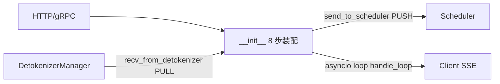

# 03.3.1 TokenizerManager 结构

## 定位

`TokenizerManager` 是请求生命周期的"前台"与管线枢纽：在主进程内接收 HTTP/gRPC 入参，做分词和多模态预处理后下发 Scheduler，并持续把上行 `BatchStrOutput` 聚合推回客户端。它同时是控制面广播（权重/LoRA/flush/pause）的发起方。

## 职责

- 持有 `ServerArgs`、`ModelConfig`、tokenizer 与多模态 processor
- 装配 IPC 通道（recv from Detokenizer、send to Scheduler）
- 装配控制面 `FanOutCommunicator` 与 score mixin
- 维护请求注册表 `rid_to_state`、流式聚合缓存
- 在主进程 asyncio loop 中驱动 `handle_loop`

## 关键类与函数

| 名称 | 定义位置 | 说明 |
|---|---|---|
| `TokenizerManager` | `managers/tokenizer_manager.py:265` | 主类，继承 `TokenizerControlMixin` + `TokenizerManagerScoreMixin` |
| `ReqState` | `managers/tokenizer_manager.py:172` | 单请求异步状态机 |
| `__init__` | `managers/tokenizer_manager.py:278` | 8 步 `init_*` 编排链 |
| `init_model_config` | `managers/tokenizer_manager.py:329` | 加载/校验模型配置 |
| `init_tokenizer_and_processor` | `managers/tokenizer_manager.py:357` | 分词器 + mm processor |
| `init_ipc_channels` | `managers/tokenizer_manager.py:412` | 建立 ZMQ socket |
| `init_running_status` | `managers/tokenizer_manager.py` | rid 注册表 + 状态 |
| `init_request_dispatcher` | `managers/tokenizer_manager.py:601` | `_result_dispatcher` |

## __init__ 编排链

`__init__`（`tokenizer_manager.py:278`）严格按顺序装配：

1. 解析 `server_args`、设置 elastic/trace/lora/dump 等开关
2. `init_model_config()`（:329）— `ModelConfig.from_server_args`，得出 `context_len`、`is_generation`、`num_reserved_tokens`（spec 预留槽位）
3. `init_tokenizer_and_processor()`（:357）— 非多模态直接 `get_tokenizer`；多模态走 `import_processors` + `get_mm_processor`，可选 `AsyncDynamicbatchTokenizer`（详见 [03.3.3](03.3.3-tm-tokenize-mm.md)）
4. `init_ipc_channels(port_args)`（:412）— `recv_from_detokenizer` PULL；`send_to_scheduler` PUSH（多 tokenizer 时改 PUSH 到 `tokenizer_worker_ipc_name`，见 [03.3.7](03.3.7-tm-multi-tokenizer.md)），以及 `load_snapshot_reader`
5. `init_running_status()` — `rid_to_state: Dict[str, ReqState]` 与计数
6. `init_request_logging_and_dumping()` — crash dump / trace
7. `init_weight_update()` / `init_lora()` / `init_disaggregation()` — 控制面与分离式配置
8. `init_metric_collector_watchdog()` / `init_request_dispatcher()`（:601）— `_result_dispatcher` 注册 `BatchStrOutput`、`AbortReq` 等回包处理器

`init_request_dispatcher` 注册的处理器就是 [`03.3.4`](03.3.4-tm-handle-loop-streaming.md) 的 `handle_loop` 入口。

## 子模块树

- `tokenizer_manager.py` — 主类
- `tokenizer_control_mixin.py` — 控制面广播（[03.3.5](03.3.5-tm-control-mixin.md)）
- `tokenizer_manager_score_mixin.py` — cross-encoder 打分（[03.3.6](03.3.6-tm-score-mixin.md)）
- `multi_tokenizer_mixin.py` — 多 tokenizer 路由（[03.3.7](03.3.7-tm-multi-tokenizer.md)）
- `async_dynamic_batch_tokenizer.py` — 异步批量分词
- `multimodal_processor.py` — 多模态 processor 工厂

## 数据流

TM 主进程内还创建 `SignalHandler`（`tokenizer_manager.py:3250`）与可选 `MultiTokenizerRouter`，用于优雅退出和把请求按 tokenizer 维度二次分发。

## 交叉引用

- 上游: [`02 服务入口`](../02-server-api/index.md) — 构造并调用 TM
- 下游: [03.4.7 请求准入](03.4.7-scheduler-request-admission.md) — Scheduler 接收 TM 下发的 `TokenizedGenerateReqInput`
- 相关: [03.1 管线总览](03.1-pipeline-overview.md)、[03.2 io_struct](03.2-io-struct.md)、[03.3.2 生命周期](03.3.2-tm-generate-lifecycle.md)
- 相关 skill: `.claude/skills/large-class-style`

## 进一步阅读

- 源码: `python/sglang/srt/managers/tokenizer_manager.py`
