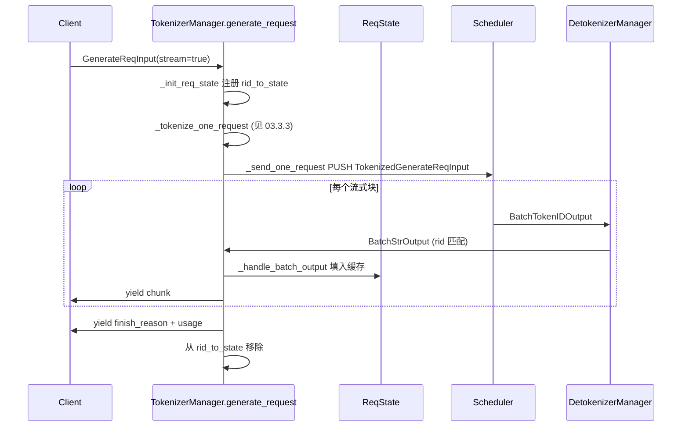

# 03.3.2 generate_request 生命周期

## 定位

`TokenizerManager.generate_request` 是一条请求在主进程内的全闭环：从 `GenerateReqInput` 到客户端拿到最后一个 token/finish_reason。它把"分词 → 下发 → 收响应 → 聚合"四件事都以 `ReqState` 为中心串联起来。

## 职责

- 把 `GenerateReqInput` 转成内部 `ReqState` 并发起异步 token 收集
- 控制流式 vs 非流式输出形态（`stream` / `stream_options`）
- 检查输入 token / image / context 长度，触发 `return_logprob` / `skip_tokenizer_init` 旁路
- 取消（abort）与超时清理

## 关键类与函数

| 名称 | 定义位置 | 说明 |
|---|---|---|
| `ReqState` | `managers/tokenizer_manager.py:172` | 单请求状态机：缓存、stream chunks、asyncio event |
| `generate_request` | `managers/tokenizer_manager.py:624` | 入口 async generator |
| `_init_req_state` | `managers/tokenizer_manager.py:2983` | 装配 `ReqState` 并注册 `rid_to_state` |
| `_send_one_request` | `managers/tokenizer_manager.py:1367` | 构造 `TokenizedGenerateReqInput` 并 PUSH |
| `_wait_one_response` | `managers/tokenizer_manager.py:1482` | async loop 收 `BatchStrOutput` 流式块 |

## 控制流

`generate_request`（`tokenizer_manager.py:624`）首先 `_init_req_state`（:2983）创建 `ReqState`（:172）并把它放入 `self.rid_to_state`，再调 `_tokenize_one_request`（见 [03.3.3](03.3.3-tm-tokenize-mm.md)）拿到 token id 与多模态产物；`_send_one_request`（:1367）把它们封装为 `TokenizedGenerateReqInput`（`io_struct.py:788`）经 `send_to_scheduler` PUSH 出去。

`_wait_one_response`（:1482）是客户端面向的 async generator。它不直接从 socket 读——socket 由统一的 `handle_loop`（`tokenizer_manager.py:1884`，详见 [03.3.4](03.3.4-tm-handle-loop-streaming.md)）驱动，`handle_loop` 取到 `BatchStrOutput` 后依据 `rid` 找到对应 `ReqState` 并填入缓存、置 event；`_wait_one_response` 只是循环 wait + 取 + yield。流式块由 `_coalesce_streaming_chunks`（`tokenizer_manager.py:1401`）按 `stream_interval` 与增量解码合并。

非流式模式等同一轮"全收完再退"。Abort 时客户端断开或显式 `/v1/abort`，TM 调 `TokenizerControlMixin` 广播 `AbortReq`（`io_struct.py:1795`）给 Scheduler（[03.3.5](03.3.5-tm-control-mixin.md)）。

## 交叉引用

- 上游: [`02 服务入口`](../02-server-api/index.md) — HTTP handler 直接 await `generate_request`
- 下游: [03.4.7 请求准入](03.4.7-scheduler-request-admission.md) — Scheduler 端 `handle_generate_request`
- 相关: [03.3.1 TM 结构](03.3.1-tokenizer-manager.md)、[03.3.3 分词](03.3.3-tm-tokenize-mm.md)、[03.3.4 handle_loop](03.3.4-tm-handle-loop-streaming.md)

## 进一步阅读

- 源码: `python/sglang/srt/managers/tokenizer_manager.py`
