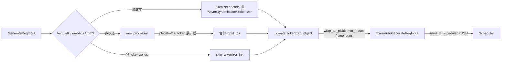

# 03.3.3 分词与多模态预处理

## 定位

`_tokenize_one_request` 把 `GenerateReqInput`（`io_struct.py:155`）的 text/input_ids/image/audio 展开成 Scheduler 可直接调度的 token id 序列与多模态张量包，并把结果组装成 `TokenizedGenerateReqInput`。它是请求下行链上的"编码器"。

## 职责

- text / input_ids / input_embeds 三种输入形态分发
- 多模态数据走 `MultimodalProcessor` 展开 placeholder token
- 异步批量分词（`enable_dynamic_batch_tokenizer`）
- 构造 `TokenizedGenerateReqInput` 与 `PickleWrapper` payload
- 校验 `context_len` / `max_req_input_len` / image token 上限

## 关键类与函数

| 名称 | 定义位置 | 说明 |
|---|---|---|
| `_tokenize_one_request` | `managers/tokenizer_manager.py:828` | 编排分词 + mm |
| `_create_tokenized_object` | `managers/tokenizer_manager.py:1147` | 装配最终下行消息 |
| `AsyncDynamicbatchTokenizer` | `managers/async_dynamic_batch_tokenizer.py:17` | 动态批量分词器 |
| `get_mm_processor` | `managers/multimodal_processor.py:44` | 多模态 processor 工厂 |
| `import_processors` | `managers/multimodal_processor.py:16` | 注册内置/外部 processor |
| `MultimodalProcessorOutput` | `managers/schedule_batch.py:415` | processor 输出再封装 |
| `MultimodalInputs` | `managers/schedule_batch.py:499` | Scheduler 端最终 mm 数据模型 |

## 子模块树

- `tokenizer_manager.py` — `_tokenize_one_request` / `_create_tokenized_object`
- `async_dynamic_batch_tokenizer.py` — 异步批量分词（按 wait_timeout + max_batch）
- `multimodal_processor.py` — `get_mm_processor` 工厂
- `sglang/srt/multimodal/processors/` — 各模型 family 的 `BaseMultimodalProcessor` 实现（详见 [`12 多模态`](../12-multimodal/index.md)）

## 数据流

`_tokenize_one_request`（:828）先判定 `InputFormat`（TM 内部枚举）。纯文本走 `self.tokenizer.encode`，若 `server_args.enable_dynamic_batch_tokenizer` 则改为 `self.async_dynamic_batch_tokenizer.encode`（`AsyncDynamicbatchTokenizer` 在 `async_dynamic_batch_tokenizer.py:17`，内部维护一个动态批 loop，按 `batch_wait_timeout_s` 与 `max_batch_size` 攒批后调底层 `tokenizer.encode_batch`）。

多模态路径调 `self.mm_processor`（`get_mm_processor` 在 `multimodal_processor.py:44` 取 `BaseMultimodalProcessor`），其扩展 image/audio/video placeholder token 并返回 `MultimodalProcessorOutput`（张量、偏移、`mm_inputs`）。结果在 `_create_tokenized_object`（:1147）被 `wrap_as_pickle`（`io_struct.py:2140`）后塞进 `TokenizedGenerateReqInput.mm_inputs`（`io_struct.py:795`）等 `PickleWrapper` 字段，确保跨进程 msgpack 安全。`time_stats` 同理 `PickleWrapper` 化。

`skip_tokenizer_init=True` 时跳过分词，直接走客户端给的 `input_ids` / `input_embeds`，但 mm 仍要 `mm_processor` 编码以保证 image token 占位正确（`init_tokenizer_and_processor:379` 仍初始化 mm_processor）。`return_logprob` 与 `tool_call_parser` 也在此路径装配额外字段。

## 交叉引用

- 上游: [03.3.2 生命周期](03.3.2-tm-generate-lifecycle.md) — 由 `generate_request` 调用
- 下游: [03.4.7 请求准入](03.4.7-scheduler-request-admission.md) — Scheduler 处理 `TokenizedGenerateReqInput.mm_inputs`
- 下游: [`12 多模态`](../12-multimodal/index.md) — 各 model processor 实现
- 相关: [03.2 io_struct](03.2-io-struct.md) — `PickleWrapper`

## 进一步阅读

- 源码: `python/sglang/srt/managers/tokenizer_manager.py`、`python/sglang/srt/managers/multimodal_processor.py`、`python/sglang/srt/managers/async_dynamic_batch_tokenizer.py`
