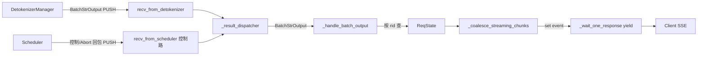

# 03.3.4 handle_loop 与流式聚合

## 定位

`handle_loop` 是 `TokenizerManager` 主进程 asyncio loop 上的"上行消费者"。所有来自 `DetokenizerManager` 的 `BatchStrOutput` 与来自 Scheduler 的控制回包从这里入口，再按 `rid` 分发到各 `ReqState`。

## 职责

- 持续从 `recv_from_detokenizer` PULL 收消息
- 通过 `_result_dispatcher` 按消息类型路由
- 调 `_handle_batch_output` 把流块写入对应 `ReqState`
- 用 `_coalesce_streaming_chunks` 按间隔合并多块增量
- 处理 abort / error / health check 回流

## 关键类与函数

| 名称 | 定义位置 | 说明 |
|---|---|---|
| `handle_loop` | `managers/tokenizer_manager.py:1884` | asyncio loop 主入口 |
| `_handle_batch_output` | `managers/tokenizer_manager.py:1899` | 单条 `BatchStrOutput` 处理 |
| `_result_dispatcher` | `managers/tokenizer_manager.py:602` | `TypeBasedDispatcher` |
| `_coalesce_streaming_chunks` | `managers/tokenizer_manager.py:1401` | 合并流式增量块 |
| `ReqState` | `managers/tokenizer_manager.py:172` | 持有缓存与 asyncio event |
| `init_request_dispatcher` | `managers/tokenizer_manager.py:601` | 注册 dispatch 表 |

## 数据流

## 控制流

`handle_loop`（:1884）在 `Engine.launch_tokenizer_manager` 后启动，循环：

1. `await self.recv_from_detokenizer.recv()`（asyncio PULL）
2. `output = self._result_dispatcher(recv_obj)`（`init_request_dispatcher` 在 `tokenizer_manager.py:602` 注册——`BatchStrOutput` → `_handle_batch_output`，`AbortReq` → abort 处理，`HealthCheck` → ipc 回写等）
3. `_handle_batch_output`（:1899）从 `BatchStrOutput`（`io_struct.py:1300`）解出 `rids`，按 `rid` 查 `self.rid_to_state` 取 `ReqState`，把解码后的 `output_strs` 与 `finished_reason` 追加进 `ReqState.stream_chunks`
4. 触发 event，让对应的 `_wait_one_response`（:1482，见 [03.3.2](03.3.2-tm-generate-lifecycle.md)）异步唤醒

`_coalesce_streaming_chunks`（:1401）负责合并多个不同 `BatchStrOutput` 的同 rid 增量：按 `server_args.stream_interval` 与 `incremental_streaming_output` 决定是否把相邻块拼成一个 SSE chunk，避免向客户端推太多极小帧。`finished_reason` 非空时立即 flush 并从 `rid_to_state` 摘除。

控制路（Scheduler 直发 TM 的 `AbortReq`、`PauseAckReq`、`ResumeAckReq` 等）也走同一 `_result_dispatcher`，但来源是独立 socket（`tokenizer_control_mixin.py` 注册，见 [03.3.5](03.3.5-tm-control-mixin.md)），以避免和 Detokenizer 流量相互阻塞。

## 交叉引用

- 上游: [03.7 DetokenizerManager](03.7-detokenizer.md) — `BatchStrOutput` 生产端
- 上游: [03.4.6 结果处理](03.4.6-scheduler-process-result.md) — 控制回包来源
- 相关: [03.3.2 生命周期](03.3.2-tm-generate-lifecycle.md)、[03.1 管线总览](03.1-pipeline-overview.md)
- 下游: [`02 服务入口`](../02-server-api/index.md) — SSE 推送

## 进一步阅读

- 源码: `python/sglang/srt/managers/tokenizer_manager.py`
