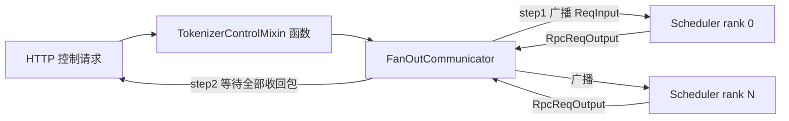

# 03.3.5 控制面广播 mixin

## 定位

`TokenizerControlMixin` 把所有"非生成数据流"控制操作（权重热更、flush cache、LoRA 上传/卸载、session 管理、pause/resume）抽象为对一组 Scheduler 子进程的同步广播，并通过 `FanOutCommunicator` 收集响应。

## 調责

- 把控制消息经 `FanOutCommunicator` 发给所有 TP/DP Scheduler
- 收集 `RpcReqOutput` 聚合成单一回包给 HTTP
- 维护 LoRA / session / 权重版本号状态
- 接收 Scheduler 直发的控制回包（`PauseAckReq` 等）并经 `_result_dispatcher` 处理

## 关键类与函数

| 名称 | 定义位置 | 说明 |
|---|---|---|
| `TokenizerControlMixin` | `managers/tokenizer_control_mixin.py:126` | 主控制 mixin |
| `FanOutCommunicator` | `managers/communicator.py:13` | 广播 + 收回包的泛型封装 |
| `TokenizerManager` | `managers/tokenizer_manager.py:265` | 通过多继承接入 mixin |
| `_result_dispatcher` 注册 | `managers/tokenizer_control_mixin.py:144` | 追加控制回包处理器 |

## 子模块树

- `tokenizer_control_mixin.py` — mixin 主体
  - 权重族: `update_weights` / `update_weights_from_disk` / `load_weights` / `rollback_weights`
  - LoRA 族: `upload_lora` / `unload_lora`（详见 [`13 LoRA`](../13-lora/index.md)）
  - cache 族: `flush_cache` / `FreezeGCReq`（详见 [`07 KV Cache`](../07-kv-cache/index.md)）
  - session 族: `open_session` / `close_session`（详见 [`14 session-state`](../14-session-state/index.md)）
  -pause/resume 族: `pause` / `resume` / `PauseContinueBroadcastReq`

## 数据流

## 实现说明

`FanOutCommunicator`（`communicator.py:13`）是泛型 `Generic[T]`，对外提供 `broadcast(req)` + `gather_responses()`：内部针对每个 Scheduler 维护一条 socket + 一个回包队列。控制消息大致分两类：

- "fire-and-collect"型（`UpdateWeightReqInput`、`LoadWeightReqInput`、`UploadLoRAReqInput`、`PauseReq`）需要等所有 rank 的 `RpcReqOutput` 才能向 HTTP 返回成功
- "fire-and-forget"型（`FlushCacheReqInput` `io_struct.py:1418`、`AbortReq` `io_struct.py:1795`）只广播不等回包，由 Scheduler 异步消化

`_result_dispatcher` 在 `tokenizer_control_mixin.py:144` 追加 dispatch pairs：处理 Scheduler 主动上行（如 `PauseAckReq`、`ResumeAckReq`、`LogpcReqAudit`）的状态机型回包。session 与 weight version 由 mixin 内部维护一致性视图，TM 端缓存 `session_id → state`、`weight_version`，使得后续 `generate_request` 能带上正确版本号下发。

## 交叉引用

- 上游: [`02 服务入口`](../02-server-api/index.md) — `/v1/update_weights`、`/v1/flush_cache` 等
- 下游: [03.4.1 Scheduler](03.4.1-scheduler-structure.md) — `_request_dispatcher` 接收并执行控制
- 相关: [`13 LoRA`](../13-lora/index.md)、[`14 session-state`](../14-session-state/index.md)、[`07 KV Cache`](../07-kv-cache/index.md)
- 相关 skill: `.claude/skills/sglang-runtime-context`

## 进一步阅读

- 源码: `python/sglang/srt/managers/tokenizer_control_mixin.py`、`python/sglang/srt/managers/communicator.py`
