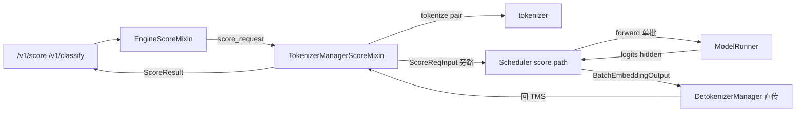

# 03.3.6 score mixin

## 定位

`TokenizerManagerScoreMixin` 给 `TokenizerManager` 提供 cross-encoder / embedding 模型的"打分"路径，对应 OpenAI `/v1/classify`、`/v1/score` 与 rerank 用法。它不经过 Scheduler 的连续批前向，而是直接驱动 ModelRunner 在主进程旁路完成一次前向。

## 职责

- 处理 (query, document) pair 列表的打分请求
- 支持纯 text 输入与 tokenized 输入两种模式
- 支持 cross-encoder（逐 pair 联合编码）与 bi-encoder（query/doc 分别 embedding）两种范式
- 返回 `ScoreResult`（每项分数、prompt token 数、可选 hidden states）

## 关键类与函数

| 名称 | 定义位置 | 说明 |
|---|---|---|
| `TokenizerManagerScoreMixin` | `managers/tokenizer_manager_score_mixin.py:28` | 主 mixin |
| `ScoreResult` | `managers/tokenizer_manager_score_mixin.py:17` | 打分返回类型 |
| `EngineScoreMixin` | `python/sglang/srt/entrypoints/engine_score_mixin.py:17` | Engine 端代理，转发到 `score_request` |

## 数据流

`ScoreResult`（`tokenizer_manager_score_mixin.py:17`）字段含 `scores: List[float]`、`prompt_tokens: int`、可选 `pooled_hidden_states`。mixin 内三个主入口分别对应：

- `score_request`（≈:35）：cross-encoder 经典模式，把 (q, d) 拼接后送入模型取 `[CLS]` 或 pooled logits
- `score_request_bi_encoder`（≈:148）：bi-encoder 模式，q 与 docs 分别编码，相似度由点积得出
- 其余辅助（tokenized 直入）

打分请求仍是 `BaseReq` 衍生的控制类消息（`io_struct.py:74`），由 TM 直接装配并通过与生成请求相同的 `send_to_scheduler` PUSH 通道下发；Scheduler 在 `_request_dispatcher`（`scheduler.py:1333`）把它路由到打分专用处理函数，前向结果不经 Detokenizer 解码而直发 TM。Embedding 模型路径用 `BatchEmbeddingOutput`，由 `DetokenizerManager.handle_batch_embedding_out`（`detokenizer_manager.py:203`）直接透传。

## 交叉引用

- 上游: [`02 服务入口`](../02-server-api/index.md) — `serving_classify` / `serving_rerank`
- 下游: [`04 模型执行`](../04-model-execution/index.md) — 单批前向
- 相关: [03.3.1 TM 结构](03.3.1-tokenizer-manager.md)、[`11 采样控制`](../11-sampling-control/index.md)（不参与采样，仅 logits 取值）

## 进一步阅读

- 源码: `python/sglang/srt/managers/tokenizer_manager_score_mixin.py`、`python/sglang/srt/entrypoints/engine_score_mixin.py`
