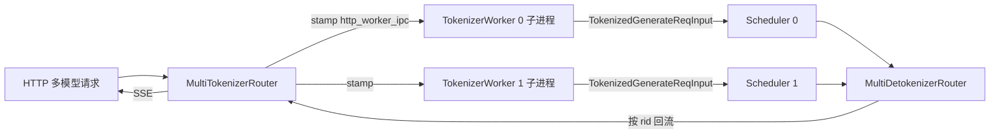

# 03.3.7 多 tokenizer 路由

## 定位

当单实例同时服务多个模型（多 chat template / 多 tokenizer，例如 `tokenizer_worker_num>1`）时，`MultiTokenizerRouter` 取代主进程内的 `TokenizerManager` 成为 HTTP 入口，把请求按 tokenizer 维度二次分发到若干 `TokenizerWorker` 子进程；`MultiDetokenizerRouter` 同理收集 Detokenizer 端的回流。

## 职责

- HTTP 路由：按 `tokenizer_id` 选择 worker
- 与各 `TokenizerWorker` 子进程做 ZMQ 双向通信
- 多模态数据经共享内存 (`shared_memory.SharedMemory`) 旁路传大对象
- 输出聚合：把不同 worker 的 `BatchStrOutput` 按 rid 还原给客户端

## 关键类与函数

| 名称 | 定义位置 | 说明 |
|---|---|---|
| `MultiTokenizerRouter` | `managers/multi_tokenizer_mixin.py:411` | TM 端主路由 |
| `MultiDetokenizerRouter` | `managers/multi_tokenizer_mixin.py:533` | Detokenizer 端聚合路由 |
| `TokenizerWorker` | `managers/multi_tokenizer_mixin.py:625` | 子进程内 `TokenizerManager` 子类 |
| `SocketMapping` | `managers/multi_tokenizer_mixin.py:79` | worker↔socket 映射关系 |
| `run_multi_detokenizer_router_process` | `managers/multi_tokenizer_mixin.py:603` | Detokenizer router 子进程入口 |
| `write_data_for_multi_tokenizer` | `managers/multi_tokenizer_mixin.py:784` | 共享内存写入辅助 |

## 子模块树

- `multi_tokenizer_mixin.py`
  - `MultiTokenizerRouter` — 主进程 HTTP 前端
  - `TokenizerWorker` — `TokenizerManager` 的子进程化 wrapper
  - `MultiDetokenizerRouter` — Detokenizer 子进程路由
  - `MultiHttpWorkerDetokenizerMixin`（`:374`） — DetokenizerManager 接入多 worker 的 mixin
  - 共享内存辅助: `write_to_shared_memory:753`、`read_from_shared_memory:773`、`write_data_for_multi_tokenizer:784`

## 数据流

## 实现说明

主进程内的 `MultiTokenizerRouter`（`:411`）不直接做分词，而是把每条请求经 `_request_dispatcher`（`multi_tokenizer_mixin.py:389`）按 `tokenizer_id` 路由到对应 worker 的 PUSH socket；`stamp_http_worker_ipc`（`tokenizer_manager.py:3286`）把 `http_worker_ipc` 字段打在消息上，使回流能被原路返回。

每个 `TokenizerWorker`（`:625`）是独立子进程内 `TokenizerManager` 的子类，`__init__`（`:628`）重写过 IPC 通道：`send_to_scheduler` 直接 PUSH 到本 worker 对应的 Scheduler 输入 socket。多模态张量较大时走 `write_data_for_multi_tokenizer`（`:784`）写入共享内存，worker 端 `read_from_shared_memory:773` 取回，避免大对象经 ZMQ msgpack。

输出侧 `MultiDetokenizerRouter`（`:533`）把所有 DetokenizerManager 子进程的 `BatchStrOutput` 汇聚，再按 `http_worker_ipc` 路由给对应 router。`MultiHttpWorkerDetokenizerMixin`（`:374`）让 DetokenizerManager 本体能挂多个 worker ipc，注册 `PauseContinueBroadcastReq`（`multi_tokenizer_mixin.py:670`）等控制回包。

## 交叉引用

- 上游: [`02 服务入口`](../02-server-api/index.md) — 多模型网关走 `MultiTokenizerRouter`
- 下游: [03.4.1 Scheduler](03.4.1-scheduler-structure.md) — 每个 worker 对应一组 Scheduler
- 相关: [03.3.1 TM 结构](03.3.1-tokenizer-manager.md)、[03.7 DetokenizerManager](03.7-detokenizer.md)、[`18 gateway`](../18-gateway/index.md)

## 进一步阅读

- 源码: `python/sglang/srt/managers/multi_tokenizer_mixin.py`
