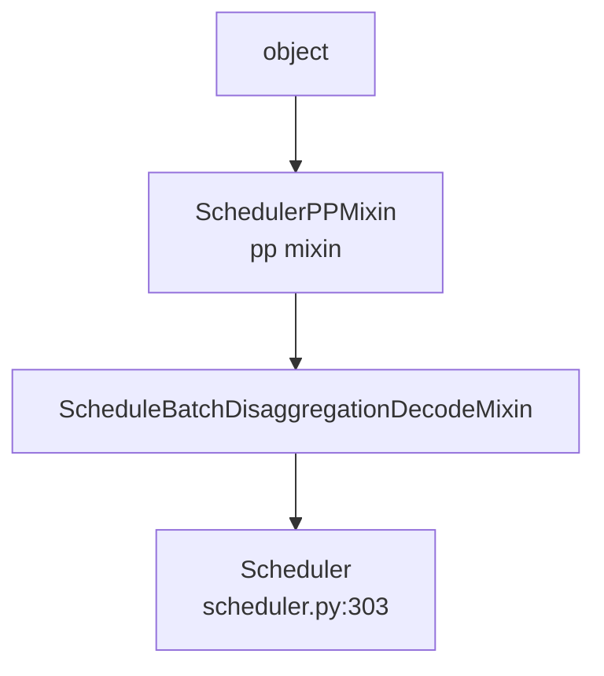

# 03.4.1 Scheduler 类结构

## 定位

`Scheduler` 是 SGLang 最复杂的单类，是请求调度、批构造、前向触发、KV cache 维护、overlap、retract、控制面执行的汇聚点。它运行在 worker 子进程内，持有 `TpModelWorker` 与多组 `scheduler_components` 协作者。

## 职责

- 维护 `waiting_queue`、`running_batch`、`chunked_req`、`last_batch`
- 持有 `req_to_token_pool`、`token_to_kv_pool_allocator`、`tree_cache`（与 [`07`](../07-kv-cache/index.md) 共口径）
- 驱动 event loop（normal / overlap / pp / disagg）
- 把控制消息（`FlushCacheReqInput`、`WeightReqInput` 等）落到本地状态
- 协调 spec decoding、dp attention、chunked prefill 等高级路径

## 关键类与函数

| 名称 | 定义位置 | 说明 |
|---|---|---|
| `Scheduler` | `managers/scheduler.py:303` | 主类，多 mixin 继承 |
| `Scheduler.__init__` | `managers/scheduler.py:313` | 约 250 行编排链 |
| `SchedulerPPMixin` | `managers/scheduler_pp_mixin.py:66` | PP 专用 event loop 与调度覆盖 |
| `SchedulerInputBlocker` | `managers/scheduler_input_blocker.py:25` | 输入门控（保持 DP/PP/EP 对齐） |
| `init_request_dispatcher` | `managers/scheduler.py:1333` | `_request_dispatcher` 装配 |
| `process_input_requests` | `managers/scheduler.py:1645` | 一帧入口分发 |

## 继承链

`Scheduler` 通过 mixin 装配 PP / disagg decode 路径；当 `pp_size>1` 时 `dispatch_event_loop`（`scheduler.py:4444`）选择 `event_loop_pp`（`scheduler_pp_mixin.py:68`）覆盖 normal/overlap；分离式 P/D 分别走 `event_loop_pp_disagg_prefill:177` / `event_loop_pp_disagg_decode:361`。

## 字段分类

- 拓扑/状态: `server_args`、`ps: ParallelState`、`is_initializing`、`forward_ct`、`gracefully_exit`、`_engine_paused`
- 模型: `model_config`、`page_size`、`spec_algorithm`、`is_mixed_chunk`、`max_prefill_tokens`、`max_running_requests`、`chunked_prefill_size`
- 批状态: `waiting_queue`、`running_batch`、`last_batch`、`chunked_req`、`result_queue`（overlap）
- 内存: `req_to_token_pool`、`token_to_kv_pool_allocator`、`tree_cache`、`decode_offload_manager`、`hisparse_coordinator`
- 协作者: 见 [03.5](03.5-scheduler-components.md)
- 流: `schedule_stream`、`forward_stream`、`future_map`（overlap only）

核心方法分组（行号已在 [03.4.2](03.4.2-scheduler-init.md) 至 [03.4.10](03.4.10-scheduler-retract-oom.md) 详述）：init 链（313-1330）、event loop（1464-1640）、admission（2055-2470）、批构造（2670-3270）、前向/结果（3272-3960）、retract/OOM（3122/2599）、overlap 工具（1485/3227/3499）。

## 交叉引用

- 上游: [03.1 管线总览](03.1-pipeline-overview.md) — Engine 拉起子进程
- 下游: [03.4.2 init 编排](03.4.2-scheduler-init.md)、[03.4.3 事件循环](03.4.3-scheduler-event-loop.md)、[03.5 协作者](03.5-scheduler-components.md)
- 下游: [`04 模型执行`](../04-model-execution/index.md)、[`07 KV Cache`](../07-kv-cache/index.md)、[`08 分布式`](../08-distributed/index.md)
- 相关 skill: `.claude/skills/large-class-style`、`.claude/skills/sglang-runtime-context`

## 进一步阅读

- 源码: `python/sglang/srt/managers/scheduler.py`、`python/sglang/srt/managers/scheduler_pp_mixin.py`
