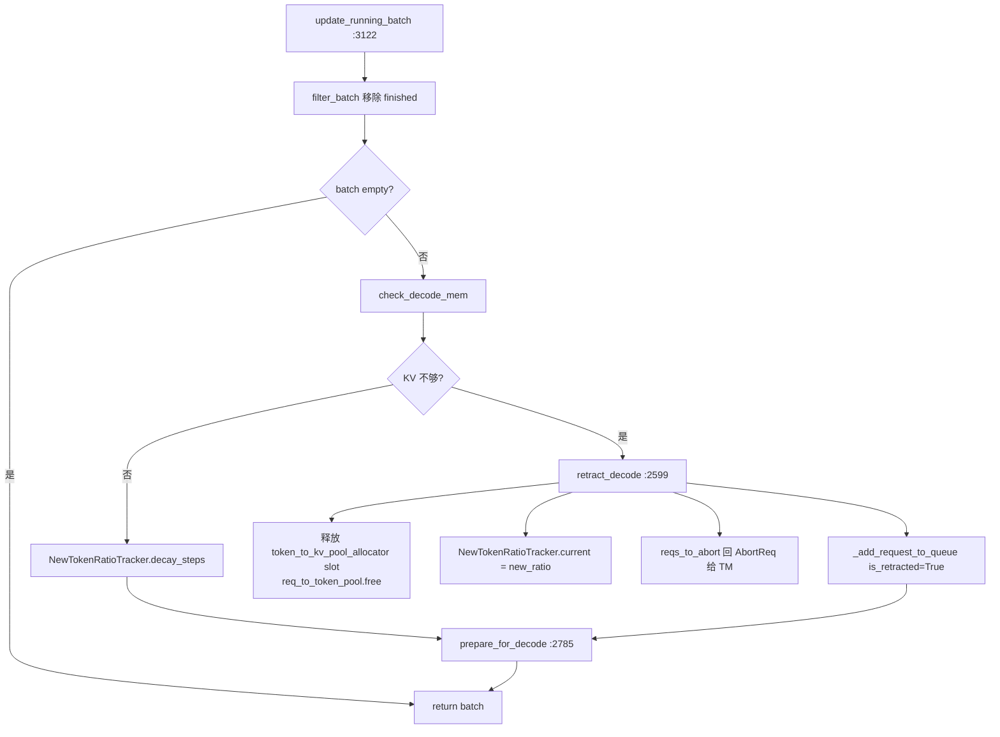

# 03.4.10 retract / OOM

## 定位

decode 阶段 KV cache 可能不够给所有 running 请求再生成一个 token。`update_running_batch`（`scheduler.py:3122`）触发 `retract_decode`（`schedule_batch.py:2599`）把若干请求"回退"到 `waiting_queue`、释放其 KV slot，并按 `NewTokenRatioTracker` 收紧后续准入估值。

## 职责

- `check_decode_mem` 检测下迭代 KV 不够
- `retract_decode` 选择 retract 集合，回收 `token_to_kv_pool_allocator` 与 `req_to_token_pool` slot
- `NewTokenRatioTracker` 动态调整 `new_token_ratio` 估值（影响 PrefillAdder 准入）
- 可选 `offload/load_kv_cache` 把 retract 的 KV 写到 host HiCache（[07.5](../07-kv-cache/07.5-hicache.md)）
- 把被 abort 的请求立即回 `AbortReq` 给 TM

## 关键类与函数

| 名称 | 定义位置 | 说明 |
|---|---|---|
| `update_running_batch` | `managers/scheduler.py:3122` | decode 主入口 |
| `retract_decode` | `managers/schedule_batch.py:2599` | 回退选择与释放 |
| `NewTokenRatioTracker` | `scheduler_components/new_token_ratio_tracker.py:14` | ratio 跟踪器 |
| `check_decode_mem` | `managers/schedule_batch.py` | 单步 KV 检查 |
| `prepare_for_decode` | `managers/schedule_batch.py:2785` | 重整 batch tensor |
| `_add_request_to_queue` | `managers/scheduler.py:2374` | retract 后回队 |
| `DecodeKVCacheOffloadManager` | `python/sglang/srt/` | 可选 offload 旁路 |

## 控制流

## 实现要点

`update_running_batch:3122` 先 `filter_batch`，再判定 OOM。OOM 触发条件是 `not batch.check_decode_mem()` 或测试钩子 `TEST_RETRACT`。`retract_decode`（`schedule_batch.py:2599`）按优先级（priority 低/无 → 低 `lora_path` 优先）选 retract 集合，调用 `tree_cache.free_req` 或 `req_to_token_pool.free` 回收槽位；可选项 `offload_kv_cache` 把 retract 请求的 KV 写 host HiCache（[07](../07-kv-cache/index.md)），后续重 prefill 时从 host 取回，省一次真前向。

`NewTokenRatioTracker`（`:14`）：每请求 `new_token_ratio` 决定其 KV 预留估值（PrefillAdder 把它视为占用）。retract 发生时把 `current` 设到更紧的 `new_ratio`（`scheduler.py:3172`），后续 `decay_steps`（:3200）慢慢回升；这套机制让 OOM 后的批小步慢放、避免抖动。

被 `retract_decode` 标 `reqs_to_abort` 的请求（达到 `max_new_tokens_limit` 或外部 abort）直接 `to_finish=FINISH_ABORT` 并 `ipc_channels.send_to_tokenizer.send_output(AbortReq)`（:3175-3181，[03.10 abort](03.3.5-tm-control-mixin.md) 联动）。其余 retract 请求 `_add_request_to_queue(req, is_retracted=True)` 回队——`is_retracted=True` 让它排在前部，避免饿死。`prepare_for_decode:2785` 重整 batch tensor（`out_cache_loc`、`seq_lens`）后返回；若 batch 已空，本迭代改在 idle 路径。

## 交叉引用

- 上游: [03.4.4 下一批](03.4.4-scheduler-next-batch.md)、[03.4.3 事件循环](03.4.3-scheduler-event-loop.md)
- 下游: [03.5 协作者](03.5-scheduler-components.md)（`NewTokenRatioTracker`、`PoolStatsObserver`）、[03.10 schedule_policy](03.10-schedule-policy.md)
- 下游: [`07 KV Cache`](../07-kv-cache/index.md)（HiCache offload、`tree_cache`）
- 相关: [03.3.5 控制广播](03.3.5-tm-control-mixin.md) — `AbortReq` 上行

## 进一步阅读

- 源码: `python/sglang/srt/managers/scheduler.py`、`python/sglang/srt/managers/schedule_batch.py`、`python/sglang/srt/managers/scheduler_components/new_token_ratio_tracker.py`
